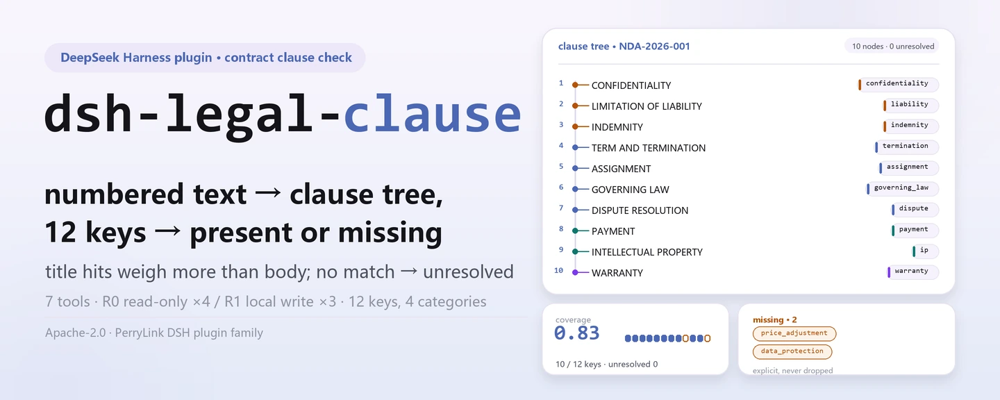
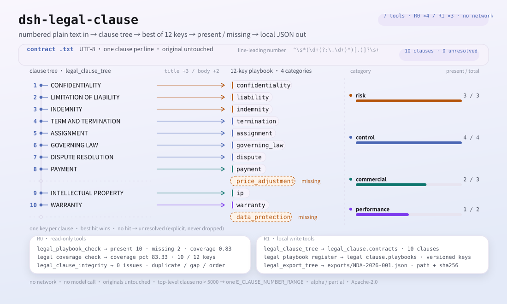
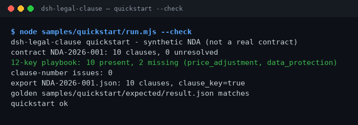

<div align="center">

<picture>
  <source media="(prefers-color-scheme: dark)" srcset="docs/assets/dsh-legal-clause-hero-en-dark.webp">
  
</picture>

# dsh-legal-clause

**Turn one contract into a clause tree, map it against a 12-key playbook, and see the missing keys right away — entirely local.**

A contract-clause static checker for DeepSeek Harness: it splits clauses by their leading numbers, maps each clause to one of 12 keys across risk / control / commercial / performance using title and body keywords, then reports gaps and numbering problems. No network, no model call, no upload.

[Install](#three-step-setup) · [Configuration](#configuration) · [FAQ](#faq) · [简体中文](README.md) · [English](README.en.md) · [Español](README.es.md) · [Português](README.pt.md) · [हिन्दी](README.hi.md)

[](LICENSE)
[](#compatibility)
[](https://www.npmjs.com/package/dsh-legal-clause)
[](https://github.com/PerryLink/dsh-legal-clause/actions/workflows/ci.yml)
[](#compatibility)

[](https://github.com/PerryLink/dsh-legal-clause/stargazers)
[](https://www.npmjs.com/package/dsh-legal-clause)
[](https://dshfind.com/plugins/PerryLink/dsh-legal-clause?ref=badge)
[](https://dsh.market/)
[](https://gitee.com/perrylink/dsh-plugins)

```sh
dsh plugin --profile <profile> add dsh-legal-clause
```

</div>

<sub>Community plugin, not affiliated with DeepSeek. Canonical repository: <https://github.com/PerryLink/dsh-legal-clause>; same-name repositories under other accounts are not affiliated. Apache-2.0; Gitee is an aggregate mirror.</sub>

> **Status: alpha / public-synthetic / partial / not counted / not GA.** No customer evidence, customer data, or production-readiness claim.

## What it is

`dsh-legal-clause` turns one piece of plain contract text into a clause tree by its leading clause numbers, then maps each clause to one of 12 key clauses — risk (confidentiality, liability, indemnity), control (termination, assignment, governing law, dispute), commercial (payment, price adjustment, IP) and performance (warranty, data protection) — using keywords in the title and body. It reports which keys are missing and whether clause numbering is duplicated or has gaps. All seven tools live under the `legal.` namespace; there is no network access, no model call and no upload, and the original file is never modified.

- **Good for**: 10–200 clause, UTF-8 plain-text contracts in Chinese or English; checking clause numbering for duplicates/gaps first, then seeing which of the 12 key clauses are missing; exporting the clause tree as JSON for a downstream step.
- **Not for**: scans, PDFs or Word originals (convert to plain text first); per-clause legal advice or risk ratings; uploading a customer contract anywhere (everything runs on your machine).

<picture>
  <source media="(prefers-color-scheme: dark)" srcset="docs/assets/dsh-legal-clause-flow-v5-dark.svg">
  
</picture>

## Three-step setup

1. **Install** (pick one channel):

   ```sh
   # npm channel (recommended, published releases)
   dsh plugin --profile <profile> add dsh-legal-clause
   # git channel (latest main; lib/ is not committed, run pnpm install && pnpm build in this repo first)
   dsh plugin --profile <profile> add github:PerryLink/dsh-legal-clause
   # tarball channel: pnpm pack in this repo, then
   dsh plugin --profile <profile> add ./dsh-legal-clause-<version>.tgz
   ```

   The npm package ships the built `lib/`; the git channel is a source snapshot with `lib/` gitignored — build before installing.

2. **Minimal config**: defaults work — `cordis.patch.yml` inserts a single row (`id: dsh-legal-clause`) and there are no Schemastery config keys; the only knobs are environment variables (see Configuration).

   ```yaml
   - insert:
       - id: dsh-legal-clause
         name: 'dsh-legal-clause'
   ```

3. **Verify it mounts**:

   ```sh
   dsh --profile <profile> --dump-config | grep dsh-legal-clause
   pnpm build && node samples/quickstart/run.mjs --check
   ```

   The second command recomputes the clause tree, playbook coverage and numbering integrity for the shipped 10-clause synthetic NDA and compares the result with the golden `samples/quickstart/expected/result.json`; the last line is `quickstart ok`.

**Uninstall**: `dsh plugin --profile <profile> remove dsh-legal-clause` (or delete the row from the profile patch).

<details>
<summary>Install from the DSH Desktop marketplace</summary>

All PerryLink plugins can be browsed in the built-in DSH Desktop marketplace: **Marketplace → Sources → Add source → paste** `https://perrylink-dsh-catalog.perrylink.workers.dev/catalog-source.json` **→ select**. Installation still goes through the marketplace's npm identity check and your confirmation.

</details>

## Core capabilities

- **Clause tree by numbering** — `legal_clause_tree` splits clauses on leading Arabic numbers (`1.`, `1.2`, `1)`; whitespace after the number is required) and folds continuation lines into the previous clause; text with no numbering fails closed with `E_CLAUSE_TREE_INVALID`. It returns clause count, unresolved count and coverage, and stores the result in the `contracts` table of the `legal_clause` domain.
- **12-key mapping** — each clause is scored by keyword hits (title hits weigh more than body hits) and mapped to one of 12 keys; anything unmatched is marked `unresolved` explicitly, never hidden or dropped.
- **Coverage and gaps** — `legal_playbook_check` reports present / missing and coverage for a stored tree; `legal_coverage_check` computes the 12-key coverage ratio directly on text. Both only count whether a key appears; neither judges clause quality.
- **Numbering integrity** — `legal_clause_integrity` reports duplicate numbers, missing top-level numbers and out-of-order numbering; when the top-level number exceeds 5000 it returns one `E_CLAUSE_NUMBER_RANGE` issue instead of expanding every gap.
- **Custom playbooks** — `legal_playbook_register` registers a versioned custom key set (keys must be non-empty and unique); `legal_playbook_check` uses it when a `version` is passed. The built-in playbook is never modified.
- **Restricted export** — `legal_export_tree` writes a stored tree as JSON under `exports/<contract_id>.json` and returns the path plus `sha256`; the filename must match `[A-Za-z0-9._-]{1,120}` and may not contain `/`, spaces or Chinese characters.
- **Local only** — the source contains no HTTP / DNS / WebSocket calls; no network, no model call, no upload, and originals are never modified.

### Tool surface

Tool names are the stable API (kept in English to match runtime output); descriptions are localized.

| Tool | Purpose | Risk |
|---|---|---|
| `legal_playbook` | Return the built-in 12-key playbook (4 categories) | R0 read-only |
| `legal_clause_tree` | Parse contract text by numbering, map the 12 keys and store the clause tree | R1 local write (storage domain) |
| `legal_playbook_register` | Register a versioned custom playbook key set; never overwrites the built-in playbook | R1 local write (storage domain) |
| `legal_playbook_check` | Compare a stored tree against the built-in playbook or a named version; report present / missing / coverage | R0 read-only |
| `legal_export_tree` | Export a stored clause tree as a JSON file; return the path and `sha256` | R1 local write |
| `legal_clause_integrity` | Check duplicate clause numbers, missing top-level numbers and out-of-order numbering | R0 read-only |
| `legal_coverage_check` | Compute the 12-key coverage ratio directly on text; writes no state | R0 read-only |

### Inputs & outputs

**Inputs**:

- UTF-8 plain-text contracts with one clause per line, starting with an Arabic number such as `1.` or `2.`; `1.2` and `1)` are accepted too. The body can be pasted into the tool argument or read from a file.
- The shipped sample `samples/quickstart/input/synthetic-nda-2026.txt` is about 3 KB with 10 clauses; keep a single document under 1 MB (larger text means slower keyword scanning).
- Sources: a contract-system export, Word saved as plain text, or a manual paste. Originals are never modified; there is no OCR and no PDF/Word parsing.

**Outputs**:

- Tool return values: clause count, unresolved count, coverage, missing keys, numbering issues, and the export path plus `sha256`.
- The clause-tree JSON: written to `$DSH_HOME/storages/dsh-legal-clause/exports/<contract_id>.json`; the original file is untouched.
- The session `legal_clause` storage domain: `contracts` holds clause trees, `playbooks` holds custom playbooks.
- Golden sample: `samples/quickstart/expected/result.json` (produced by a real run, not hand-written).

### Examples

Paste this prompt to the assistant (the shipped demo prompt in `package.json`, translated):

```text
I have a 10-clause NDA. Split it into a clause tree and tell me which of the 12 key clauses are missing.
```

You can also run it yourself (a real run; the screenshot is a render of this command's output):

```sh
pnpm build && node samples/quickstart/run.mjs --check
```



*The real command `node samples/quickstart/run.mjs --check` on the shipped 10-clause synthetic NDA: 10 clauses, 0 unresolved, 10 of the 12 keys present (missing `price_adjustment` and `data_protection`), 0 numbering issues, golden file matches. Provenance in [`screenshots.json`](screenshots.json); the golden file is `samples/quickstart/expected/result.json`.*

Fixture example: input [`fixtures/public/mit/sample_nda.txt`](https://github.com/PerryLink/dsh-legal-clause/blob/main/fixtures/public/mit/sample_nda.txt) (public MIT sample); command `pnpm test`.

### Acceptance evidence

`node scripts/acceptance.mjs` produces `ACCEPTANCE.csv`: all seven SKU rows are `counted=false`, and the shipped-sample row `PS1-QS01` is `counted=true`.

| req_id | Metric | Threshold | Actual | pass | source | counted |
|---|---|---|---|---|---|---|
| SKU-10-A01 | Contract clause tree (20 synthetic) | 20/20 | 20 | true | public/synthetic | false |
| SKU-10-A02 | Clause mapping | 240 | 240 | true | public/synthetic | false |
| SKU-10-A03 | Unresolved | 0 | 0 | true | public/synthetic | false |
| SKU-10-A04 | JSON export | 20 | 20 | true | public/synthetic | false |
| SKU-10-A05 | Custom playbook v2 | 1/1 | 1 | true | public/synthetic | false |
| SKU-10-A06 | Clause-number integrity | 2 | 2 | true | public/synthetic | false |
| SKU-10-A07 | Clause coverage | 16.67 | 16.67 | true | public/synthetic | false |
| PS1-QS01 | quickstart sample matches the golden file | 1/1 | 1 | true | synthetic/quickstart | true |

*0 real contracts and 0 customer evidence; these are public/synthetic rows and establish no customer accuracy or GA-readiness claim. Full rows and evidence hashes are in [`ACCEPTANCE.csv`](ACCEPTANCE.csv) and [`EVIDENCE.md`](EVIDENCE.md).*

## Configuration

This plugin has no Schemastery config keys: `cordis.patch.yml` inserts a single row and the defaults work. The knobs are environment variables:

| Key | Default | Meaning |
|---|---|---|
| `DSH_CLAUSE_HOME` | `$DSH_HOME/storages/dsh-legal-clause` | Storage root: the `exports/` directory lives here; falls back to `storages/dsh-legal-clause` under the host process cwd when `$DSH_HOME` is unset |
| `DSH_HOME` | host process cwd | Only used to derive the default `DSH_CLAUSE_HOME`; ignored when `DSH_CLAUSE_HOME` is set explicitly |

<details>
<summary>Full mount surface, storage domain and built-in playbook</summary>

`cordis.patch.yml` (complete):

```yaml
- insert:
    - id: dsh-legal-clause
      name: 'dsh-legal-clause'
```

- The plugin declares `inject = ['tools', 'storageDomain']`: both services must be present or the plugin does not mount; a missing `storageDomain` never degrades silently.
- Tools register on `ctx.tools`; `legal_clause_tree` and `legal_playbook_register` write the storage domain, `legal_export_tree` also writes `exports/`, and the other four tools are read-only.
- Storage domain `legal_clause` (version 1) has two tables: `contracts` for clause trees and `playbooks` for custom playbooks; domain close is registered as a Cordis effect and is undone on stop or hot reload.

Built-in 12-key playbook:

| Key | Category | Clause title |
|---|---|---|
| `confidentiality` | risk | Confidentiality |
| `liability` | risk | Limitation of Liability |
| `indemnity` | risk | Indemnity |
| `termination` | control | Termination |
| `assignment` | control | Assignment |
| `governing_law` | control | Governing Law |
| `dispute` | control | Dispute Resolution |
| `payment` | commercial | Payment |
| `price_adjustment` | commercial | Price Adjustment |
| `ip` | commercial | Intellectual Property |
| `warranty` | performance | Warranty |
| `data_protection` | performance | Data Protection |

</details>

## FAQ

<details>
<summary>It will not install or mount. What now?</summary>

Check that `node --version` is ≥24.9 and <25 and that `dsh --version` is within `>=0.2.1-rc.3 <0.4.0`, then run `dsh plugin --profile <profile> add dsh-legal-clause`. The host must provide both `tools` and `storageDomain` (hard dependency), otherwise the plugin does not mount. The full error table is in [`TROUBLESHOOTING.md`](TROUBLESHOOTING.md).

</details>

<details>
<summary>Does it handle PDFs, Word originals or scans?</summary>

No. Only UTF-8 plain text is accepted: `.docx`/`.doc`, PDFs, scans and images are not parsed. Save the file as plain text from Word/WPS first (run OCR first for scans), then put each clause on its own line starting with `1.`; otherwise it fails closed with `E_CLAUSE_TREE_INVALID`.

</details>

<details>
<summary>A clause was not recognized, or the result looks wrong. Why?</summary>

Run `node samples/quickstart/run.mjs --check` first: a passing sample means the install is fine. Then check that every clause is on its own line and starts with an Arabic number. Mapping is static keyword matching (title hits weigh more than body hits), not semantic understanding: Chinese and English keywords both work, but a different wording may land in `unresolved`. Use `legal_coverage_check` to see which keys are missing, then register your own key set with `legal_playbook_register`.

</details>

<details>
<summary>Does it modify my contract file? Where is data stored?</summary>

It never modifies originals. Clause trees are written under `$DSH_HOME/storages/dsh-legal-clause` (or `DSH_CLAUSE_HOME`): the `contracts`/`playbooks` tables in the session `legal_clause` domain, plus `exports/<contract_id>.json` when you export explicitly. The source has no network calls; nothing is uploaded and no model is called. The repository contains only public/synthetic fixtures, no customer data.

</details>

<details>
<summary>Does a custom playbook overwrite the built-in 12 keys?</summary>

No. `legal_playbook_register` writes a versioned entry into the `playbooks` table and the built-in playbook stays read-only; `legal_playbook_check` uses the built-in 12 keys without `version` and the named version with it. An unknown version raises `E_PLAYBOOK_NOT_FOUND`; empty or duplicate keys raise `E_PLAYBOOK_INVALID`.

</details>

## Security boundaries

- **Read scope**: only the contract text you pass explicitly; no directory traversal and no reading other files from the environment.
- **Write scope**: only `DSH_CLAUSE_HOME`'s `exports/` and the session `legal_clause` storage domain; originals are never modified.
- **No network**: no HTTP / DNS / WebSocket calls in the source; no external systems, no upload, no model call.
- **Export path allow-list**: the filename must match `[A-Za-z0-9._-]{1,120}` (`E_LEGAL_PATH_INVALID`), must stay inside `exports/` after resolution, and is re-anchored on `realpath` so a symlink cannot redirect the write outside the directory (`E_LEGAL_PATH_NOT_ALLOWED`).
- **Fail closed**: empty text `E_CLAUSE_EMPTY`, no numbering `E_CLAUSE_TREE_INVALID`, missing tree `E_CLAUSE_TREE_NOT_FOUND`, invalid playbook or version `E_PLAYBOOK_INVALID` / `E_PLAYBOOK_NOT_FOUND` all raise errors instead of returning an empty result disguised as success.
- **Numbering scan bound**: a top-level number above 5000 returns one `E_CLAUSE_NUMBER_RANGE` issue instead of expanding every gap (DoS guard).
- **Risk levels**: tools that write are R1 (local write), read-only tools are R0; see Tool surface.
- **No content judgement**: this is a static numbering and keyword check, not legal advice, not a risk rating, and not a fairness assessment.

## Permissions & data

```text
read: the UTF-8 plain-text contract you name; no other directory traversal
write: $DSH_HOME/storages/dsh-legal-clause/exports/ and the legal_clause storage domain; originals untouched
network: no
external systems: none
```

- Runs locally; no network, no model call, no upload.
- Public/synthetic fixtures only; no customer data or customer evidence.
- Alpha / partial; not counted, no GA or production-readiness claim.

## Known limitations

- **Public/synthetic validation only.** Alpha / partial / not counted / not GA; 0 real contracts and 0 customer evidence. This establishes no customer accuracy, clause-recognition rate or GA-readiness claim.
- **Plain text only.** No `.docx` / `.doc`, PDF, scans or images; convert to UTF-8 plain text first, and run OCR on scans.
- **Depends on leading numbers.** Each clause must be on its own line and start with an Arabic number (`1.`, `1.2`, `1)`); worded numbering and exports that dropped the numbers fail with `E_CLAUSE_TREE_INVALID`.
- **Keywords are static.** A keyword hit maps the clause — Chinese and English included — with no semantic understanding and no quality judgement; different wording may produce `unresolved` or an adjacent key, and coverage only means "how many of the 12 keys appeared".
- **`text_hash` is not SHA-256.** The `text_hash` on a clause record is the first 16 characters of the body's base64, useful only to roughly distinguish clauses, never as a content hash for evidence.
- **Exported `contract_id` is filename-restricted.** Contract IDs containing `/`, `..`, spaces or Chinese characters are rejected (`E_LEGAL_PATH_INVALID`); use an ASCII ID such as `NDA-2026-001`.
- **Numbering scan is bounded.** A top-level number above 5000 returns one range error and no gap details.
- **No UI/client half.** A pure host plugin with no browser UI or editor; every result is returned through tool output and the exported JSON.

## Compatibility

| Surface | Status |
|---|---|
| Harness | `dsh >=0.2.1-rc.3 <0.4.0` |
| Node | `>=24.9.0 <25` |
| Platforms | Anywhere DSH runs; local files only |
| Data | No network, no model call, no upload |

## Ecosystem & quality

- [Gitee aggregate mirror](https://gitee.com/perrylink/dsh-plugins) (PerryLink plugin aggregate mirror; GitHub is canonical)
- [dshfind plugin page](https://dshfind.com/plugins/PerryLink/dsh-legal-clause) (installs and ranking)
- [DSH Market](https://dsh.market/) (listed)
- **1024 store channel**: run `npm i -g dsh1024`, then `dsh1024 plugin --profile <profile> add dsh-legal-clause` (counts toward the [deepseek1024.com](https://deepseek1024.com) install ranking)
- Docs: [`TROUBLESHOOTING.md`](TROUBLESHOOTING.md) · [`PRIVACY.md`](PRIVACY.md) · [`SECURITY.md`](SECURITY.md) · [`ACCEPTANCE.csv`](ACCEPTANCE.csv) · [`EVIDENCE.md`](EVIDENCE.md) · [`FIXTURES.md`](FIXTURES.md)
- Family indexes: [domain index](https://perrylink.github.io/dsh-plugins/) · [checker family](https://perrylink.github.io/zh/checkers/) · [mainline family](https://github.com/PerryLink/dsh-kit)
- Sibling packages: [dsh-legal-intake](https://github.com/PerryLink/dsh-legal-intake) · [dsh-docx-redline](https://github.com/PerryLink/dsh-docx-redline) · [dsh-contract-suite](https://github.com/PerryLink/dsh-contract-suite)

Related checkers (each is a separate package with its own rule pack and version; install only the ones you need):

| Package | Why it is relevant |
|---|---|
| [`dsh-contract-stance`](https://github.com/PerryLink/dsh-contract-stance) | Clause stance register for negotiation positions and risk levels. |
| [`dsh-lawcite-adapter`](https://github.com/PerryLink/dsh-lawcite-adapter) | Citation and legal-document element verification. |
| [`dsh-evidence-check`](https://github.com/PerryLink/dsh-evidence-check) | Evidence-list completeness for the same matter. |

## Development

```sh
pnpm install --frozen-lockfile
pnpm build && pnpm lint && pnpm typecheck && pnpm test
pnpm run gate:sku10
node scripts/acceptance.mjs
pnpm run pack:check
pnpm build && node samples/quickstart/run.mjs --check
```

`pnpm test` builds with `tsc` and then runs `node --test test/*.test.mjs` (25 cases: clause parsing, numbering integrity, coverage, path safety, playbook versions, plugin smoke, public NDA, quickstart). `pnpm run gate:sku10` re-runs the acceptance script and checks that every `ACCEPTANCE.csv` row has `pass=true`.

| Path | Content |
|---|---|
| `src/core/clause.ts` | 12-key playbook, error codes, clause parsing and numbering integrity |
| `src/core/safe-path.ts` | Export filename allow-list and realpath re-anchoring |
| `src/plugin/index.ts` | Host entry: reads env vars, opens the `legal_clause` domain, registers the seven tools |
| `src/plugin/storage.ts` | `legal_clause` storage domain (`contracts` / `playbooks` tables) |
| `src/plugin/tools.ts` | Definitions of the seven tools |
| `test/` | `node --test` cases (25) |
| `fixtures/public/mit/` | Public MIT-licensed NDA sample (with LICENSE / SOURCE) |
| `samples/quickstart/` | Synthetic NDA, run script and golden output |
| `scripts/` | lint, acceptance, gate, pack check and image generator |
| `docs/assets/` | hero banner, flow-v5 diagram and real run captures |

The README images are generated by [`scripts/gen-readme-assets.py`](scripts/gen-readme-assets.py) (Pillow for the hero banner, hand-written SVG for the flow-v5 structure diagram) and can be re-run; the older single-skin flow diagram stays in `docs/assets/` for external deep links, while the READMEs reference only the new hero and flow-v5 diagram, each in light and dark. `quickstart.png` is a render of the captured `node samples/quickstart/run.mjs --check` output.

Topics: `deepseek-harness`, `dsh`, `dsh-plugin`, `legal`, `clause`, `contract`, `perrylink`, `playbook`

## Family & thanks

This project is a member of the DeepSeek Harness plugin family maintained by [PerryLink](https://github.com/PerryLink) (all Apache-2.0). If this plugin helps you, **give it a star** — it unlocks nothing, but it makes the next person more likely to find it.

- [@PerryLink](https://github.com/PerryLink) — creator and maintainer: clause-number parsing, the 12-key playbook, coverage and numbering-integrity checks, restricted JSON export and five-language docs.

<details>
<summary>DSH domain plugin family (15 packages + 2 suites)</summary>

| Package | npm |
|---|---|
| **[dsh-einvoice](https://github.com/PerryLink/dsh-einvoice)** | [npm](https://www.npmjs.com/package/dsh-einvoice) |
| **[dsh-docx-redline](https://github.com/PerryLink/dsh-docx-redline)** | [npm](https://www.npmjs.com/package/dsh-docx-redline) |
| **[dsh-policy-ledger](https://github.com/PerryLink/dsh-policy-ledger)** | [npm](https://www.npmjs.com/package/dsh-policy-ledger) |
| **[dsh-ghg](https://github.com/PerryLink/dsh-ghg)** | [npm](https://www.npmjs.com/package/dsh-ghg) |
| **[dsh-bankrec](https://github.com/PerryLink/dsh-bankrec)** | [npm](https://www.npmjs.com/package/dsh-bankrec) |
| **[dsh-ap-three-way](https://github.com/PerryLink/dsh-ap-three-way)** | [npm](https://www.npmjs.com/package/dsh-ap-three-way) |
| **[dsh-ifc-qto](https://github.com/PerryLink/dsh-ifc-qto)** | [npm](https://www.npmjs.com/package/dsh-ifc-qto) |
| **[dsh-qms-capa](https://github.com/PerryLink/dsh-qms-capa)** | [npm](https://www.npmjs.com/package/dsh-qms-capa) |
| **[dsh-legal-intake](https://github.com/PerryLink/dsh-legal-intake)** | [npm](https://www.npmjs.com/package/dsh-legal-intake) |
| **[dsh-legal-clause](https://github.com/PerryLink/dsh-legal-clause)** | [npm](https://www.npmjs.com/package/dsh-legal-clause) |
| **[dsh-freight-audit](https://github.com/PerryLink/dsh-freight-audit)** | [npm](https://www.npmjs.com/package/dsh-freight-audit) |
| **[dsh-hs-candidate](https://github.com/PerryLink/dsh-hs-candidate)** | [npm](https://www.npmjs.com/package/dsh-hs-candidate) |
| **[dsh-travel-recon](https://github.com/PerryLink/dsh-travel-recon)** | [npm](https://www.npmjs.com/package/dsh-travel-recon) |
| **[dsh-pim-lint](https://github.com/PerryLink/dsh-pim-lint)** | [npm](https://www.npmjs.com/package/dsh-pim-lint) |
| **[dsh-eval-pack](https://github.com/PerryLink/dsh-eval-pack)** | [npm](https://www.npmjs.com/package/dsh-eval-pack) |
| **[dsh-finops-suite](https://github.com/PerryLink/dsh-finops-suite)** | [npm](https://www.npmjs.com/package/dsh-finops-suite) |
| **[dsh-contract-suite](https://github.com/PerryLink/dsh-contract-suite)** | [npm](https://www.npmjs.com/package/dsh-contract-suite) |

</details>

<details>
<summary>Mainline family — 87 current install specs</summary>

| Package | npm |
|---|---|
| **[dsh-aqua-input-check](https://github.com/PerryLink/dsh-aqua-input-check)** | [npm](https://www.npmjs.com/package/dsh-aqua-input-check) |
| **[dsh-archive-check](https://github.com/PerryLink/dsh-archive-check)** | [npm](https://www.npmjs.com/package/dsh-archive-check) |
| **[dsh-bid-ca-precheck](https://github.com/PerryLink/dsh-bid-ca-precheck)** | [npm](https://www.npmjs.com/package/dsh-bid-ca-precheck) |
| **[dsh-bid-qual-check](https://github.com/PerryLink/dsh-bid-qual-check)** | [npm](https://www.npmjs.com/package/dsh-bid-qual-check) |
| **[dsh-contract-stance](https://github.com/PerryLink/dsh-contract-stance)** | [npm](https://www.npmjs.com/package/dsh-contract-stance) |
| **[dsh-customs-doc-check](https://github.com/PerryLink/dsh-customs-doc-check)** | [npm](https://www.npmjs.com/package/dsh-customs-doc-check) |
| **[dsh-demurrage-ledger](https://github.com/PerryLink/dsh-demurrage-ledger)** | [npm](https://www.npmjs.com/package/dsh-demurrage-ledger) |
| **[dsh-drill-script-check](https://github.com/PerryLink/dsh-drill-script-check)** | [npm](https://www.npmjs.com/package/dsh-drill-script-check) |
| **[dsh-eia-guide-check](https://github.com/PerryLink/dsh-eia-guide-check)** | [npm](https://www.npmjs.com/package/dsh-eia-guide-check) |
| **[dsh-emergency-plan](https://github.com/PerryLink/dsh-emergency-plan)** | [npm](https://www.npmjs.com/package/dsh-emergency-plan) |
| **[dsh-essay-rubric-check](https://github.com/PerryLink/dsh-essay-rubric-check)** | [npm](https://www.npmjs.com/package/dsh-essay-rubric-check) |
| **[dsh-evidence-check](https://github.com/PerryLink/dsh-evidence-check)** | [npm](https://www.npmjs.com/package/dsh-evidence-check) |
| **[dsh-export-ctl-check](https://github.com/PerryLink/dsh-export-ctl-check)** | [npm](https://www.npmjs.com/package/dsh-export-ctl-check) |
| **[dsh-fmea-table-check](https://github.com/PerryLink/dsh-fmea-table-check)** | [npm](https://www.npmjs.com/package/dsh-fmea-table-check) |
| **[dsh-forecast-penalty](https://github.com/PerryLink/dsh-forecast-penalty)** | [npm](https://www.npmjs.com/package/dsh-forecast-penalty) |
| **[dsh-gongwen-flow-check](https://github.com/PerryLink/dsh-gongwen-flow-check)** | [npm](https://www.npmjs.com/package/dsh-gongwen-flow-check) |
| **[dsh-gongwen-word-check](https://github.com/PerryLink/dsh-gongwen-word-check)** | [npm](https://www.npmjs.com/package/dsh-gongwen-word-check) |
| **[dsh-guard-plan-qc](https://github.com/PerryLink/dsh-guard-plan-qc)** | [npm](https://www.npmjs.com/package/dsh-guard-plan-qc) |
| **[dsh-hazchem-check](https://github.com/PerryLink/dsh-hazchem-check)** | [npm](https://www.npmjs.com/package/dsh-hazchem-check) |
| **[dsh-hazplan-check](https://github.com/PerryLink/dsh-hazplan-check)** | [npm](https://www.npmjs.com/package/dsh-hazplan-check) |
| **[dsh-hidden-risk-map](https://github.com/PerryLink/dsh-hidden-risk-map)** | [npm](https://www.npmjs.com/package/dsh-hidden-risk-map) |
| **[dsh-hs-classify](https://github.com/PerryLink/dsh-hs-classify)** | [npm](https://www.npmjs.com/package/dsh-hs-classify) |
| **[dsh-icd-rule-check](https://github.com/PerryLink/dsh-icd-rule-check)** | [npm](https://www.npmjs.com/package/dsh-icd-rule-check) |
| **[dsh-lawcite-adapter](https://github.com/PerryLink/dsh-lawcite-adapter)** | [npm](https://www.npmjs.com/package/dsh-lawcite-adapter) |
| **[dsh-lc-doc-check](https://github.com/PerryLink/dsh-lc-doc-check)** | [npm](https://www.npmjs.com/package/dsh-lc-doc-check) |
| **[dsh-learning-gap-check](https://github.com/PerryLink/dsh-learning-gap-check)** | [npm](https://www.npmjs.com/package/dsh-learning-gap-check) |
| **[dsh-medrec-qc](https://github.com/PerryLink/dsh-medrec-qc)** | [npm](https://www.npmjs.com/package/dsh-medrec-qc) |
| **[dsh-nsfc-form-check](https://github.com/PerryLink/dsh-nsfc-form-check)** | [npm](https://www.npmjs.com/package/dsh-nsfc-form-check) |
| **[dsh-nurse-record-check](https://github.com/PerryLink/dsh-nurse-record-check)** | [npm](https://www.npmjs.com/package/dsh-nurse-record-check) |
| **[dsh-origin-rvc-check](https://github.com/PerryLink/dsh-origin-rvc-check)** | [npm](https://www.npmjs.com/package/dsh-origin-rvc-check) |
| **[dsh-ota-review-check](https://github.com/PerryLink/dsh-ota-review-check)** | [npm](https://www.npmjs.com/package/dsh-ota-review-check) |
| **[dsh-paper-doc-adapter](https://github.com/PerryLink/dsh-paper-doc-adapter)** | [npm](https://www.npmjs.com/package/dsh-paper-doc-adapter) |
| **[dsh-permit-report-check](https://github.com/PerryLink/dsh-permit-report-check)** | [npm](https://www.npmjs.com/package/dsh-permit-report-check) |
| **[dsh-pipeline-check](https://github.com/PerryLink/dsh-pipeline-check)** | [npm](https://www.npmjs.com/package/dsh-pipeline-check) |
| **[dsh-pleading-draft](https://github.com/PerryLink/dsh-pleading-draft)** | [npm](https://www.npmjs.com/package/dsh-pleading-draft) |
| **[dsh-policy-brief-draft](https://github.com/PerryLink/dsh-policy-brief-draft)** | [npm](https://www.npmjs.com/package/dsh-policy-brief-draft) |
| **[dsh-power-loss-split](https://github.com/PerryLink/dsh-power-loss-split)** | [npm](https://www.npmjs.com/package/dsh-power-loss-split) |
| **[dsh-power-ticket-check](https://github.com/PerryLink/dsh-power-ticket-check)** | [npm](https://www.npmjs.com/package/dsh-power-ticket-check) |
| **[dsh-ppap-check](https://github.com/PerryLink/dsh-ppap-check)** | [npm](https://www.npmjs.com/package/dsh-ppap-check) |
| **[dsh-protest-deadline](https://github.com/PerryLink/dsh-protest-deadline)** | [npm](https://www.npmjs.com/package/dsh-protest-deadline) |
| **[dsh-railway-window](https://github.com/PerryLink/dsh-railway-window)** | [npm](https://www.npmjs.com/package/dsh-railway-window) |
| **[dsh-repair-order-qc](https://github.com/PerryLink/dsh-repair-order-qc)** | [npm](https://www.npmjs.com/package/dsh-repair-order-qc) |
| **[dsh-review-reply-check](https://github.com/PerryLink/dsh-review-reply-check)** | [npm](https://www.npmjs.com/package/dsh-review-reply-check) |
| **[dsh-rulefile-check](https://github.com/PerryLink/dsh-rulefile-check)** | [npm](https://www.npmjs.com/package/dsh-rulefile-check) |
| **[dsh-safety-brief-check](https://github.com/PerryLink/dsh-safety-brief-check)** | [npm](https://www.npmjs.com/package/dsh-safety-brief-check) |
| **[dsh-site-log-check](https://github.com/PerryLink/dsh-site-log-check)** | [npm](https://www.npmjs.com/package/dsh-site-log-check) |
| **[dsh-soe-decision-check](https://github.com/PerryLink/dsh-soe-decision-check)** | [npm](https://www.npmjs.com/package/dsh-soe-decision-check) |
| **[dsh-soilwater-check](https://github.com/PerryLink/dsh-soilwater-check)** | [npm](https://www.npmjs.com/package/dsh-soilwater-check) |
| **[dsh-sop-sync-check](https://github.com/PerryLink/dsh-sop-sync-check)** | [npm](https://www.npmjs.com/package/dsh-sop-sync-check) |
| **[dsh-spc-gbt-adapter](https://github.com/PerryLink/dsh-spc-gbt-adapter)** | [npm](https://www.npmjs.com/package/dsh-spc-gbt-adapter) |
| **[dsh-tender-extract](https://github.com/PerryLink/dsh-tender-extract)** | [npm](https://www.npmjs.com/package/dsh-tender-extract) |
| **[dsh-tender-matrix](https://github.com/PerryLink/dsh-tender-matrix)** | [npm](https://www.npmjs.com/package/dsh-tender-matrix) |
| **[dsh-warranty-calc](https://github.com/PerryLink/dsh-warranty-calc)** | [npm](https://www.npmjs.com/package/dsh-warranty-calc) |
| **[dsh-auto-review](https://github.com/PerryLink/dsh-auto-review)** | [npm](https://www.npmjs.com/package/dsh-auto-review) |
| **[dsh-autotier](https://github.com/PerryLink/dsh-autotier)** | [npm](https://www.npmjs.com/package/dsh-autotier) |
| **[dsh-budget](https://github.com/PerryLink/dsh-budget)** | [npm](https://www.npmjs.com/package/dsh-budget) |
| **[dsh-cert-mcp](https://github.com/PerryLink/dsh-cert-mcp)** | [npm](https://www.npmjs.com/package/dsh-cert-mcp) |
| **[dsh-checkpoint-rewind](https://github.com/PerryLink/dsh-checkpoint-rewind)** | [npm](https://www.npmjs.com/package/dsh-checkpoint-rewind) |
| **[dsh-claude-move](https://github.com/PerryLink/dsh-claude-move)** | [npm](https://www.npmjs.com/package/dsh-claude-move) |
| **[dsh-click](https://github.com/PerryLink/dsh-click)** | [npm](https://www.npmjs.com/package/dsh-click) |
| **[dsh-composer-history](https://github.com/PerryLink/dsh-composer-history)** | [npm](https://www.npmjs.com/package/dsh-composer-history) |
| **[dsh-data-quality](https://github.com/PerryLink/dsh-data-quality)** | [npm](https://www.npmjs.com/package/dsh-data-quality) |
| **[dsh-defend](https://github.com/PerryLink/dsh-defend)** | [npm](https://www.npmjs.com/package/dsh-defend) |
| **[dsh-doublecheck](https://github.com/PerryLink/dsh-doublecheck)** | [npm](https://www.npmjs.com/package/dsh-doublecheck) |
| **[dsh-draw](https://github.com/PerryLink/dsh-draw)** | [npm](https://www.npmjs.com/package/dsh-draw) |
| **[dsh-fast](https://github.com/PerryLink/dsh-fast)** | [npm](https://www.npmjs.com/package/dsh-fast) |
| **[dsh-fund-research](https://github.com/PerryLink/dsh-fund-research)** | [npm](https://www.npmjs.com/package/dsh-fund-research) |
| **[dsh-industry-research](https://github.com/PerryLink/dsh-industry-research)** | [npm](https://www.npmjs.com/package/dsh-industry-research) |
| **[dsh-laya](https://github.com/PerryLink/dsh-laya)** | [npm](https://www.npmjs.com/package/dsh-laya) |
| **[dsh-library](https://github.com/PerryLink/dsh-library)** | [npm](https://www.npmjs.com/package/dsh-library) |
| **[dsh-local-ai](https://github.com/PerryLink/dsh-local-ai)** | [npm](https://www.npmjs.com/package/dsh-local-ai) |
| **[dsh-lsp-actions](https://github.com/PerryLink/dsh-lsp-actions)** | [npm](https://www.npmjs.com/package/dsh-lsp-actions) |
| **[dsh-mask](https://github.com/PerryLink/dsh-mask)** | [npm](https://www.npmjs.com/package/dsh-mask) |
| **[dsh-mcp-panel](https://github.com/PerryLink/dsh-mcp-panel)** | [npm](https://www.npmjs.com/package/dsh-mcp-panel) |
| **[dsh-memento](https://github.com/PerryLink/dsh-memento)** | [npm](https://www.npmjs.com/package/dsh-memento) |
| **[dsh-observe](https://github.com/PerryLink/dsh-observe)** | [npm](https://www.npmjs.com/package/dsh-observe) |
| **[dsh-output-styles](https://github.com/PerryLink/dsh-output-styles)** | [npm](https://www.npmjs.com/package/dsh-output-styles) |
| **[dsh-permission-rules](https://github.com/PerryLink/dsh-permission-rules)** | [npm](https://www.npmjs.com/package/dsh-permission-rules) |
| **[dsh-plugin-guide](https://github.com/PerryLink/dsh-plugin-guide)** | [npm](https://www.npmjs.com/package/dsh-plugin-guide) |
| **[dsh-plugin-upgrade](https://github.com/PerryLink/dsh-plugin-upgrade)** | [npm](https://www.npmjs.com/package/dsh-plugin-upgrade) |
| **[dsh-reach](https://github.com/PerryLink/dsh-reach)** | [npm](https://www.npmjs.com/package/dsh-reach) |
| **[dsh-research-report](https://github.com/PerryLink/dsh-research-report)** | [npm](https://www.npmjs.com/package/dsh-research-report) |
| **[dsh-score](https://github.com/PerryLink/dsh-score)** | [npm](https://www.npmjs.com/package/dsh-score) |
| **[dsh-session-sync](https://github.com/PerryLink/dsh-session-sync)** | [npm](https://www.npmjs.com/package/dsh-session-sync) |
| **[dsh-talk](https://github.com/PerryLink/dsh-talk)** | [npm](https://www.npmjs.com/package/dsh-talk) |
| **[dsh-test-drive](https://github.com/PerryLink/dsh-test-drive)** | [npm](https://www.npmjs.com/package/dsh-test-drive) |
| **[dsh-translate](https://github.com/PerryLink/dsh-translate)** | [npm](https://www.npmjs.com/package/dsh-translate) |

</details>

## License

[LICENSE](LICENSE) (Apache License 2.0) © 2026 PerryLink; see also `NOTICE` and `THIRD-PARTY-NOTICES`.

<p align="center"><sub>Apache-2.0 · community plugin, not affiliated with DeepSeek.</sub></p>
