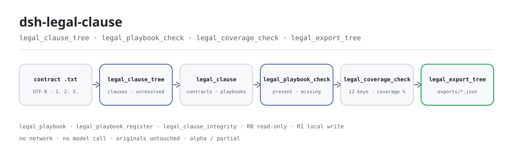
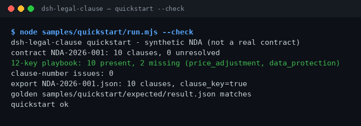

<div align="center">

<picture>
  <source media="(prefers-color-scheme: dark)" srcset="docs/assets/dsh-legal-clause-flow-dark.svg">
  
</picture>

# dsh-legal-clause

**Convierte un contrato en un árbol de cláusulas, lo contrasta con un playbook de 12 claves y muestra al instante qué claves faltan — todo local.**

Un verificador estático de cláusulas para DeepSeek Harness: divide las cláusulas por su numeración inicial, mapea cada una a una de 12 claves (riesgo / control / comercial / ejecución) con palabras clave del título y del cuerpo, y reporta huecos y problemas de numeración. Sin red, sin llamada a modelo y sin subida de datos.

[Instalar](#instalación-en-tres-pasos) · [Configuración](#configuración) · [FAQ](#faq) · [简体中文](README.md) · [English](README.en.md) · [Español](README.es.md) · [Português](README.pt.md) · [हिन्दी](README.hi.md)

[](LICENSE)
[](#compatibilidad)
[](https://www.npmjs.com/package/dsh-legal-clause)
[](https://github.com/PerryLink/dsh-legal-clause/actions/workflows/ci.yml)
[](#compatibilidad)

[](https://github.com/PerryLink/dsh-legal-clause/stargazers)
[](https://www.npmjs.com/package/dsh-legal-clause)
[](https://dshfind.com/plugins/PerryLink/dsh-legal-clause?ref=badge)
[](https://dsh.market/)
[](https://gitee.com/perrylink/dsh-plugins)

```sh
dsh plugin --profile <profile> add dsh-legal-clause
```

</div>

<sub>Plugin de la comunidad, no afiliado a DeepSeek. Repositorio canónico: <https://github.com/PerryLink/dsh-legal-clause>; los repositorios con el mismo nombre en otras cuentas no están afiliados. Apache-2.0; Gitee es un espejo agregado.</sub>

> **Estado: alpha / sintético público / parcial / no contabilizado / no GA.** Sin evidencia de clientes, datos de clientes ni promesa de producción.

## Qué es

`dsh-legal-clause` convierte un texto plano de contrato en un árbol de cláusulas usando la numeración inicial de cada cláusula, y luego mapea cada una a una de las 12 cláusulas clave — riesgo (confidencialidad, responsabilidad, indemnización), control (terminación, cesión, ley aplicable, disputas), comercial (pago, ajuste de precio, propiedad intelectual) y ejecución (garantía, protección de datos) — mediante palabras clave del título y del cuerpo. Reporta qué claves faltan y si la numeración tiene duplicados o saltos. Las siete herramientas viven bajo el namespace `legal.`; no hay red, ni llamada a modelo, ni subida de datos, y el archivo original nunca se modifica.

- **Adecuado para**: contratos de 10–200 cláusulas en texto plano UTF-8, en chino o inglés; revisar primero la numeración (duplicados/saltos) y después qué falta de las 12 cláusulas clave; exportar el árbol de cláusulas como JSON para un paso posterior.
- **No adecuado para**: escaneos, PDF o archivos Word originales (primero hay que pasarlos a texto plano); dictámenes legales cláusula por cláusula o valoraciones de riesgo; subir un contrato de cliente a cualquier sitio (todo se ejecuta en tu máquina).

## Instalación en tres pasos

1. **Instala** (elige un canal):

   ```sh
   # canal npm (recomendado, versiones publicadas)
   dsh plugin --profile <profile> add dsh-legal-clause
   # canal git (último main; lib/ no se versiona, ejecuta antes pnpm install && pnpm build)
   dsh plugin --profile <profile> add github:PerryLink/dsh-legal-clause
   # canal tarball: pnpm pack en este repo y luego
   dsh plugin --profile <profile> add ./dsh-legal-clause-<version>.tgz
   ```

   El paquete npm incluye `lib/` ya construido; el canal git es una instantánea del código con `lib/` en gitignore: construye antes de instalar.

2. **Configuración mínima**: los valores por defecto funcionan — `cordis.patch.yml` inserta una sola fila (`id: dsh-legal-clause`) y no hay claves de configuración Schemastery; solo hay variables de entorno (ver Configuración).

   ```yaml
   - insert:
       - id: dsh-legal-clause
         name: 'dsh-legal-clause'
   ```

3. **Verifica que se monta**:

   ```sh
   dsh --profile <profile> --dump-config | grep dsh-legal-clause
   pnpm build && node samples/quickstart/run.mjs --check
   ```

   El segundo comando recalcula el árbol de cláusulas, la cobertura del playbook y la integridad de la numeración del NDA sintético de 10 cláusulas incluido, y compara el resultado con el archivo dorado `samples/quickstart/expected/result.json`; la última línea es `quickstart ok`.

**Desinstalar**: `dsh plugin --profile <profile> remove dsh-legal-clause` (o borra la fila del patch del perfil).

<details>
<summary>Instalar desde el marketplace de DSH Desktop</summary>

Todos los plugins de PerryLink se pueden explorar en el marketplace integrado de DSH Desktop: **Marketplace → Sources → Add source → pega** `https://perrylink-dsh-catalog.perrylink.workers.dev/catalog-source.json` **→ selecciona**. La instalación sigue pasando por la verificación de identidad npm del marketplace y tu confirmación.

</details>

## Capacidades clave

- **Árbol de cláusulas por numeración** — `legal.clause_tree` divide por números arábigos al inicio de línea (`1.`, `1.2`, `1)`; se exige un espacio tras el número) y une las líneas de continuación a la cláusula anterior; un texto sin numeración falla cerrado con `E_CLAUSE_TREE_INVALID`. Devuelve número de cláusulas, no resueltas y cobertura, y guarda el resultado en la tabla `contracts` del dominio `legal_clause`.
- **Mapeo de 12 claves** — cada cláusula se puntúa por coincidencias de palabras clave (el título pesa más que el cuerpo) y se mapea a una de las 12 claves; lo que no coincide se marca explícitamente como `unresolved`, nunca se oculta ni se descarta.
- **Cobertura y huecos** — `legal.playbook_check` informa present / missing y cobertura de un árbol guardado; `legal.coverage_check` calcula el porcentaje de cobertura de las 12 claves directamente sobre el texto. Ambos solo cuentan si una clave aparece; ninguno juzga la calidad de la cláusula.
- **Integridad de la numeración** — `legal.clause_integrity` informa números duplicados, números de primer nivel faltantes y numeración fuera de orden; cuando el número de primer nivel supera 5000 devuelve un único `E_CLAUSE_NUMBER_RANGE` en lugar de expandir todos los huecos.
- **Playbooks personalizados** — `legal.playbook_register` registra un conjunto de claves versionado (claves no vacías y únicas); `legal.playbook_check` lo usa cuando se pasa `version`. El playbook integrado nunca se modifica.
- **Exportación restringida** — `legal.export_tree` escribe un árbol guardado como JSON en `exports/<contract_id>.json` y devuelve la ruta y `sha256`; el nombre de archivo debe cumplir `[A-Za-z0-9._-]{1,120}` y no puede contener `/`, espacios ni caracteres chinos.
- **Solo local** — el código fuente no contiene llamadas HTTP / DNS / WebSocket; sin red, sin llamada a modelo, sin subida y sin modificar los originales.

### Superficie de herramientas

Los nombres de herramienta son la API estable (se mantienen en inglés para coincidir con la salida del runtime); las descripciones están localizadas.

| Herramienta | Propósito | Riesgo |
|---|---|---|
| `legal.playbook` | Devuelve el playbook integrado de 12 claves (4 categorías) | R0 solo lectura |
| `legal.clause_tree` | Parsea el texto por numeración, mapea las 12 claves y guarda el árbol | R1 escritura local (dominio de almacenamiento) |
| `legal.playbook_register` | Registra un playbook personalizado versionado; nunca sobrescribe el integrado | R1 escritura local (dominio de almacenamiento) |
| `legal.playbook_check` | Compara un árbol guardado con el playbook integrado o una versión; informa present / missing / cobertura | R0 solo lectura |
| `legal.export_tree` | Exporta un árbol guardado como archivo JSON; devuelve ruta y `sha256` | R1 escritura local |
| `legal.clause_integrity` | Comprueba números duplicados, números de primer nivel faltantes y desorden | R0 solo lectura |
| `legal.coverage_check` | Calcula la cobertura de las 12 claves sobre el texto; no escribe estado | R0 solo lectura |

### Entradas y salidas

**Entradas**:

- Contratos en texto plano UTF-8 con una cláusula por línea, empezando por un número arábigo como `1.` o `2.`; también se aceptan `1.2` y `1)`. El cuerpo se puede pegar en el argumento de la herramienta o leer de un archivo.
- La muestra incluida `samples/quickstart/input/synthetic-nda-2026.txt` ocupa unos 3 KB y tiene 10 cláusulas; conviene mantener un documento por debajo de 1 MB (más texto implica un escaneo de palabras clave más lento).
- Orígenes: exportación de un sistema de contratos, Word guardado como texto plano o un pegado manual. Los originales nunca se modifican; no hay OCR ni parseo de PDF/Word.

**Salidas**:

- Valores de retorno: número de cláusulas, no resueltas, cobertura, claves faltantes, problemas de numeración y la ruta de exportación con `sha256`.
- El JSON del árbol de cláusulas: se escribe en `$DSH_HOME/storages/dsh-legal-clause/exports/<contract_id>.json`; el archivo original no cambia.
- El dominio de almacenamiento `legal_clause` de la sesión: `contracts` guarda árboles y `playbooks` guarda playbooks personalizados.
- Archivo dorado: `samples/quickstart/expected/result.json` (generado por una ejecución real, no escrito a mano).

### Ejemplos

Pega esta frase al asistente (el prompt de demostración de `package.json`, traducido):

```text
Tengo un acuerdo de confidencialidad de 10 cláusulas. Divídelo en un árbol de cláusulas y dime cuáles de las 12 cláusulas clave faltan.
```

También puedes ejecutarlo tú mismo (ejecución real; la captura es un render de la salida de este comando):

```sh
pnpm build && node samples/quickstart/run.mjs --check
```



*El comando real `node samples/quickstart/run.mjs --check` sobre el NDA sintético de 10 cláusulas incluido: 10 cláusulas, 0 sin resolver, 10 de las 12 claves presentes (faltan `price_adjustment` y `data_protection`), 0 problemas de numeración y el archivo dorado coincide. Procedencia en [`screenshots.json`](screenshots.json); el archivo dorado es `samples/quickstart/expected/result.json`.*

Ejemplo con fixture: entrada [`fixtures/public/mit/sample_nda.txt`](https://github.com/PerryLink/dsh-legal-clause/blob/main/fixtures/public/mit/sample_nda.txt) (muestra pública con licencia MIT); comando `pnpm test`.

### Evidencia de aceptación

`node scripts/acceptance.mjs` genera `ACCEPTANCE.csv`: las siete filas SKU son `counted=false` y la fila de la muestra incluida `PS1-QS01` es `counted=true`.

| req_id | Métrica | Umbral | Real | pass | source | counted |
|---|---|---|---|---|---|---|
| SKU-10-A01 | Árbol de cláusulas (20 sintéticos) | 20/20 | 20 | true | public/synthetic | false |
| SKU-10-A02 | Mapeo de cláusulas | 240 | 240 | true | public/synthetic | false |
| SKU-10-A03 | Sin resolver | 0 | 0 | true | public/synthetic | false |
| SKU-10-A04 | Exportación JSON | 20 | 20 | true | public/synthetic | false |
| SKU-10-A05 | Playbook personalizado v2 | 1/1 | 1 | true | public/synthetic | false |
| SKU-10-A06 | Integridad de numeración | 2 | 2 | true | public/synthetic | false |
| SKU-10-A07 | Cobertura de cláusulas | 16.67 | 16.67 | true | public/synthetic | false |
| PS1-QS01 | La muestra quickstart coincide con el dorado | 1/1 | 1 | true | synthetic/quickstart | true |

*0 contratos reales y 0 evidencias de clientes; son filas públicas/sintéticas y no establecen precisión con clientes ni disponibilidad GA. Las filas completas y los hashes de evidencia están en [`ACCEPTANCE.csv`](ACCEPTANCE.csv) y [`EVIDENCE.md`](EVIDENCE.md).*

## Configuración

Este plugin no tiene claves de configuración Schemastery: `cordis.patch.yml` inserta una sola fila y los valores por defecto funcionan. Los ajustes son variables de entorno:

| Clave | Valor por defecto | Significado |
|---|---|---|
| `DSH_CLAUSE_HOME` | `$DSH_HOME/storages/dsh-legal-clause` | Raíz de almacenamiento: aquí vive el directorio `exports/`; si `$DSH_HOME` no está definido, cae en `storages/dsh-legal-clause` bajo el cwd del proceso host |
| `DSH_HOME` | cwd del proceso host | Solo se usa para derivar el `DSH_CLAUSE_HOME` por defecto; se ignora si `DSH_CLAUSE_HOME` está definido explícitamente |

<details>
<summary>Superficie de montaje completa, dominio de almacenamiento y playbook integrado</summary>

`cordis.patch.yml` (completo):

```yaml
- insert:
    - id: dsh-legal-clause
      name: 'dsh-legal-clause'
```

- El plugin declara `inject = ['tools', 'storageDomain']`: ambos servicios deben estar presentes o el plugin no se monta; si falta `storageDomain` nunca degrada en silencio.
- Las herramientas se registran en `ctx.tools`; `legal.clause_tree` y `legal.playbook_register` escriben el dominio de almacenamiento, `legal.export_tree` además escribe `exports/`, y las otras cuatro son de solo lectura.
- El dominio de almacenamiento `legal_clause` (versión 1) tiene dos tablas: `contracts` para árboles y `playbooks` para playbooks personalizados; el cierre del dominio se registra como efecto Cordis y se revierte al parar o recargar en caliente.

Playbook integrado de 12 claves:

| Clave | Categoría | Título de cláusula |
|---|---|---|
| `confidentiality` | risk | Confidentiality |
| `liability` | risk | Limitation of Liability |
| `indemnity` | risk | Indemnity |
| `termination` | control | Termination |
| `assignment` | control | Assignment |
| `governing_law` | control | Governing Law |
| `dispute` | control | Dispute Resolution |
| `payment` | commercial | Payment |
| `price_adjustment` | commercial | Price Adjustment |
| `ip` | commercial | Intellectual Property |
| `warranty` | performance | Warranty |
| `data_protection` | performance | Data Protection |

</details>

## FAQ

<details>
<summary>No se instala o no se monta. ¿Qué hago?</summary>

Comprueba que `node --version` sea ≥24.9 y <25 y que `dsh --version` esté dentro de `>=0.2.1-rc.3 <0.4.0`, y luego ejecuta `dsh plugin --profile <profile> add dsh-legal-clause`. El host debe proporcionar `tools` y `storageDomain` (dependencia dura); si falta alguno, el plugin no se monta. La tabla completa de errores está en [`TROUBLESHOOTING.md`](TROUBLESHOOTING.md).

</details>

<details>
<summary>¿Procesa PDF, archivos Word originales o escaneos?</summary>

No. Solo acepta texto plano UTF-8: `.docx`/`.doc`, PDF, escaneos e imágenes no se parsean. Guarda primero el archivo como texto plano desde Word/WPS (para escaneos, haz OCR antes) y pon cada cláusula en su propia línea empezando por `1.`; de lo contrario falla cerrado con `E_CLAUSE_TREE_INVALID`.

</details>

<details>
<summary>No reconoce una cláusula o el resultado parece incorrecto. ¿Por qué?</summary>

Ejecuta primero `node samples/quickstart/run.mjs --check`: si la muestra pasa, la instalación está bien. Después comprueba que cada cláusula esté en su propia línea y empiece por un número arábigo. El mapeo es coincidencia estática de palabras clave (el título pesa más que el cuerpo), no comprensión semántica: las palabras clave en chino e inglés funcionan, pero otra redacción puede caer en `unresolved`. Usa `legal.coverage_check` para ver qué claves faltan y registra tu propio conjunto con `legal.playbook_register`.

</details>

<details>
<summary>¿Modifica mi archivo de contrato? ¿Dónde se guardan los datos?</summary>

Nunca modifica los originales. Los árboles se escriben bajo `$DSH_HOME/storages/dsh-legal-clause` (o `DSH_CLAUSE_HOME`): las tablas `contracts`/`playbooks` del dominio `legal_clause` de la sesión y, cuando exportas explícitamente, `exports/<contract_id>.json`. El código no tiene llamadas de red; no se sube nada y no se llama a ningún modelo. El repositorio solo contiene fixtures públicos/sintéticos, sin datos de clientes.

</details>

<details>
<summary>¿Un playbook personalizado sobrescribe las 12 claves integradas?</summary>

No. `legal.playbook_register` escribe una entrada versionada en la tabla `playbooks` y el playbook integrado sigue siendo de solo lectura; `legal.playbook_check` usa las 12 claves integradas sin `version` y la versión indicada con ella. Una versión desconocida lanza `E_PLAYBOOK_NOT_FOUND`; claves vacías o duplicadas lanzan `E_PLAYBOOK_INVALID`.

</details>

## Límites de seguridad

- **Alcance de lectura**: solo el texto de contrato que pasas explícitamente; sin recorrido de directorios y sin leer otros archivos del entorno.
- **Alcance de escritura**: solo `exports/` de `DSH_CLAUSE_HOME` y el dominio de almacenamiento `legal_clause` de la sesión; los originales nunca se modifican.
- **Sin red**: no hay llamadas HTTP / DNS / WebSocket en el código; sin sistemas externos, sin subida y sin llamada a modelo.
- **Lista blanca de rutas de exportación**: el nombre de archivo debe cumplir `[A-Za-z0-9._-]{1,120}` (`E_LEGAL_PATH_INVALID`), debe quedar dentro de `exports/` tras la resolución y se reancla sobre `realpath`, de modo que un enlace simbólico no pueda redirigir la escritura fuera del directorio (`E_LEGAL_PATH_NOT_ALLOWED`).
- **Fallo cerrado**: texto vacío `E_CLAUSE_EMPTY`, sin numeración `E_CLAUSE_TREE_INVALID`, árbol inexistente `E_CLAUSE_TREE_NOT_FOUND`, playbook o versión inválidos `E_PLAYBOOK_INVALID` / `E_PLAYBOOK_NOT_FOUND` lanzan error en lugar de devolver un resultado vacío como si fuera éxito.
- **Límite del escaneo de numeración**: un número de primer nivel mayor que 5000 devuelve un único `E_CLAUSE_NUMBER_RANGE` en lugar de expandir todos los huecos (protección DoS).
- **Niveles de riesgo**: las herramientas que escriben son R1 (escritura local), las de solo lectura son R0; ver Superficie de herramientas.
- **Sin juicio de contenido**: es una comprobación estática de numeración y palabras clave, no un dictamen legal, no una valoración de riesgo y no una evaluación de equidad.

## Permisos y datos

```text
lectura: el contrato en texto plano UTF-8 que indiques; sin recorrer otros directorios
escritura: $DSH_HOME/storages/dsh-legal-clause/exports/ y el dominio legal_clause; originales intactos
red: no
sistemas externos: ninguno
```

- Se ejecuta en local; sin red, sin llamada a modelo, sin subida.
- Solo fixtures públicos/sintéticos; sin datos de clientes ni evidencia de clientes.
- Alpha / parcial; no contabilizado, sin promesa de GA ni de producción.

## Limitaciones conocidas

- **Solo validación pública/sintética.** Alpha / parcial / no contabilizado / no GA; 0 contratos reales y 0 evidencias de clientes. No establece precisión con clientes, tasa de reconocimiento de cláusulas ni disponibilidad GA.
- **Solo texto plano.** Nada de `.docx` / `.doc`, PDF, escaneos ni imágenes; convierte primero a texto plano UTF-8 y haz OCR en los escaneos.
- **Depende de la numeración inicial.** Cada cláusula debe estar en su propia línea y empezar por un número arábigo (`1.`, `1.2`, `1)`); la numeración con palabras y las exportaciones que perdieron los números fallan con `E_CLAUSE_TREE_INVALID`.
- **Las palabras clave son estáticas.** Una coincidencia mapea la cláusula —también en chino e inglés— sin comprensión semántica ni juicio de calidad; otra redacción puede producir `unresolved` o una clave adyacente, y la cobertura solo significa «cuántas de las 12 claves aparecieron».
- **`text_hash` no es SHA-256.** El `text_hash` de una cláusula son los primeros 16 caracteres del base64 del cuerpo; solo sirve para distinguir cláusulas de forma aproximada y nunca como hash de contenido para evidencia.
- **El `contract_id` exportado está restringido por el nombre de archivo.** Los IDs con `/`, `..`, espacios o caracteres chinos se rechazan (`E_LEGAL_PATH_INVALID`); usa un ID ASCII como `NDA-2026-001`.
- **El escaneo de numeración está acotado.** Un número de primer nivel mayor que 5000 devuelve un único error de rango y ningún detalle de huecos.
- **Sin UI ni mitad cliente.** Plugin puro de host, sin interfaz de navegador ni editor; todos los resultados salen por la salida de las herramientas y el JSON exportado.

## Compatibilidad

| Superficie | Estado |
|---|---|
| Harness | `dsh >=0.2.1-rc.3 <0.4.0` |
| Node | `>=24.9.0 <25` |
| Plataformas | Donde corra DSH; solo archivos locales |
| Datos | Sin red, sin llamada a modelo, sin subida |

## Ecosistema y calidad

- [Espejo agregado de Gitee](https://gitee.com/perrylink/dsh-plugins) (espejo agregado de plugins PerryLink; GitHub es la fuente canónica)
- [Página de dshfind](https://dshfind.com/plugins/PerryLink/dsh-legal-clause) (instalaciones y ranking)
- [DSH Market](https://dsh.market/) (listado)
- **Canal de la tienda 1024**: ejecuta `npm i -g dsh1024` y luego `dsh1024 plugin --profile <profile> add dsh-legal-clause` (cuenta para el ranking de instalaciones de [deepseek1024.com](https://deepseek1024.com))
- Documentación: [`TROUBLESHOOTING.md`](TROUBLESHOOTING.md) · [`PRIVACY.md`](PRIVACY.md) · [`SECURITY.md`](SECURITY.md) · [`ACCEPTANCE.csv`](ACCEPTANCE.csv) · [`EVIDENCE.md`](EVIDENCE.md) · [`FIXTURES.md`](FIXTURES.md)
- Índices de familia: [índice de dominio](https://perrylink.github.io/dsh-plugins/) · [familia de checkers](https://perrylink.github.io/zh/checkers/) · [familia principal](https://github.com/PerryLink/dsh-kit)
- Paquetes hermanos: [dsh-legal-intake](https://github.com/PerryLink/dsh-legal-intake) · [dsh-docx-redline](https://github.com/PerryLink/dsh-docx-redline) · [dsh-contract-suite](https://github.com/PerryLink/dsh-contract-suite)

Checkers relacionados (cada uno es un paquete independiente con su propio rule pack y versión; instala solo los que necesites):

| Paquete | Por qué es relevante |
|---|---|
| [`dsh-contract-stance`](https://github.com/PerryLink/dsh-contract-stance) | Registro de postura por cláusula para posiciones de negociación y niveles de riesgo. |
| [`dsh-lawcite-adapter`](https://github.com/PerryLink/dsh-lawcite-adapter) | Verificación de citas y de elementos de documentos legales. |
| [`dsh-evidence-check`](https://github.com/PerryLink/dsh-evidence-check) | Completitud de la lista de evidencias del mismo asunto. |

## Desarrollo

```sh
pnpm install --frozen-lockfile
pnpm build && pnpm lint && pnpm typecheck && pnpm test
pnpm run gate:sku10
node scripts/acceptance.mjs
pnpm run pack:check
pnpm build && node samples/quickstart/run.mjs --check
```

`pnpm test` compila con `tsc` y luego ejecuta `node --test test/*.test.mjs` (25 casos: parseo de cláusulas, integridad de numeración, cobertura, seguridad de rutas, versiones de playbook, smoke del plugin, NDA pública, quickstart). `pnpm run gate:sku10` vuelve a ejecutar el script de aceptación y comprueba que cada fila de `ACCEPTANCE.csv` tenga `pass=true`.

| Ruta | Contenido |
|---|---|
| `src/core/clause.ts` | Playbook de 12 claves, códigos de error, parseo de cláusulas e integridad de numeración |
| `src/core/safe-path.ts` | Lista blanca de nombres de exportación y reanclaje con realpath |
| `src/plugin/index.ts` | Entrada host: lee variables de entorno, abre el dominio `legal_clause` y registra las siete herramientas |
| `src/plugin/storage.ts` | Dominio de almacenamiento `legal_clause` (tablas `contracts` / `playbooks`) |
| `src/plugin/tools.ts` | Definiciones de las siete herramientas |
| `test/` | Casos `node --test` (25) |
| `fixtures/public/mit/` | Muestra pública de NDA con licencia MIT (con LICENSE / SOURCE) |
| `samples/quickstart/` | NDA sintético, script de ejecución y archivo dorado |
| `scripts/` | lint, aceptación, gate, comprobación de pack y generador de imágenes |
| `docs/assets/` | SVGs del hero y capturas reales |

El diagrama de cabecera lo genera [`scripts/gen-readme-assets.py`](scripts/gen-readme-assets.py) (Python; produce `docs/assets/dsh-legal-clause-flow-{light,dark}.svg`) y se puede volver a ejecutar; `quickstart.png` es un render de la salida capturada de `node samples/quickstart/run.mjs --check`.

Topics: `deepseek-harness`, `dsh`, `dsh-plugin`, `legal`, `clause`, `contract`, `perrylink`, `playbook`

## Familia y agradecimientos

Este proyecto es miembro de la familia de plugins de DeepSeek Harness mantenida por [PerryLink](https://github.com/PerryLink) (todos Apache-2.0). Si este plugin te ayuda, **dale una estrella**: no desbloquea nada, pero hace que la siguiente persona lo encuentre más fácilmente.

- [@PerryLink](https://github.com/PerryLink) — creador y mantenedor: parseo de numeración de cláusulas, playbook de 12 claves, comprobaciones de cobertura e integridad de numeración, exportación JSON restringida y documentación en cinco idiomas.

<details>
<summary>Familia de plugins de dominio DSH (15 paquetes + 2 suites)</summary>

| Package | npm |
|---|---|
| **[dsh-einvoice](https://github.com/PerryLink/dsh-einvoice)** | [npm](https://www.npmjs.com/package/dsh-einvoice) |
| **[dsh-docx-redline](https://github.com/PerryLink/dsh-docx-redline)** | [npm](https://www.npmjs.com/package/dsh-docx-redline) |
| **[dsh-policy-ledger](https://github.com/PerryLink/dsh-policy-ledger)** | [npm](https://www.npmjs.com/package/dsh-policy-ledger) |
| **[dsh-ghg](https://github.com/PerryLink/dsh-ghg)** | [npm](https://www.npmjs.com/package/dsh-ghg) |
| **[dsh-bankrec](https://github.com/PerryLink/dsh-bankrec)** | [npm](https://www.npmjs.com/package/dsh-bankrec) |
| **[dsh-ap-three-way](https://github.com/PerryLink/dsh-ap-three-way)** | [npm](https://www.npmjs.com/package/dsh-ap-three-way) |
| **[dsh-ifc-qto](https://github.com/PerryLink/dsh-ifc-qto)** | [npm](https://www.npmjs.com/package/dsh-ifc-qto) |
| **[dsh-qms-capa](https://github.com/PerryLink/dsh-qms-capa)** | [npm](https://www.npmjs.com/package/dsh-qms-capa) |
| **[dsh-legal-intake](https://github.com/PerryLink/dsh-legal-intake)** | [npm](https://www.npmjs.com/package/dsh-legal-intake) |
| **[dsh-legal-clause](https://github.com/PerryLink/dsh-legal-clause)** | [npm](https://www.npmjs.com/package/dsh-legal-clause) |
| **[dsh-freight-audit](https://github.com/PerryLink/dsh-freight-audit)** | [npm](https://www.npmjs.com/package/dsh-freight-audit) |
| **[dsh-hs-candidate](https://github.com/PerryLink/dsh-hs-candidate)** | [npm](https://www.npmjs.com/package/dsh-hs-candidate) |
| **[dsh-travel-recon](https://github.com/PerryLink/dsh-travel-recon)** | [npm](https://www.npmjs.com/package/dsh-travel-recon) |
| **[dsh-pim-lint](https://github.com/PerryLink/dsh-pim-lint)** | [npm](https://www.npmjs.com/package/dsh-pim-lint) |
| **[dsh-eval-pack](https://github.com/PerryLink/dsh-eval-pack)** | [npm](https://www.npmjs.com/package/dsh-eval-pack) |
| **[dsh-finops-suite](https://github.com/PerryLink/dsh-finops-suite)** | [npm](https://www.npmjs.com/package/dsh-finops-suite) |
| **[dsh-contract-suite](https://github.com/PerryLink/dsh-contract-suite)** | [npm](https://www.npmjs.com/package/dsh-contract-suite) |

</details>

<details>
<summary>Familia principal — 87 specs de instalación actuales</summary>

| Package | npm |
|---|---|
| **[dsh-aqua-input-check](https://github.com/PerryLink/dsh-aqua-input-check)** | [npm](https://www.npmjs.com/package/dsh-aqua-input-check) |
| **[dsh-archive-check](https://github.com/PerryLink/dsh-archive-check)** | [npm](https://www.npmjs.com/package/dsh-archive-check) |
| **[dsh-bid-ca-precheck](https://github.com/PerryLink/dsh-bid-ca-precheck)** | [npm](https://www.npmjs.com/package/dsh-bid-ca-precheck) |
| **[dsh-bid-qual-check](https://github.com/PerryLink/dsh-bid-qual-check)** | [npm](https://www.npmjs.com/package/dsh-bid-qual-check) |
| **[dsh-contract-stance](https://github.com/PerryLink/dsh-contract-stance)** | [npm](https://www.npmjs.com/package/dsh-contract-stance) |
| **[dsh-customs-doc-check](https://github.com/PerryLink/dsh-customs-doc-check)** | [npm](https://www.npmjs.com/package/dsh-customs-doc-check) |
| **[dsh-demurrage-ledger](https://github.com/PerryLink/dsh-demurrage-ledger)** | [npm](https://www.npmjs.com/package/dsh-demurrage-ledger) |
| **[dsh-drill-script-check](https://github.com/PerryLink/dsh-drill-script-check)** | [npm](https://www.npmjs.com/package/dsh-drill-script-check) |
| **[dsh-eia-guide-check](https://github.com/PerryLink/dsh-eia-guide-check)** | [npm](https://www.npmjs.com/package/dsh-eia-guide-check) |
| **[dsh-emergency-plan](https://github.com/PerryLink/dsh-emergency-plan)** | [npm](https://www.npmjs.com/package/dsh-emergency-plan) |
| **[dsh-essay-rubric-check](https://github.com/PerryLink/dsh-essay-rubric-check)** | [npm](https://www.npmjs.com/package/dsh-essay-rubric-check) |
| **[dsh-evidence-check](https://github.com/PerryLink/dsh-evidence-check)** | [npm](https://www.npmjs.com/package/dsh-evidence-check) |
| **[dsh-export-ctl-check](https://github.com/PerryLink/dsh-export-ctl-check)** | [npm](https://www.npmjs.com/package/dsh-export-ctl-check) |
| **[dsh-fmea-table-check](https://github.com/PerryLink/dsh-fmea-table-check)** | [npm](https://www.npmjs.com/package/dsh-fmea-table-check) |
| **[dsh-forecast-penalty](https://github.com/PerryLink/dsh-forecast-penalty)** | [npm](https://www.npmjs.com/package/dsh-forecast-penalty) |
| **[dsh-gongwen-flow-check](https://github.com/PerryLink/dsh-gongwen-flow-check)** | [npm](https://www.npmjs.com/package/dsh-gongwen-flow-check) |
| **[dsh-gongwen-word-check](https://github.com/PerryLink/dsh-gongwen-word-check)** | [npm](https://www.npmjs.com/package/dsh-gongwen-word-check) |
| **[dsh-guard-plan-qc](https://github.com/PerryLink/dsh-guard-plan-qc)** | [npm](https://www.npmjs.com/package/dsh-guard-plan-qc) |
| **[dsh-hazchem-check](https://github.com/PerryLink/dsh-hazchem-check)** | [npm](https://www.npmjs.com/package/dsh-hazchem-check) |
| **[dsh-hazplan-check](https://github.com/PerryLink/dsh-hazplan-check)** | [npm](https://www.npmjs.com/package/dsh-hazplan-check) |
| **[dsh-hidden-risk-map](https://github.com/PerryLink/dsh-hidden-risk-map)** | [npm](https://www.npmjs.com/package/dsh-hidden-risk-map) |
| **[dsh-hs-classify](https://github.com/PerryLink/dsh-hs-classify)** | [npm](https://www.npmjs.com/package/dsh-hs-classify) |
| **[dsh-icd-rule-check](https://github.com/PerryLink/dsh-icd-rule-check)** | [npm](https://www.npmjs.com/package/dsh-icd-rule-check) |
| **[dsh-lawcite-adapter](https://github.com/PerryLink/dsh-lawcite-adapter)** | [npm](https://www.npmjs.com/package/dsh-lawcite-adapter) |
| **[dsh-lc-doc-check](https://github.com/PerryLink/dsh-lc-doc-check)** | [npm](https://www.npmjs.com/package/dsh-lc-doc-check) |
| **[dsh-learning-gap-check](https://github.com/PerryLink/dsh-learning-gap-check)** | [npm](https://www.npmjs.com/package/dsh-learning-gap-check) |
| **[dsh-medrec-qc](https://github.com/PerryLink/dsh-medrec-qc)** | [npm](https://www.npmjs.com/package/dsh-medrec-qc) |
| **[dsh-nsfc-form-check](https://github.com/PerryLink/dsh-nsfc-form-check)** | [npm](https://www.npmjs.com/package/dsh-nsfc-form-check) |
| **[dsh-nurse-record-check](https://github.com/PerryLink/dsh-nurse-record-check)** | [npm](https://www.npmjs.com/package/dsh-nurse-record-check) |
| **[dsh-origin-rvc-check](https://github.com/PerryLink/dsh-origin-rvc-check)** | [npm](https://www.npmjs.com/package/dsh-origin-rvc-check) |
| **[dsh-ota-review-check](https://github.com/PerryLink/dsh-ota-review-check)** | [npm](https://www.npmjs.com/package/dsh-ota-review-check) |
| **[dsh-paper-doc-adapter](https://github.com/PerryLink/dsh-paper-doc-adapter)** | [npm](https://www.npmjs.com/package/dsh-paper-doc-adapter) |
| **[dsh-permit-report-check](https://github.com/PerryLink/dsh-permit-report-check)** | [npm](https://www.npmjs.com/package/dsh-permit-report-check) |
| **[dsh-pipeline-check](https://github.com/PerryLink/dsh-pipeline-check)** | [npm](https://www.npmjs.com/package/dsh-pipeline-check) |
| **[dsh-pleading-draft](https://github.com/PerryLink/dsh-pleading-draft)** | [npm](https://www.npmjs.com/package/dsh-pleading-draft) |
| **[dsh-policy-brief-draft](https://github.com/PerryLink/dsh-policy-brief-draft)** | [npm](https://www.npmjs.com/package/dsh-policy-brief-draft) |
| **[dsh-power-loss-split](https://github.com/PerryLink/dsh-power-loss-split)** | [npm](https://www.npmjs.com/package/dsh-power-loss-split) |
| **[dsh-power-ticket-check](https://github.com/PerryLink/dsh-power-ticket-check)** | [npm](https://www.npmjs.com/package/dsh-power-ticket-check) |
| **[dsh-ppap-check](https://github.com/PerryLink/dsh-ppap-check)** | [npm](https://www.npmjs.com/package/dsh-ppap-check) |
| **[dsh-protest-deadline](https://github.com/PerryLink/dsh-protest-deadline)** | [npm](https://www.npmjs.com/package/dsh-protest-deadline) |
| **[dsh-railway-window](https://github.com/PerryLink/dsh-railway-window)** | [npm](https://www.npmjs.com/package/dsh-railway-window) |
| **[dsh-repair-order-qc](https://github.com/PerryLink/dsh-repair-order-qc)** | [npm](https://www.npmjs.com/package/dsh-repair-order-qc) |
| **[dsh-review-reply-check](https://github.com/PerryLink/dsh-review-reply-check)** | [npm](https://www.npmjs.com/package/dsh-review-reply-check) |
| **[dsh-rulefile-check](https://github.com/PerryLink/dsh-rulefile-check)** | [npm](https://www.npmjs.com/package/dsh-rulefile-check) |
| **[dsh-safety-brief-check](https://github.com/PerryLink/dsh-safety-brief-check)** | [npm](https://www.npmjs.com/package/dsh-safety-brief-check) |
| **[dsh-site-log-check](https://github.com/PerryLink/dsh-site-log-check)** | [npm](https://www.npmjs.com/package/dsh-site-log-check) |
| **[dsh-soe-decision-check](https://github.com/PerryLink/dsh-soe-decision-check)** | [npm](https://www.npmjs.com/package/dsh-soe-decision-check) |
| **[dsh-soilwater-check](https://github.com/PerryLink/dsh-soilwater-check)** | [npm](https://www.npmjs.com/package/dsh-soilwater-check) |
| **[dsh-sop-sync-check](https://github.com/PerryLink/dsh-sop-sync-check)** | [npm](https://www.npmjs.com/package/dsh-sop-sync-check) |
| **[dsh-spc-gbt-adapter](https://github.com/PerryLink/dsh-spc-gbt-adapter)** | [npm](https://www.npmjs.com/package/dsh-spc-gbt-adapter) |
| **[dsh-tender-extract](https://github.com/PerryLink/dsh-tender-extract)** | [npm](https://www.npmjs.com/package/dsh-tender-extract) |
| **[dsh-tender-matrix](https://github.com/PerryLink/dsh-tender-matrix)** | [npm](https://www.npmjs.com/package/dsh-tender-matrix) |
| **[dsh-warranty-calc](https://github.com/PerryLink/dsh-warranty-calc)** | [npm](https://www.npmjs.com/package/dsh-warranty-calc) |
| **[dsh-auto-review](https://github.com/PerryLink/dsh-auto-review)** | [npm](https://www.npmjs.com/package/dsh-auto-review) |
| **[dsh-autotier](https://github.com/PerryLink/dsh-autotier)** | [npm](https://www.npmjs.com/package/dsh-autotier) |
| **[dsh-budget](https://github.com/PerryLink/dsh-budget)** | [npm](https://www.npmjs.com/package/dsh-budget) |
| **[dsh-cert-mcp](https://github.com/PerryLink/dsh-cert-mcp)** | [npm](https://www.npmjs.com/package/dsh-cert-mcp) |
| **[dsh-checkpoint-rewind](https://github.com/PerryLink/dsh-checkpoint-rewind)** | [npm](https://www.npmjs.com/package/dsh-checkpoint-rewind) |
| **[dsh-claude-move](https://github.com/PerryLink/dsh-claude-move)** | [npm](https://www.npmjs.com/package/dsh-claude-move) |
| **[dsh-click](https://github.com/PerryLink/dsh-click)** | [npm](https://www.npmjs.com/package/dsh-click) |
| **[dsh-composer-history](https://github.com/PerryLink/dsh-composer-history)** | [npm](https://www.npmjs.com/package/dsh-composer-history) |
| **[dsh-data-quality](https://github.com/PerryLink/dsh-data-quality)** | [npm](https://www.npmjs.com/package/dsh-data-quality) |
| **[dsh-defend](https://github.com/PerryLink/dsh-defend)** | [npm](https://www.npmjs.com/package/dsh-defend) |
| **[dsh-doublecheck](https://github.com/PerryLink/dsh-doublecheck)** | [npm](https://www.npmjs.com/package/dsh-doublecheck) |
| **[dsh-draw](https://github.com/PerryLink/dsh-draw)** | [npm](https://www.npmjs.com/package/dsh-draw) |
| **[dsh-fast](https://github.com/PerryLink/dsh-fast)** | [npm](https://www.npmjs.com/package/dsh-fast) |
| **[dsh-fund-research](https://github.com/PerryLink/dsh-fund-research)** | [npm](https://www.npmjs.com/package/dsh-fund-research) |
| **[dsh-industry-research](https://github.com/PerryLink/dsh-industry-research)** | [npm](https://www.npmjs.com/package/dsh-industry-research) |
| **[dsh-laya](https://github.com/PerryLink/dsh-laya)** | [npm](https://www.npmjs.com/package/dsh-laya) |
| **[dsh-library](https://github.com/PerryLink/dsh-library)** | [npm](https://www.npmjs.com/package/dsh-library) |
| **[dsh-local-ai](https://github.com/PerryLink/dsh-local-ai)** | [npm](https://www.npmjs.com/package/dsh-local-ai) |
| **[dsh-lsp-actions](https://github.com/PerryLink/dsh-lsp-actions)** | [npm](https://www.npmjs.com/package/dsh-lsp-actions) |
| **[dsh-mask](https://github.com/PerryLink/dsh-mask)** | [npm](https://www.npmjs.com/package/dsh-mask) |
| **[dsh-mcp-panel](https://github.com/PerryLink/dsh-mcp-panel)** | [npm](https://www.npmjs.com/package/dsh-mcp-panel) |
| **[dsh-memento](https://github.com/PerryLink/dsh-memento)** | [npm](https://www.npmjs.com/package/dsh-memento) |
| **[dsh-observe](https://github.com/PerryLink/dsh-observe)** | [npm](https://www.npmjs.com/package/dsh-observe) |
| **[dsh-output-styles](https://github.com/PerryLink/dsh-output-styles)** | [npm](https://www.npmjs.com/package/dsh-output-styles) |
| **[dsh-permission-rules](https://github.com/PerryLink/dsh-permission-rules)** | [npm](https://www.npmjs.com/package/dsh-permission-rules) |
| **[dsh-plugin-guide](https://github.com/PerryLink/dsh-plugin-guide)** | [npm](https://www.npmjs.com/package/dsh-plugin-guide) |
| **[dsh-plugin-upgrade](https://github.com/PerryLink/dsh-plugin-upgrade)** | [npm](https://www.npmjs.com/package/dsh-plugin-upgrade) |
| **[dsh-reach](https://github.com/PerryLink/dsh-reach)** | [npm](https://www.npmjs.com/package/dsh-reach) |
| **[dsh-research-report](https://github.com/PerryLink/dsh-research-report)** | [npm](https://www.npmjs.com/package/dsh-research-report) |
| **[dsh-score](https://github.com/PerryLink/dsh-score)** | [npm](https://www.npmjs.com/package/dsh-score) |
| **[dsh-session-sync](https://github.com/PerryLink/dsh-session-sync)** | [npm](https://www.npmjs.com/package/dsh-session-sync) |
| **[dsh-talk](https://github.com/PerryLink/dsh-talk)** | [npm](https://www.npmjs.com/package/dsh-talk) |
| **[dsh-test-drive](https://github.com/PerryLink/dsh-test-drive)** | [npm](https://www.npmjs.com/package/dsh-test-drive) |
| **[dsh-translate](https://github.com/PerryLink/dsh-translate)** | [npm](https://www.npmjs.com/package/dsh-translate) |

</details>

## Licencia

[LICENSE](LICENSE) (Apache License 2.0) © 2026 PerryLink; ver también `NOTICE` y `THIRD-PARTY-NOTICES`.

<p align="center"><sub>Apache-2.0 · plugin de la comunidad, no afiliado a DeepSeek.</sub></p>
