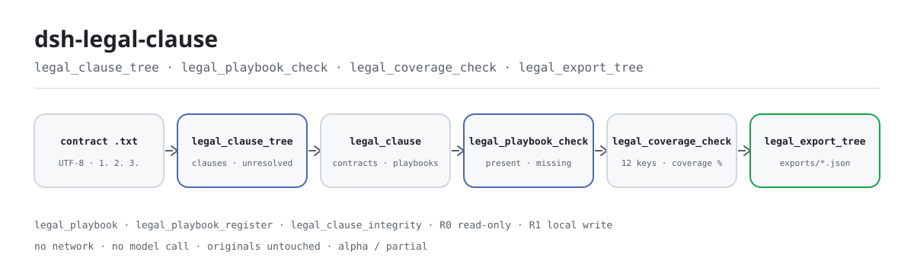
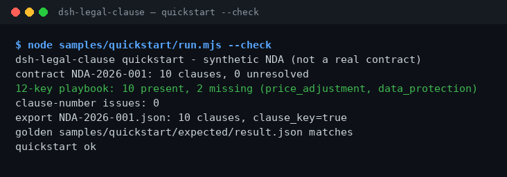

<div align="center">

<picture>
  <source media="(prefers-color-scheme: dark)" srcset="docs/assets/dsh-legal-clause-flow-dark.svg">
  
</picture>

# dsh-legal-clause

**एक अनुबंध को क्लॉज़-वृक्ष में बदलें, 12-कुंजी playbook से मिलाएँ और तुरंत देखें कि कौन-सी कुंजियाँ गायब हैं — पूरी तरह स्थानीय।**

DeepSeek Harness के लिए अनुबंध-क्लॉज़ स्टैटिक चेकर: पंक्ति के शुरू में दिए नंबर से क्लॉज़ बाँटता है, शीर्षक और मुख्य भाग के कीवर्ड से हर क्लॉज़ को जोखिम / नियंत्रण / वाणिज्यिक / निष्पादन — इन चार श्रेणियों की 12 कुंजियों में से एक पर मैप करता है, फिर कमियाँ और नंबरिंग की समस्याएँ बताता है। कोई नेटवर्क नहीं, कोई मॉडल कॉल नहीं, कोई अपलोड नहीं।

[इंस्टॉल](#तीन-चरणों-में-शुरुआत) · [कॉन्फ़िगरेशन](#कॉन्फ़िगरेशन) · [FAQ](#faq) · [简体中文](README.md) · [English](README.en.md) · [Español](README.es.md) · [Português](README.pt.md) · [हिन्दी](README.hi.md)

[](LICENSE)
[](#संगतता)
[](https://www.npmjs.com/package/dsh-legal-clause)
[](https://github.com/PerryLink/dsh-legal-clause/actions/workflows/ci.yml)
[](#संगतता)

[](https://github.com/PerryLink/dsh-legal-clause/stargazers)
[](https://www.npmjs.com/package/dsh-legal-clause)
[](https://dshfind.com/plugins/PerryLink/dsh-legal-clause?ref=badge)
[](https://dsh.market/)
[](https://gitee.com/perrylink/dsh-plugins)

```sh
dsh plugin --profile <profile> add dsh-legal-clause
```

</div>

<sub>सामुदायिक प्लगइन, DeepSeek से असंबद्ध। कैनोनिकल रिपॉज़िटरी: <https://github.com/PerryLink/dsh-legal-clause>; अन्य खातों की समान-नाम वाली रिपॉज़िटरी संबद्ध नहीं हैं। Apache-2.0; Gitee एक एग्रीगेट मिरर है।</sub>

> **स्थिति: alpha / सार्वजनिक-सिंथेटिक / आंशिक / गिना नहीं गया / GA नहीं।** ग्राहक साक्ष्य, ग्राहक डेटा या उत्पादन-तैयारी का दावा नहीं।

## यह क्या है

`dsh-legal-clause` स्थानीय स्तर पर अनुबंध के सादे टेक्स्ट को क्लॉज़ की शुरुआती संख्या के आधार पर क्लॉज़-वृक्ष में बदलता है, फिर शीर्षक और मुख्य भाग के कीवर्ड से हर क्लॉज़ को 12 मुख्य क्लॉज़ों में से एक पर मैप करता है — जोखिम (गोपनीयता, देयता, क्षतिपूर्ति), नियंत्रण (समाप्ति, हस्तांतरण, लागू कानून, विवाद), वाणिज्यिक (भुगतान, मूल्य समायोजन, बौद्धिक संपदा) और निष्पादन (वारंटी, डेटा संरक्षण)। यह बताता है कि कौन-सी कुंजियाँ गायब हैं और क्लॉज़ नंबरिंग में दोहराव या अंतराल है या नहीं। सातों टूल `legal.` नेमस्पेस में हैं; कोई नेटवर्क नहीं, कोई मॉडल कॉल नहीं, कोई अपलोड नहीं, और मूल फ़ाइल कभी नहीं बदलती।

- **इनके लिए उपयुक्त**: 10–200 क्लॉज़ वाले, चीनी या अंग्रेज़ी UTF-8 सादे-टेक्स्ट अनुबंध; पहले क्लॉज़ नंबरिंग में दोहराव/अंतराल देखना, फिर 12 मुख्य क्लॉज़ों में क्या गायब है देखना; क्लॉज़-वृक्ष को JSON के रूप में अगली प्रक्रिया के लिए निर्यात करना।
- **इनके लिए उपयुक्त नहीं**: स्कैन, PDF या Word की मूल फ़ाइलें (पहले सादे टेक्स्ट में बदलें); क्लॉज़-दर-क्लॉज़ कानूनी सलाह या जोखिम रेटिंग; ग्राहक अनुबंध को कहीं अपलोड करना (सब कुछ आपकी मशीन पर चलता है)।

## तीन चरणों में शुरुआत

1. **इंस्टॉल करें** (कोई एक चैनल चुनें):

   ```sh
   # npm चैनल (अनुशंसित, प्रकाशित संस्करण)
   dsh plugin --profile <profile> add dsh-legal-clause
   # git चैनल (नवीनतम main; lib/ git में नहीं है, पहले pnpm install && pnpm build चलाएँ)
   dsh plugin --profile <profile> add github:PerryLink/dsh-legal-clause
   # tarball चैनल: इस रेपो में pnpm pack के बाद
   dsh plugin --profile <profile> add ./dsh-legal-clause-<version>.tgz
   ```

   npm पैकेज में बना हुआ `lib/` आता है; git चैनल सोर्स स्नैपशॉट है और `lib/` gitignore में है — इंस्टॉल से पहले बिल्ड करें।

2. **न्यूनतम कॉन्फ़िगरेशन**: डिफ़ॉल्ट चलता है — `cordis.patch.yml` केवल एक पंक्ति (`id: dsh-legal-clause`) जोड़ता है और कोई Schemastery कॉन्फ़िगरेशन कुंजी नहीं है; एकमात्र समायोजन पर्यावरण चर हैं (कॉन्फ़िगरेशन देखें)।

   ```yaml
   - insert:
       - id: dsh-legal-clause
         name: 'dsh-legal-clause'
   ```

3. **जाँचें कि माउंट हुआ**:

   ```sh
   dsh --profile <profile> --dump-config | grep dsh-legal-clause
   pnpm build && node samples/quickstart/run.mjs --check
   ```

   दूसरा कमांड साथ आए 10-क्लॉज़ वाले सिंथेटिक NDA का क्लॉज़-वृक्ष, playbook कवरेज और नंबरिंग अखंडता फिर से गणना करता है और परिणाम की तुलना गोल्डन `samples/quickstart/expected/result.json` से करता है; अंतिम पंक्ति `quickstart ok` होती है।

**अनइंस्टॉल**: `dsh plugin --profile <profile> remove dsh-legal-clause` (या प्रोफ़ाइल पैच से वह पंक्ति हटाएँ)।

<details>
<summary>DSH Desktop मार्केटप्लेस से इंस्टॉल करें</summary>

सभी PerryLink प्लगइन DSH Desktop के अंतर्निहित मार्केटप्लेस में देखे जा सकते हैं: **Marketplace → Sources → Add source → चिपकाएँ** `https://perrylink-dsh-catalog.perrylink.workers.dev/catalog-source.json` **→ चुनें**। इंस्टॉल अब भी मार्केटप्लेस के npm पहचान सत्यापन और आपकी पुष्टि से होता है।

</details>

## मुख्य क्षमताएँ

- **नंबरिंग से क्लॉज़-वृक्ष** — `legal.clause_tree` पंक्ति के शुरू में अरबी अंक (`1.`, `1.2`, `1)`; अंक के बाद स्पेस आवश्यक) पर क्लॉज़ बाँटता है और अगली पंक्तियाँ पिछले क्लॉज़ में जोड़ता है; बिना नंबरिंग वाला टेक्स्ट `E_CLAUSE_TREE_INVALID` के साथ विफल-बंद होता है। यह क्लॉज़ संख्या, अनसुलझे और कवरेज लौटाता है और परिणाम `legal_clause` डोमेन की `contracts` तालिका में रखता है।
- **12-कुंजी मैपिंग** — हर क्लॉज़ कीवर्ड मिलान से अंक पाता है (शीर्षक का मिलान मुख्य भाग से अधिक भारी) और 12 में से एक कुंजी पर मैप होता है; जो नहीं मिलता उसे स्पष्ट रूप से `unresolved` चिह्नित किया जाता है, छिपाया या गिराया नहीं जाता।
- **कवरेज और कमियाँ** — `legal.playbook_check` संग्रहीत वृक्ष के लिए present / missing और कवरेज बताता है; `legal.coverage_check` सीधे टेक्स्ट पर 12 कुंजियों का कवरेज प्रतिशत निकालता है। दोनों केवल यह गिनते हैं कि कुंजी दिखी या नहीं; क्लॉज़ की गुणवत्ता नहीं आँकते।
- **नंबरिंग अखंडता** — `legal.clause_integrity` दोहराए गए नंबर, छूटे हुए शीर्ष-स्तरीय नंबर और क्रम-भंग बताता है; शीर्ष-स्तरीय नंबर 5000 से अधिक होने पर हर अंतराल खोलने के बजाय एक ही `E_CLAUSE_NUMBER_RANGE` लौटाता है।
- **कस्टम playbook** — `legal.playbook_register` संस्करण-युक्त कस्टम कुंजी-समूह दर्ज करता है (कुंजियाँ खाली नहीं और अद्वितीय होनी चाहिए); `legal.playbook_check` `version` मिलने पर उसी से तुलना करता है। अंतर्निहित playbook कभी नहीं बदलता।
- **सीमित निर्यात** — `legal.export_tree` संग्रहीत वृक्ष को `exports/<contract_id>.json` में JSON के रूप में लिखता है और पथ तथा `sha256` लौटाता है; फ़ाइल नाम `[A-Za-z0-9._-]{1,120}` से मेल खाना चाहिए और उसमें `/`, स्पेस या चीनी अक्षर नहीं हो सकते।
- **केवल स्थानीय** — सोर्स में कोई HTTP / DNS / WebSocket कॉल नहीं; कोई नेटवर्क नहीं, कोई मॉडल कॉल नहीं, कोई अपलोड नहीं, और मूल फ़ाइलें नहीं बदलतीं।

### टूल सतह

टूल नाम स्थिर API हैं (रनटाइम आउटपुट से मेल खाने के लिए अंग्रेज़ी में रखे गए); विवरण स्थानीयकृत हैं।

| टूल | उद्देश्य | जोखिम |
|---|---|---|
| `legal.playbook` | अंतर्निहित 12-कुंजी playbook (4 श्रेणियाँ) लौटाता है | R0 केवल पढ़ें |
| `legal.clause_tree` | नंबरिंग से अनुबंध टेक्स्ट पढ़ता है, 12 कुंजियाँ मैप करता है और क्लॉज़-वृक्ष सहेजता है | R1 स्थानीय लेखन (स्टोरेज डोमेन) |
| `legal.playbook_register` | संस्करण-युक्त कस्टम playbook दर्ज करता है; अंतर्निहित को कभी नहीं ढकता | R1 स्थानीय लेखन (स्टोरेज डोमेन) |
| `legal.playbook_check` | संग्रहीत वृक्ष की तुलना अंतर्निहित या नामित संस्करण के playbook से करता है; present / missing / कवरेज बताता है | R0 केवल पढ़ें |
| `legal.export_tree` | संग्रहीत क्लॉज़-वृक्ष को JSON फ़ाइल के रूप में निर्यात करता है; पथ और `sha256` लौटाता है | R1 स्थानीय लेखन |
| `legal.clause_integrity` | दोहराए नंबर, छूटे शीर्ष-स्तरीय नंबर और क्रम-भंग जाँचता है | R0 केवल पढ़ें |
| `legal.coverage_check` | सीधे टेक्स्ट पर 12 कुंजियों का कवरेज निकालता है; कोई स्थिति नहीं लिखता | R0 केवल पढ़ें |

### इनपुट और आउटपुट

**इनपुट**:

- UTF-8 सादा-टेक्स्ट अनुबंध, जिसमें प्रति पंक्ति एक क्लॉज़ हो और पंक्ति `1.` या `2.` जैसे अरबी अंक से शुरू हो; `1.2` और `1)` भी स्वीकार हैं। मुख्य भाग टूल आर्ग्युमेंट में चिपकाया जा सकता है या फ़ाइल से पढ़ा जा सकता है।
- साथ आई नमूना फ़ाइल `samples/quickstart/input/synthetic-nda-2026.txt` लगभग 3 KB और 10 क्लॉज़ की है; एक दस्तावेज़ 1 MB से नीचे रखें (अधिक टेक्स्ट का अर्थ है धीमा कीवर्ड स्कैन)।
- स्रोत: अनुबंध प्रणाली का निर्यात, Word से सादे टेक्स्ट के रूप में सहेजी फ़ाइल, या हाथ से चिपकाया टेक्स्ट। मूल फ़ाइलें कभी नहीं बदलतीं; कोई OCR नहीं और PDF/Word पार्सिंग नहीं।

**आउटपुट**:

- टूल के रिटर्न मान: क्लॉज़ संख्या, अनसुलझे, कवरेज, छूटी कुंजियाँ, नंबरिंग समस्याएँ, और निर्यात पथ के साथ `sha256`।
- क्लॉज़-वृक्ष JSON: `$DSH_HOME/storages/dsh-legal-clause/exports/<contract_id>.json` में लिखा जाता है; मूल फ़ाइल नहीं बदलती।
- सत्र का `legal_clause` स्टोरेज डोमेन: `contracts` में क्लॉज़-वृक्ष और `playbooks` में कस्टम playbook रहते हैं।
- गोल्डन फ़ाइल: `samples/quickstart/expected/result.json` (वास्तविक रन से बनी, हाथ से लिखी नहीं)।

### उदाहरण

यह वाक्य सीधे सहायक को भेजें (`package.json` में दिया डेमो प्रॉम्प्ट, अनुवादित):

```text
मेरे पास 10 क्लॉज़ का गोपनीयता समझौता है। इसे क्लॉज़-वृक्ष में बाँटें और बताएँ कि 12 मुख्य क्लॉज़ों में कौन-से गायब हैं।
```

आप स्वयं भी चला सकते हैं (वास्तविक रन; स्क्रीनशॉट इसी कमांड के आउटपुट का रेंडर है):

```sh
pnpm build && node samples/quickstart/run.mjs --check
```



*साथ आए 10-क्लॉज़ सिंथेटिक NDA पर वास्तविक कमांड `node samples/quickstart/run.mjs --check`: 10 क्लॉज़, 0 अनसुलझे, 12 में से 10 कुंजियाँ मौजूद (`price_adjustment` और `data_protection` गायब), 0 नंबरिंग समस्याएँ, गोल्डन फ़ाइल मेल खाती है। स्रोत-विवरण [`screenshots.json`](screenshots.json) में; गोल्डन फ़ाइल `samples/quickstart/expected/result.json` है।*

फ़िक्स्चर उदाहरण: इनपुट [`fixtures/public/mit/sample_nda.txt`](https://github.com/PerryLink/dsh-legal-clause/blob/main/fixtures/public/mit/sample_nda.txt) (MIT लाइसेंस वाला सार्वजनिक नमूना); कमांड `pnpm test`।

### स्वीकृति साक्ष्य

`node scripts/acceptance.mjs` `ACCEPTANCE.csv` बनाता है: सातों SKU पंक्तियाँ `counted=false` हैं और साथ आई नमूना पंक्ति `PS1-QS01` `counted=true` है।

| req_id | मीट्रिक | सीमा | वास्तविक | pass | source | counted |
|---|---|---|---|---|---|---|
| SKU-10-A01 | अनुबंध क्लॉज़-वृक्ष (20 सिंथेटिक) | 20/20 | 20 | true | public/synthetic | false |
| SKU-10-A02 | क्लॉज़ मैपिंग | 240 | 240 | true | public/synthetic | false |
| SKU-10-A03 | अनसुलझे | 0 | 0 | true | public/synthetic | false |
| SKU-10-A04 | JSON निर्यात | 20 | 20 | true | public/synthetic | false |
| SKU-10-A05 | कस्टम playbook v2 | 1/1 | 1 | true | public/synthetic | false |
| SKU-10-A06 | क्लॉज़ नंबरिंग अखंडता | 2 | 2 | true | public/synthetic | false |
| SKU-10-A07 | क्लॉज़ कवरेज | 16.67 | 16.67 | true | public/synthetic | false |
| PS1-QS01 | quickstart नमूना गोल्डन से मेल खाता है | 1/1 | 1 | true | synthetic/quickstart | true |

*0 वास्तविक अनुबंध और 0 ग्राहक साक्ष्य; ये सार्वजनिक/सिंथेटिक पंक्तियाँ हैं और ग्राहक सटीकता या GA उपलब्धता का दावा नहीं करतीं। पूर्ण पंक्तियाँ और साक्ष्य हैश [`ACCEPTANCE.csv`](ACCEPTANCE.csv) तथा [`EVIDENCE.md`](EVIDENCE.md) में हैं।*

## कॉन्फ़िगरेशन

इस प्लगइन में कोई Schemastery कॉन्फ़िगरेशन कुंजी नहीं है: `cordis.patch.yml` केवल एक पंक्ति जोड़ता है और डिफ़ॉल्ट चलते हैं। समायोजन पर्यावरण चर हैं:

| कुंजी | डिफ़ॉल्ट | अर्थ |
|---|---|---|
| `DSH_CLAUSE_HOME` | `$DSH_HOME/storages/dsh-legal-clause` | स्टोरेज रूट: `exports/` निर्देशिका यहीं रहती है; `$DSH_HOME` सेट न हो तो होस्ट प्रोसेस के cwd के नीचे `storages/dsh-legal-clause` |
| `DSH_HOME` | होस्ट प्रोसेस का cwd | केवल डिफ़ॉल्ट `DSH_CLAUSE_HOME` निकालने के लिए; `DSH_CLAUSE_HOME` स्पष्ट रूप से सेट हो तो अनदेखा |

<details>
<summary>पूरी माउंट सतह, स्टोरेज डोमेन और अंतर्निहित playbook</summary>

`cordis.patch.yml` (पूरा):

```yaml
- insert:
    - id: dsh-legal-clause
      name: 'dsh-legal-clause'
```

- प्लगइन `inject = ['tools', 'storageDomain']` घोषित करता है: दोनों सेवाएँ मौजूद होनी चाहिए, वरना प्लगइन माउंट नहीं होता; `storageDomain` न होने पर कभी चुपचाप गिरावट नहीं होती।
- टूल `ctx.tools` पर पंजीकृत होते हैं; `legal.clause_tree` और `legal.playbook_register` स्टोरेज डोमेन लिखते हैं, `legal.export_tree` अलावा `exports/` लिखता है, और बाकी चार केवल पढ़ते हैं।
- स्टोरेज डोमेन `legal_clause` (संस्करण 1) की दो तालिकाएँ हैं: `contracts` क्लॉज़-वृक्ष के लिए और `playbooks` कस्टम playbook के लिए; डोमेन बंद होना Cordis effect के रूप में दर्ज है और रोकने या हॉट रीलोड पर वापस लिया जाता है।

अंतर्निहित 12-कुंजी playbook:

| कुंजी | श्रेणी | क्लॉज़ शीर्षक |
|---|---|---|
| `confidentiality` | risk | Confidentiality |
| `liability` | risk | Limitation of Liability |
| `indemnity` | risk | Indemnity |
| `termination` | control | Termination |
| `assignment` | control | Assignment |
| `governing_law` | control | Governing Law |
| `dispute` | control | Dispute Resolution |
| `payment` | commercial | Payment |
| `price_adjustment` | commercial | Price Adjustment |
| `ip` | commercial | Intellectual Property |
| `warranty` | performance | Warranty |
| `data_protection` | performance | Data Protection |

</details>

## FAQ

<details>
<summary>इंस्टॉल या माउंट नहीं हो रहा। क्या करें?</summary>

देखें कि `node --version` ≥24.9 और <25 है और `dsh --version` `>=0.2.1-rc.3 <0.4.0` के भीतर है, फिर `dsh plugin --profile <profile> add dsh-legal-clause` चलाएँ। होस्ट को `tools` और `storageDomain` दोनों देना होंगे (कठोर निर्भरता), वरना प्लगइन माउंट नहीं होता। पूरी त्रुटि तालिका [`TROUBLESHOOTING.md`](TROUBLESHOOTING.md) में है।

</details>

<details>
<summary>क्या यह PDF, Word की मूल फ़ाइल या स्कैन संभालता है?</summary>

नहीं। केवल UTF-8 सादा टेक्स्ट लेता है: `.docx`/`.doc`, PDF, स्कैन और तस्वीरें पार्स नहीं होतीं। पहले Word/WPS से सादे टेक्स्ट के रूप में सहेजें (स्कैन पर पहले OCR करें) और हर क्लॉज़ को अपनी पंक्ति में `1.` से शुरू करें; वरना यह `E_CLAUSE_TREE_INVALID` के साथ विफल-बंद होता है।

</details>

<details>
<summary>कोई क्लॉज़ पहचाना नहीं गया या परिणाम गलत लगता है। क्यों?</summary>

पहले `node samples/quickstart/run.mjs --check` चलाएँ: नमूना पास होने का अर्थ है इंस्टॉल ठीक है। फिर देखें कि हर क्लॉज़ अपनी पंक्ति में है और अरबी अंक से शुरू होता है। मैपिंग स्टैटिक कीवर्ड मिलान है (शीर्षक का भार मुख्य भाग से अधिक), अर्थ-समझ नहीं: चीनी और अंग्रेज़ी कीवर्ड दोनों काम करते हैं, पर अलग शब्दावली `unresolved` में जा सकती है। `legal.coverage_check` से देखें कौन-सी कुंजियाँ गायब हैं, फिर `legal.playbook_register` से अपना कुंजी-समूह दर्ज करें।

</details>

<details>
<summary>क्या यह मेरी अनुबंध फ़ाइल बदलता है? डेटा कहाँ रहता है?</summary>

मूल फ़ाइलें कभी नहीं बदलता। क्लॉज़-वृक्ष `$DSH_HOME/storages/dsh-legal-clause` (या `DSH_CLAUSE_HOME`) में लिखे जाते हैं: सत्र के `legal_clause` डोमेन की `contracts`/`playbooks` तालिकाएँ, और स्पष्ट निर्यात पर `exports/<contract_id>.json`। सोर्स में कोई नेटवर्क कॉल नहीं; कुछ अपलोड नहीं होता और कोई मॉडल नहीं बुलाया जाता। रेपो में केवल सार्वजनिक/सिंथेटिक फ़िक्स्चर हैं, ग्राहक डेटा नहीं।

</details>

<details>
<summary>क्या कस्टम playbook अंतर्निहित 12 कुंजियों को ढक लेता है?</summary>

नहीं। `legal.playbook_register` `playbooks` तालिका में संस्करण-युक्त प्रविष्टि लिखता है और अंतर्निहित playbook केवल-पढ़ने योग्य रहता है; `legal.playbook_check` `version` के बिना अंतर्निहित 12 कुंजियाँ और उसके साथ नामित संस्करण उपयोग करता है। अज्ञात संस्करण `E_PLAYBOOK_NOT_FOUND` देता है; खाली या दोहरी कुंजियाँ `E_PLAYBOOK_INVALID` देती हैं।

</details>

## सुरक्षा सीमाएँ

- **पढ़ने का दायरा**: केवल वही अनुबंध टेक्स्ट जो आप स्पष्ट रूप से देते हैं; कोई निर्देशिका-भ्रमण नहीं और पर्यावरण से दूसरी फ़ाइलें नहीं पढ़ता।
- **लिखने का दायरा**: केवल `DSH_CLAUSE_HOME` की `exports/` और सत्र का `legal_clause` स्टोरेज डोमेन; मूल फ़ाइलें कभी नहीं बदलतीं।
- **कोई नेटवर्क नहीं**: सोर्स में कोई HTTP / DNS / WebSocket कॉल नहीं; कोई बाहरी प्रणाली नहीं, कोई अपलोड नहीं, कोई मॉडल कॉल नहीं।
- **निर्यात पथ की अनुमति-सूची**: फ़ाइल नाम `[A-Za-z0-9._-]{1,120}` से मेल खाना चाहिए (`E_LEGAL_PATH_INVALID`), हल होने के बाद `exports/` के भीतर रहना चाहिए, और `realpath` पर फिर से एंकर होता है ताकि सिमलिंक लेखन को निर्देशिका से बाहर न भेज सके (`E_LEGAL_PATH_NOT_ALLOWED`)।
- **विफल-बंद**: खाली टेक्स्ट `E_CLAUSE_EMPTY`, बिना नंबरिंग `E_CLAUSE_TREE_INVALID`, अनुपस्थित वृक्ष `E_CLAUSE_TREE_NOT_FOUND`, अमान्य playbook या संस्करण `E_PLAYBOOK_INVALID` / `E_PLAYBOOK_NOT_FOUND` — सभी त्रुटि देते हैं, सफलता जैसा खाली परिणाम नहीं लौटाते।
- **नंबरिंग स्कैन की सीमा**: शीर्ष-स्तरीय नंबर 5000 से अधिक होने पर हर अंतराल खोलने के बजाय एक ही `E_CLAUSE_NUMBER_RANGE` लौटता है (DoS सुरक्षा)।
- **जोखिम स्तर**: लिखने वाले टूल R1 (स्थानीय लेखन), केवल-पढ़ने वाले R0; टूल सतह देखें।
- **सामग्री पर निर्णय नहीं**: यह स्टैटिक नंबरिंग और कीवर्ड जाँच है, कानूनी सलाह नहीं, जोखिम रेटिंग नहीं, और निष्पक्षता का मूल्यांकन नहीं।

## अनुमतियाँ और डेटा

```text
पढ़ना: आपके द्वारा बताया गया UTF-8 सादा-टेक्स्ट अनुबंध; अन्य निर्देशिकाओं में नहीं
लिखना: $DSH_HOME/storages/dsh-legal-clause/exports/ और legal_clause स्टोरेज डोमेन; मूल फ़ाइलें अछूती
नेटवर्क: नहीं
बाहरी प्रणालियाँ: कोई नहीं
```

- स्थानीय रूप से चलता है; कोई नेटवर्क नहीं, कोई मॉडल कॉल नहीं, कोई अपलोड नहीं।
- केवल सार्वजनिक/सिंथेटिक फ़िक्स्चर; ग्राहक डेटा या ग्राहक साक्ष्य नहीं।
- Alpha / आंशिक; गिना नहीं गया, GA या उत्पादन-उपयोगिता का दावा नहीं।

## ज्ञात सीमाएँ

- **केवल सार्वजनिक/सिंथेटिक सत्यापन।** Alpha / आंशिक / गिना नहीं गया / GA नहीं; 0 वास्तविक अनुबंध और 0 ग्राहक साक्ष्य। यह ग्राहक सटीकता, क्लॉज़-पहचान दर या GA उपलब्धता का दावा नहीं करता।
- **केवल सादा टेक्स्ट।** `.docx` / `.doc`, PDF, स्कैन या तस्वीरें नहीं; पहले UTF-8 सादे टेक्स्ट में बदलें और स्कैन पर OCR करें।
- **शुरुआती नंबरिंग पर निर्भर।** हर क्लॉज़ अपनी पंक्ति में और अरबी अंक (`1.`, `1.2`, `1)`) से शुरू होना चाहिए; शब्दों वाली नंबरिंग और नंबर खो चुके निर्यात `E_CLAUSE_TREE_INVALID` के साथ विफल होते हैं।
- **कीवर्ड स्टैटिक हैं।** कीवर्ड मिलने पर क्लॉज़ मैप हो जाता है — चीनी और अंग्रेज़ी सहित — बिना अर्थ-समझ और बिना गुणवत्ता-निर्णय; अलग शब्दावली `unresolved` या पास की कुंजी दे सकती है, और कवरेज का अर्थ केवल «12 में से कितनी कुंजियाँ दिखीं» है।
- **`text_hash` SHA-256 नहीं है।** क्लॉज़ रिकॉर्ड का `text_hash` मुख्य भाग के base64 के पहले 16 अक्षर हैं; यह केवल क्लॉज़ को मोटे तौर पर अलग पहचानने के लिए है, साक्ष्य के लिए सामग्री हैश कभी नहीं।
- **निर्यातित `contract_id` फ़ाइल नाम से सीमित है।** `/`, `..`, स्पेस या चीनी अक्षर वाले अनुबंध ID अस्वीकार होते हैं (`E_LEGAL_PATH_INVALID`); `NDA-2026-001` जैसा ASCII ID इस्तेमाल करें।
- **नंबरिंग स्कैन सीमित है।** शीर्ष-स्तरीय नंबर 5000 से अधिक होने पर एक ही श्रेणी-त्रुटि लौटती है और अंतराल का विवरण नहीं।
- **कोई UI या क्लाइंट आधा नहीं।** शुद्ध होस्ट प्लगइन, बिना ब्राउज़र इंटरफ़ेस या एडिटर; सभी परिणाम टूल आउटपुट और निर्यातित JSON से आते हैं।

## संगतता

| सतह | स्थिति |
|---|---|
| Harness | `dsh >=0.2.1-rc.3 <0.4.0` |
| Node | `>=24.9.0 <25` |
| प्लेटफ़ॉर्म | जहाँ DSH चलता है; केवल स्थानीय फ़ाइलें |
| डेटा | कोई नेटवर्क नहीं, कोई मॉडल कॉल नहीं, कोई अपलोड नहीं |

## इकोसिस्टम और गुणवत्ता

- [Gitee एग्रीगेट मिरर](https://gitee.com/perrylink/dsh-plugins) (PerryLink प्लगइन एग्रीगेट मिरर; GitHub कैनोनिकल है)
- [dshfind प्लगइन पेज](https://dshfind.com/plugins/PerryLink/dsh-legal-clause) (इंस्टॉल और रैंकिंग)
- [DSH Market](https://dsh.market/) (सूचीबद्ध)
- **1024 स्टोर चैनल**: `npm i -g dsh1024` चलाएँ, फिर `dsh1024 plugin --profile <profile> add dsh-legal-clause` ([deepseek1024.com](https://deepseek1024.com) की इंस्टॉल रैंकिंग में गिना जाता है)
- दस्तावेज़: [`TROUBLESHOOTING.md`](TROUBLESHOOTING.md) · [`PRIVACY.md`](PRIVACY.md) · [`SECURITY.md`](SECURITY.md) · [`ACCEPTANCE.csv`](ACCEPTANCE.csv) · [`EVIDENCE.md`](EVIDENCE.md) · [`FIXTURES.md`](FIXTURES.md)
- परिवार सूचकांक: [डोमेन सूचकांक](https://perrylink.github.io/dsh-plugins/) · [चेकर परिवार](https://perrylink.github.io/zh/checkers/) · [मुख्य परिवार](https://github.com/PerryLink/dsh-kit)
- सहोदर पैकेज: [dsh-legal-intake](https://github.com/PerryLink/dsh-legal-intake) · [dsh-docx-redline](https://github.com/PerryLink/dsh-docx-redline) · [dsh-contract-suite](https://github.com/PerryLink/dsh-contract-suite)

संबंधित चेकर (हर एक अलग पैकेज है, अपने rule pack और संस्करण के साथ; केवल ज़रूरी वाले इंस्टॉल करें):

| पैकेज | क्यों प्रासंगिक है |
|---|---|
| [`dsh-contract-stance`](https://github.com/PerryLink/dsh-contract-stance) | बातचीत की स्थिति और जोखिम स्तर के लिए क्लॉज़ stance रजिस्टर। |
| [`dsh-lawcite-adapter`](https://github.com/PerryLink/dsh-lawcite-adapter) | उद्धरण और कानूनी दस्तावेज़ तत्वों का सत्यापन। |
| [`dsh-evidence-check`](https://github.com/PerryLink/dsh-evidence-check) | उसी मामले की साक्ष्य-सूची की पूर्णता। |

## डेवलपमेंट

```sh
pnpm install --frozen-lockfile
pnpm build && pnpm lint && pnpm typecheck && pnpm test
pnpm run gate:sku10
node scripts/acceptance.mjs
pnpm run pack:check
pnpm build && node samples/quickstart/run.mjs --check
```

`pnpm test` पहले `tsc` से बिल्ड करता है, फिर `node --test test/*.test.mjs` चलाता है (25 केस: क्लॉज़ पार्सिंग, नंबरिंग अखंडता, कवरेज, पथ सुरक्षा, playbook संस्करण, प्लगइन स्मोक, सार्वजनिक NDA, quickstart)। `pnpm run gate:sku10` स्वीकृति स्क्रिप्ट फिर चलाता है और जाँचता है कि `ACCEPTANCE.csv` की हर पंक्ति में `pass=true` है।

| पथ | सामग्री |
|---|---|
| `src/core/clause.ts` | 12-कुंजी playbook, त्रुटि कोड, क्लॉज़ पार्सिंग और नंबरिंग अखंडता |
| `src/core/safe-path.ts` | निर्यात फ़ाइल नाम अनुमति-सूची और realpath एंकरिंग |
| `src/plugin/index.ts` | होस्ट प्रवेश: पर्यावरण चर पढ़ता है, `legal_clause` डोमेन खोलता है, सात टूल पंजीकृत करता है |
| `src/plugin/storage.ts` | `legal_clause` स्टोरेज डोमेन (`contracts` / `playbooks` तालिकाएँ) |
| `src/plugin/tools.ts` | सात टूल की परिभाषाएँ |
| `test/` | `node --test` केस (25) |
| `fixtures/public/mit/` | MIT लाइसेंस वाला सार्वजनिक NDA नमूना (LICENSE / SOURCE सहित) |
| `samples/quickstart/` | सिंथेटिक NDA, रन स्क्रिप्ट और गोल्डन आउटपुट |
| `scripts/` | lint, स्वीकृति, gate, pack जाँच और चित्र जनरेटर |
| `docs/assets/` | हीरो SVG और वास्तविक रन कैप्चर |

हीरो आरेख [`scripts/gen-readme-assets.py`](scripts/gen-readme-assets.py) से प्रोग्रामैटिक रूप से बनता है (Python; `docs/assets/dsh-legal-clause-flow-{light,dark}.svg` आउटपुट) और दोबारा चलाया जा सकता है; `quickstart.png` कैप्चर किए गए `node samples/quickstart/run.mjs --check` आउटपुट का रेंडर है।

Topics: `deepseek-harness`, `dsh`, `dsh-plugin`, `legal`, `clause`, `contract`, `perrylink`, `playbook`

## परिवार और आभार

यह परियोजना [PerryLink](https://github.com/PerryLink) द्वारा अनुरक्षित DeepSeek Harness प्लगइन परिवार की सदस्य है (सभी Apache-2.0)। अगर यह प्लगइन आपकी मदद करता है, तो **एक स्टार दें** — इससे कोई सुविधा नहीं खुलती, पर अगला व्यक्ति इसे आसानी से ढूँढ पाता है।

- [@PerryLink](https://github.com/PerryLink) — निर्माता और अनुरक्षक: क्लॉज़ नंबरिंग पार्सिंग, 12-कुंजी playbook, कवरेज और नंबरिंग-अखंडता जाँच, सीमित JSON निर्यात और पाँच-भाषा दस्तावेज़।

<details>
<summary>DSH डोमेन प्लगइन परिवार (15 पैकेज + 2 सूट)</summary>

| Package | npm |
|---|---|
| **[dsh-einvoice](https://github.com/PerryLink/dsh-einvoice)** | [npm](https://www.npmjs.com/package/dsh-einvoice) |
| **[dsh-docx-redline](https://github.com/PerryLink/dsh-docx-redline)** | [npm](https://www.npmjs.com/package/dsh-docx-redline) |
| **[dsh-policy-ledger](https://github.com/PerryLink/dsh-policy-ledger)** | [npm](https://www.npmjs.com/package/dsh-policy-ledger) |
| **[dsh-ghg](https://github.com/PerryLink/dsh-ghg)** | [npm](https://www.npmjs.com/package/dsh-ghg) |
| **[dsh-bankrec](https://github.com/PerryLink/dsh-bankrec)** | [npm](https://www.npmjs.com/package/dsh-bankrec) |
| **[dsh-ap-three-way](https://github.com/PerryLink/dsh-ap-three-way)** | [npm](https://www.npmjs.com/package/dsh-ap-three-way) |
| **[dsh-ifc-qto](https://github.com/PerryLink/dsh-ifc-qto)** | [npm](https://www.npmjs.com/package/dsh-ifc-qto) |
| **[dsh-qms-capa](https://github.com/PerryLink/dsh-qms-capa)** | [npm](https://www.npmjs.com/package/dsh-qms-capa) |
| **[dsh-legal-intake](https://github.com/PerryLink/dsh-legal-intake)** | [npm](https://www.npmjs.com/package/dsh-legal-intake) |
| **[dsh-legal-clause](https://github.com/PerryLink/dsh-legal-clause)** | [npm](https://www.npmjs.com/package/dsh-legal-clause) |
| **[dsh-freight-audit](https://github.com/PerryLink/dsh-freight-audit)** | [npm](https://www.npmjs.com/package/dsh-freight-audit) |
| **[dsh-hs-candidate](https://github.com/PerryLink/dsh-hs-candidate)** | [npm](https://www.npmjs.com/package/dsh-hs-candidate) |
| **[dsh-travel-recon](https://github.com/PerryLink/dsh-travel-recon)** | [npm](https://www.npmjs.com/package/dsh-travel-recon) |
| **[dsh-pim-lint](https://github.com/PerryLink/dsh-pim-lint)** | [npm](https://www.npmjs.com/package/dsh-pim-lint) |
| **[dsh-eval-pack](https://github.com/PerryLink/dsh-eval-pack)** | [npm](https://www.npmjs.com/package/dsh-eval-pack) |
| **[dsh-finops-suite](https://github.com/PerryLink/dsh-finops-suite)** | [npm](https://www.npmjs.com/package/dsh-finops-suite) |
| **[dsh-contract-suite](https://github.com/PerryLink/dsh-contract-suite)** | [npm](https://www.npmjs.com/package/dsh-contract-suite) |

</details>

<details>
<summary>मुख्य परिवार — 87 वर्तमान इंस्टॉल स्पेक</summary>

| Package | npm |
|---|---|
| **[dsh-aqua-input-check](https://github.com/PerryLink/dsh-aqua-input-check)** | [npm](https://www.npmjs.com/package/dsh-aqua-input-check) |
| **[dsh-archive-check](https://github.com/PerryLink/dsh-archive-check)** | [npm](https://www.npmjs.com/package/dsh-archive-check) |
| **[dsh-bid-ca-precheck](https://github.com/PerryLink/dsh-bid-ca-precheck)** | [npm](https://www.npmjs.com/package/dsh-bid-ca-precheck) |
| **[dsh-bid-qual-check](https://github.com/PerryLink/dsh-bid-qual-check)** | [npm](https://www.npmjs.com/package/dsh-bid-qual-check) |
| **[dsh-contract-stance](https://github.com/PerryLink/dsh-contract-stance)** | [npm](https://www.npmjs.com/package/dsh-contract-stance) |
| **[dsh-customs-doc-check](https://github.com/PerryLink/dsh-customs-doc-check)** | [npm](https://www.npmjs.com/package/dsh-customs-doc-check) |
| **[dsh-demurrage-ledger](https://github.com/PerryLink/dsh-demurrage-ledger)** | [npm](https://www.npmjs.com/package/dsh-demurrage-ledger) |
| **[dsh-drill-script-check](https://github.com/PerryLink/dsh-drill-script-check)** | [npm](https://www.npmjs.com/package/dsh-drill-script-check) |
| **[dsh-eia-guide-check](https://github.com/PerryLink/dsh-eia-guide-check)** | [npm](https://www.npmjs.com/package/dsh-eia-guide-check) |
| **[dsh-emergency-plan](https://github.com/PerryLink/dsh-emergency-plan)** | [npm](https://www.npmjs.com/package/dsh-emergency-plan) |
| **[dsh-essay-rubric-check](https://github.com/PerryLink/dsh-essay-rubric-check)** | [npm](https://www.npmjs.com/package/dsh-essay-rubric-check) |
| **[dsh-evidence-check](https://github.com/PerryLink/dsh-evidence-check)** | [npm](https://www.npmjs.com/package/dsh-evidence-check) |
| **[dsh-export-ctl-check](https://github.com/PerryLink/dsh-export-ctl-check)** | [npm](https://www.npmjs.com/package/dsh-export-ctl-check) |
| **[dsh-fmea-table-check](https://github.com/PerryLink/dsh-fmea-table-check)** | [npm](https://www.npmjs.com/package/dsh-fmea-table-check) |
| **[dsh-forecast-penalty](https://github.com/PerryLink/dsh-forecast-penalty)** | [npm](https://www.npmjs.com/package/dsh-forecast-penalty) |
| **[dsh-gongwen-flow-check](https://github.com/PerryLink/dsh-gongwen-flow-check)** | [npm](https://www.npmjs.com/package/dsh-gongwen-flow-check) |
| **[dsh-gongwen-word-check](https://github.com/PerryLink/dsh-gongwen-word-check)** | [npm](https://www.npmjs.com/package/dsh-gongwen-word-check) |
| **[dsh-guard-plan-qc](https://github.com/PerryLink/dsh-guard-plan-qc)** | [npm](https://www.npmjs.com/package/dsh-guard-plan-qc) |
| **[dsh-hazchem-check](https://github.com/PerryLink/dsh-hazchem-check)** | [npm](https://www.npmjs.com/package/dsh-hazchem-check) |
| **[dsh-hazplan-check](https://github.com/PerryLink/dsh-hazplan-check)** | [npm](https://www.npmjs.com/package/dsh-hazplan-check) |
| **[dsh-hidden-risk-map](https://github.com/PerryLink/dsh-hidden-risk-map)** | [npm](https://www.npmjs.com/package/dsh-hidden-risk-map) |
| **[dsh-hs-classify](https://github.com/PerryLink/dsh-hs-classify)** | [npm](https://www.npmjs.com/package/dsh-hs-classify) |
| **[dsh-icd-rule-check](https://github.com/PerryLink/dsh-icd-rule-check)** | [npm](https://www.npmjs.com/package/dsh-icd-rule-check) |
| **[dsh-lawcite-adapter](https://github.com/PerryLink/dsh-lawcite-adapter)** | [npm](https://www.npmjs.com/package/dsh-lawcite-adapter) |
| **[dsh-lc-doc-check](https://github.com/PerryLink/dsh-lc-doc-check)** | [npm](https://www.npmjs.com/package/dsh-lc-doc-check) |
| **[dsh-learning-gap-check](https://github.com/PerryLink/dsh-learning-gap-check)** | [npm](https://www.npmjs.com/package/dsh-learning-gap-check) |
| **[dsh-medrec-qc](https://github.com/PerryLink/dsh-medrec-qc)** | [npm](https://www.npmjs.com/package/dsh-medrec-qc) |
| **[dsh-nsfc-form-check](https://github.com/PerryLink/dsh-nsfc-form-check)** | [npm](https://www.npmjs.com/package/dsh-nsfc-form-check) |
| **[dsh-nurse-record-check](https://github.com/PerryLink/dsh-nurse-record-check)** | [npm](https://www.npmjs.com/package/dsh-nurse-record-check) |
| **[dsh-origin-rvc-check](https://github.com/PerryLink/dsh-origin-rvc-check)** | [npm](https://www.npmjs.com/package/dsh-origin-rvc-check) |
| **[dsh-ota-review-check](https://github.com/PerryLink/dsh-ota-review-check)** | [npm](https://www.npmjs.com/package/dsh-ota-review-check) |
| **[dsh-paper-doc-adapter](https://github.com/PerryLink/dsh-paper-doc-adapter)** | [npm](https://www.npmjs.com/package/dsh-paper-doc-adapter) |
| **[dsh-permit-report-check](https://github.com/PerryLink/dsh-permit-report-check)** | [npm](https://www.npmjs.com/package/dsh-permit-report-check) |
| **[dsh-pipeline-check](https://github.com/PerryLink/dsh-pipeline-check)** | [npm](https://www.npmjs.com/package/dsh-pipeline-check) |
| **[dsh-pleading-draft](https://github.com/PerryLink/dsh-pleading-draft)** | [npm](https://www.npmjs.com/package/dsh-pleading-draft) |
| **[dsh-policy-brief-draft](https://github.com/PerryLink/dsh-policy-brief-draft)** | [npm](https://www.npmjs.com/package/dsh-policy-brief-draft) |
| **[dsh-power-loss-split](https://github.com/PerryLink/dsh-power-loss-split)** | [npm](https://www.npmjs.com/package/dsh-power-loss-split) |
| **[dsh-power-ticket-check](https://github.com/PerryLink/dsh-power-ticket-check)** | [npm](https://www.npmjs.com/package/dsh-power-ticket-check) |
| **[dsh-ppap-check](https://github.com/PerryLink/dsh-ppap-check)** | [npm](https://www.npmjs.com/package/dsh-ppap-check) |
| **[dsh-protest-deadline](https://github.com/PerryLink/dsh-protest-deadline)** | [npm](https://www.npmjs.com/package/dsh-protest-deadline) |
| **[dsh-railway-window](https://github.com/PerryLink/dsh-railway-window)** | [npm](https://www.npmjs.com/package/dsh-railway-window) |
| **[dsh-repair-order-qc](https://github.com/PerryLink/dsh-repair-order-qc)** | [npm](https://www.npmjs.com/package/dsh-repair-order-qc) |
| **[dsh-review-reply-check](https://github.com/PerryLink/dsh-review-reply-check)** | [npm](https://www.npmjs.com/package/dsh-review-reply-check) |
| **[dsh-rulefile-check](https://github.com/PerryLink/dsh-rulefile-check)** | [npm](https://www.npmjs.com/package/dsh-rulefile-check) |
| **[dsh-safety-brief-check](https://github.com/PerryLink/dsh-safety-brief-check)** | [npm](https://www.npmjs.com/package/dsh-safety-brief-check) |
| **[dsh-site-log-check](https://github.com/PerryLink/dsh-site-log-check)** | [npm](https://www.npmjs.com/package/dsh-site-log-check) |
| **[dsh-soe-decision-check](https://github.com/PerryLink/dsh-soe-decision-check)** | [npm](https://www.npmjs.com/package/dsh-soe-decision-check) |
| **[dsh-soilwater-check](https://github.com/PerryLink/dsh-soilwater-check)** | [npm](https://www.npmjs.com/package/dsh-soilwater-check) |
| **[dsh-sop-sync-check](https://github.com/PerryLink/dsh-sop-sync-check)** | [npm](https://www.npmjs.com/package/dsh-sop-sync-check) |
| **[dsh-spc-gbt-adapter](https://github.com/PerryLink/dsh-spc-gbt-adapter)** | [npm](https://www.npmjs.com/package/dsh-spc-gbt-adapter) |
| **[dsh-tender-extract](https://github.com/PerryLink/dsh-tender-extract)** | [npm](https://www.npmjs.com/package/dsh-tender-extract) |
| **[dsh-tender-matrix](https://github.com/PerryLink/dsh-tender-matrix)** | [npm](https://www.npmjs.com/package/dsh-tender-matrix) |
| **[dsh-warranty-calc](https://github.com/PerryLink/dsh-warranty-calc)** | [npm](https://www.npmjs.com/package/dsh-warranty-calc) |
| **[dsh-auto-review](https://github.com/PerryLink/dsh-auto-review)** | [npm](https://www.npmjs.com/package/dsh-auto-review) |
| **[dsh-autotier](https://github.com/PerryLink/dsh-autotier)** | [npm](https://www.npmjs.com/package/dsh-autotier) |
| **[dsh-budget](https://github.com/PerryLink/dsh-budget)** | [npm](https://www.npmjs.com/package/dsh-budget) |
| **[dsh-cert-mcp](https://github.com/PerryLink/dsh-cert-mcp)** | [npm](https://www.npmjs.com/package/dsh-cert-mcp) |
| **[dsh-checkpoint-rewind](https://github.com/PerryLink/dsh-checkpoint-rewind)** | [npm](https://www.npmjs.com/package/dsh-checkpoint-rewind) |
| **[dsh-claude-move](https://github.com/PerryLink/dsh-claude-move)** | [npm](https://www.npmjs.com/package/dsh-claude-move) |
| **[dsh-click](https://github.com/PerryLink/dsh-click)** | [npm](https://www.npmjs.com/package/dsh-click) |
| **[dsh-composer-history](https://github.com/PerryLink/dsh-composer-history)** | [npm](https://www.npmjs.com/package/dsh-composer-history) |
| **[dsh-data-quality](https://github.com/PerryLink/dsh-data-quality)** | [npm](https://www.npmjs.com/package/dsh-data-quality) |
| **[dsh-defend](https://github.com/PerryLink/dsh-defend)** | [npm](https://www.npmjs.com/package/dsh-defend) |
| **[dsh-doublecheck](https://github.com/PerryLink/dsh-doublecheck)** | [npm](https://www.npmjs.com/package/dsh-doublecheck) |
| **[dsh-draw](https://github.com/PerryLink/dsh-draw)** | [npm](https://www.npmjs.com/package/dsh-draw) |
| **[dsh-fast](https://github.com/PerryLink/dsh-fast)** | [npm](https://www.npmjs.com/package/dsh-fast) |
| **[dsh-fund-research](https://github.com/PerryLink/dsh-fund-research)** | [npm](https://www.npmjs.com/package/dsh-fund-research) |
| **[dsh-industry-research](https://github.com/PerryLink/dsh-industry-research)** | [npm](https://www.npmjs.com/package/dsh-industry-research) |
| **[dsh-laya](https://github.com/PerryLink/dsh-laya)** | [npm](https://www.npmjs.com/package/dsh-laya) |
| **[dsh-library](https://github.com/PerryLink/dsh-library)** | [npm](https://www.npmjs.com/package/dsh-library) |
| **[dsh-local-ai](https://github.com/PerryLink/dsh-local-ai)** | [npm](https://www.npmjs.com/package/dsh-local-ai) |
| **[dsh-lsp-actions](https://github.com/PerryLink/dsh-lsp-actions)** | [npm](https://www.npmjs.com/package/dsh-lsp-actions) |
| **[dsh-mask](https://github.com/PerryLink/dsh-mask)** | [npm](https://www.npmjs.com/package/dsh-mask) |
| **[dsh-mcp-panel](https://github.com/PerryLink/dsh-mcp-panel)** | [npm](https://www.npmjs.com/package/dsh-mcp-panel) |
| **[dsh-memento](https://github.com/PerryLink/dsh-memento)** | [npm](https://www.npmjs.com/package/dsh-memento) |
| **[dsh-observe](https://github.com/PerryLink/dsh-observe)** | [npm](https://www.npmjs.com/package/dsh-observe) |
| **[dsh-output-styles](https://github.com/PerryLink/dsh-output-styles)** | [npm](https://www.npmjs.com/package/dsh-output-styles) |
| **[dsh-permission-rules](https://github.com/PerryLink/dsh-permission-rules)** | [npm](https://www.npmjs.com/package/dsh-permission-rules) |
| **[dsh-plugin-guide](https://github.com/PerryLink/dsh-plugin-guide)** | [npm](https://www.npmjs.com/package/dsh-plugin-guide) |
| **[dsh-plugin-upgrade](https://github.com/PerryLink/dsh-plugin-upgrade)** | [npm](https://www.npmjs.com/package/dsh-plugin-upgrade) |
| **[dsh-reach](https://github.com/PerryLink/dsh-reach)** | [npm](https://www.npmjs.com/package/dsh-reach) |
| **[dsh-research-report](https://github.com/PerryLink/dsh-research-report)** | [npm](https://www.npmjs.com/package/dsh-research-report) |
| **[dsh-score](https://github.com/PerryLink/dsh-score)** | [npm](https://www.npmjs.com/package/dsh-score) |
| **[dsh-session-sync](https://github.com/PerryLink/dsh-session-sync)** | [npm](https://www.npmjs.com/package/dsh-session-sync) |
| **[dsh-talk](https://github.com/PerryLink/dsh-talk)** | [npm](https://www.npmjs.com/package/dsh-talk) |
| **[dsh-test-drive](https://github.com/PerryLink/dsh-test-drive)** | [npm](https://www.npmjs.com/package/dsh-test-drive) |
| **[dsh-translate](https://github.com/PerryLink/dsh-translate)** | [npm](https://www.npmjs.com/package/dsh-translate) |

</details>

## लाइसेंस

[LICENSE](LICENSE) (Apache License 2.0) © 2026 PerryLink; `NOTICE` और `THIRD-PARTY-NOTICES` भी देखें।

<p align="center"><sub>Apache-2.0 · सामुदायिक प्लगइन, DeepSeek से असंबद्ध।</sub></p>
