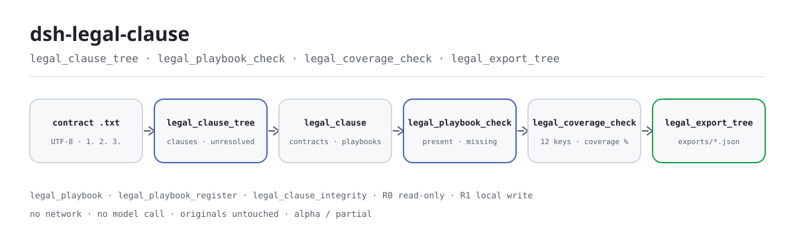
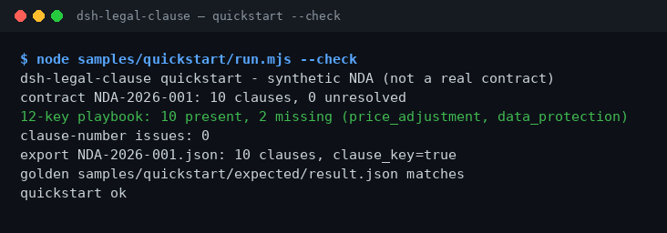

<div align="center">

<picture>
  <source media="(prefers-color-scheme: dark)" srcset="docs/assets/dsh-legal-clause-flow-dark.svg">
  
</picture>

# dsh-legal-clause

**把一份合同文本拆成条款树、对齐 12 项关键条款 playbook，并当场列出缺了哪几项——全程本地。**

面向 DeepSeek Harness 的合同条款静态检查插件：按行首编号切分条款，用标题与正文里的关键词把每条映射到风险 / 控制 / 商务 / 履约四类共 12 个键，再报告缺口与编号问题；不联网、不调用模型、不上传。

[安装](#三步上手) · [配置](#配置) · [FAQ](#faq) · [简体中文](README.md) · [English](README.en.md) · [Español](README.es.md) · [Português](README.pt.md) · [हिन्दी](README.hi.md)

[](LICENSE)
[](#兼容性)
[](https://www.npmjs.com/package/dsh-legal-clause)
[](https://github.com/PerryLink/dsh-legal-clause/actions/workflows/ci.yml)
[](#兼容性)

[](https://github.com/PerryLink/dsh-legal-clause/stargazers)
[](https://www.npmjs.com/package/dsh-legal-clause)
[](https://dshfind.com/plugins/PerryLink/dsh-legal-clause?ref=badge)
[](https://dsh.market/)
[](https://gitee.com/perrylink/dsh-plugins)

```sh
dsh plugin --profile <profile> add dsh-legal-clause
```

</div>

<sub>社区插件，与 DeepSeek 官方无关。唯一官方仓库：<https://github.com/PerryLink/dsh-legal-clause>；其他账号下的同名仓库均与本项目无关。Apache-2.0；Gitee 为聚合镜像。</sub>

> **状态：alpha / 公开合成 / partial / not counted / 非 GA。** 不含客户证据、客户数据，也不作生产可用声明。

## 它是什么

`dsh-legal-clause` 在本地把一段合同纯文本按行首条款编号拆成条款树，再用标题与正文里的关键词把每条映射到 12 个关键条款键——风险（保密、责任限制、赔偿）、控制（终止、转让、适用法律、争议）、商务（付款、调价、知识产权）、履约（保证、数据保护）——并报告缺了哪几项、条款编号有没有重复或跳号。七个工具都在 `legal.` 命名空间下；不联网、不调用模型、不上传，原文件不会被修改。

- **适合**：10–200 条、UTF-8 纯文本的中英文合同；先看条款编号有没有重复/跳号，再看 12 类关键条款缺哪几项；把条款树导出成 JSON 交给下游。
- **不适合**：扫描件、PDF、Word 原件（要先转成纯文本）；逐条法律意见或风险评级；把客户合同上传到任何地方（只在你的电脑上算）。

## 三步上手

1. **安装**（三选一）：

   ```sh
   # npm 通道（推荐，已发布版本）
   dsh plugin --profile <profile> add dsh-legal-clause
   # git 通道（最新 main；lib/ 不随 git 提交，先在本仓库 pnpm install && pnpm build）
   dsh plugin --profile <profile> add github:PerryLink/dsh-legal-clause
   # tarball 通道：本仓库 pnpm pack 后
   dsh plugin --profile <profile> add ./dsh-legal-clause-<version>.tgz
   ```

   npm 包内含构建后的 `lib/`；git 通道是源码快照，`lib/` 已被 gitignore，安装前先构建。

2. **最小配置**：默认即可用——`cordis.patch.yml` 只 `insert` 一行（`id: dsh-legal-clause`），没有 Schemastery 配置键；唯一可调的是环境变量（见「配置」）。

   ```yaml
   - insert:
       - id: dsh-legal-clause
         name: 'dsh-legal-clause'
   ```

3. **验证已生效**：

   ```sh
   dsh --profile <profile> --dump-config | grep dsh-legal-clause
   pnpm build && node samples/quickstart/run.mjs --check
   ```

   第二条命令重算随包 10 条合成 NDA 的条款树、playbook 覆盖与编号完整性，并与金标 `samples/quickstart/expected/result.json` 对照；通过时最后一行是 `quickstart ok`。

**卸载**：`dsh plugin --profile <profile> remove dsh-legal-clause`（或从 profile patch 删掉该行）。

<details>
<summary>从 DSH Desktop 市场安装</summary>

所有 PerryLink 插件均可在 DSH Desktop 内置市场中浏览：**市场 → 来源 → 添加来源 → 粘贴** `https://perrylink-dsh-catalog.perrylink.workers.dev/catalog-source.json` **→ 选中**。安装仍需通过市场的 npm 身份校验与你的确认。

</details>

## 核心能力

- **按编号拆树** —— `legal.clause_tree` 用行首阿拉伯数字编号（`1.`、`1.2`、`1)`，编号后需有空格）切分条款，续行并入上一条；一个编号都没有时以 `E_CLAUSE_TREE_INVALID` 失败关闭。返回条款数、未映射数与覆盖率，并把结果存进 `legal_clause` 域的 `contracts` 表。
- **12 键映射** —— 每条条款按「标题命中权重更高、正文命中权重较低」打分，映射到 12 个键之一；匹配不上就显式标 `unresolved`，不隐藏、不丢弃。
- **覆盖与缺口** —— `legal.playbook_check` 对已保存的树报告 present / missing 与 coverage；`legal.coverage_check` 直接对一段文本算 12 键覆盖百分比。两者都只数「键是否出现」，不判断条款写得好不好。
- **编号完整性** —— `legal.clause_integrity` 报告重复编号、顶级编号跳号、乱序三类问题；顶级编号超过 5000 时只报一条 `E_CLAUSE_NUMBER_RANGE`，不展开逐号扫描。
- **自定义 playbook** —— `legal.playbook_register` 注册带版本号的自定义键集合（键必须非空且不重复），`legal.playbook_check` 传 `version` 时按它比对；内置 playbook 不被改动。
- **受限导出** —— `legal.export_tree` 把已保存的树写成 JSON 到存储的 `exports/<contract_id>.json`，返回路径与 `sha256`；文件名必须匹配 `[A-Za-z0-9._-]{1,120}`，不允许 `/`、空格或中文。
- **纯本地** —— 源码没有 HTTP / DNS / WebSocket 调用；不联网、不调用模型、不上传，原文件不会被修改。

### 工具面

工具名是稳定 API（与运行时输出一致，保持英文）；说明已本地化。

| 工具 | 用途 | 风险 |
|---|---|---|
| `legal.playbook` | 返回内置的 12 键 playbook（4 个类别） | R0 只读 |
| `legal.clause_tree` | 按编号解析合同文本、映射 12 键并保存条款树 | R1 本地写（存储域） |
| `legal.playbook_register` | 注册带版本号的自定义 playbook 键集合；不覆盖内置 playbook | R1 本地写（存储域） |
| `legal.playbook_check` | 用内置或指定版本的 playbook 比对已保存的树，报告 present / missing / coverage | R0 只读 |
| `legal.export_tree` | 把已保存的条款树导出为 JSON 文件，返回路径与 `sha256` | R1 本地写 |
| `legal.clause_integrity` | 检查条款编号重复、顶级编号跳号与乱序 | R0 只读 |
| `legal.coverage_check` | 直接对文本计算 12 键覆盖率，不写任何状态 | R0 只读 |

### 输入与输出

**输入**：

- UTF-8 纯文本合同，每个条款单独一行、以 `1.`、`2.` 这类阿拉伯数字编号开头；也接受 `1.2`、`1)`。正文可以直接粘进工具参数，也可以传文件内容。
- 自带样例 `samples/quickstart/input/synthetic-nda-2026.txt` 约 3 KB、10 条条款；建议单份控制在 1 MB 以内（文本越大，关键词扫描越慢）。
- 来源：合同系统导出、Word 另存为纯文本，或手工粘贴；原文件不会被修改，不做 OCR、不解析 PDF/Word。

**输出**：

- 工具返回值：条款数、未映射数、覆盖率、缺失键、编号问题列表，以及导出文件的路径与 `sha256`。
- 条款树 JSON：写到 `$DSH_HOME/storages/dsh-legal-clause/exports/<contract_id>.json`；原文件不改。
- 会话内 `legal_clause` 存储域：`contracts` 表存条款树记录，`playbooks` 表存自定义 playbook。
- 样例金标：`samples/quickstart/expected/result.json`（由真实运行产生，不是手写）。

### 示例

把这句话直接发给助手（`package.json` 里的演示提示词）：

```text
我有一份 10 条的保密协议文本，帮我拆成条款树，看看 12 项关键条款缺哪几项。
```

也可以自己跑（真实运行；截图就是这条命令的输出渲染）：

```sh
pnpm build && node samples/quickstart/run.mjs --check
```



*真实命令 `node samples/quickstart/run.mjs --check` 跑在随包 10 条合成 NDA 上：10 条条款、0 条未映射、12 键中命中 10 项（缺 `price_adjustment`、`data_protection`）、编号问题 0 条，金标一致。出处见 [`screenshots.json`](screenshots.json)，金标见 `samples/quickstart/expected/result.json`。*

fixture 示例：输入 [`fixtures/public/mit/sample_nda.txt`](https://github.com/PerryLink/dsh-legal-clause/blob/main/fixtures/public/mit/sample_nda.txt)（MIT 许可公开样本）；命令 `pnpm test`。

### 验收证据

`node scripts/acceptance.mjs` 生成 `ACCEPTANCE.csv`：7 个 SKU 行全部 `counted=false`，随包样例行 `PS1-QS01` 为 `counted=true`。

| req_id | 指标 | 阈值 | 实测 | pass | source | counted |
|---|---|---|---|---|---|---|
| SKU-10-A01 | 合同条款树（20 份合成） | 20/20 | 20 | true | public/synthetic | false |
| SKU-10-A02 | 条款映射 | 240 | 240 | true | public/synthetic | false |
| SKU-10-A03 | 未映射 | 0 | 0 | true | public/synthetic | false |
| SKU-10-A04 | JSON 导出 | 20 | 20 | true | public/synthetic | false |
| SKU-10-A05 | 自定义 playbook v2 | 1/1 | 1 | true | public/synthetic | false |
| SKU-10-A06 | 条款编号完整性 | 2 | 2 | true | public/synthetic | false |
| SKU-10-A07 | 条款覆盖度 | 16.67 | 16.67 | true | public/synthetic | false |
| PS1-QS01 | quickstart 样例与金标一致 | 1/1 | 1 | true | synthetic/quickstart | true |

*0 份真实合同、0 份客户证据；这些是公开/合成行，不构成客户准确率或 GA 可用性声明。完整行与证据哈希见 [`ACCEPTANCE.csv`](ACCEPTANCE.csv) 与 [`EVIDENCE.md`](EVIDENCE.md)。*

## 配置

本插件没有 Schemastery 配置键：`cordis.patch.yml` 只 `insert` 一行，默认即可用。可调项是环境变量：

| 键 | 默认值 | 含义 |
|---|---|---|
| `DSH_CLAUSE_HOME` | `$DSH_HOME/storages/dsh-legal-clause` | 存储根：`exports/` 导出目录在这里；`$DSH_HOME` 未设时退回宿主进程 cwd 下的 `storages/dsh-legal-clause` |
| `DSH_HOME` | 宿主进程 cwd | 仅用于推导默认 `DSH_CLAUSE_HOME`；显式设了 `DSH_CLAUSE_HOME` 则忽略 |

<details>
<summary>完整挂载面、存储域与内置 playbook</summary>

`cordis.patch.yml`（全文）：

```yaml
- insert:
    - id: dsh-legal-clause
      name: 'dsh-legal-clause'
```

- 插件 `inject = ['tools', 'storageDomain']`：两个服务都必须在场，插件才会挂载；缺 `storageDomain` 时不会静默降级。
- 工具注册在 `ctx.tools`；`legal.clause_tree` 与 `legal.playbook_register` 写存储域，`legal.export_tree` 另写 `exports/`，其余四个工具只读。
- 存储域 `legal_clause`（版本 1）两张表：`contracts` 存条款树记录、`playbooks` 存自定义 playbook；域关闭注册为 Cordis effect，停止或热重载即撤销。

内置 12 键 playbook：

| 键 | 类别 | 条款标题 |
|---|---|---|
| `confidentiality` | risk | Confidentiality |
| `liability` | risk | Limitation of Liability |
| `indemnity` | risk | Indemnity |
| `termination` | control | Termination |
| `assignment` | control | Assignment |
| `governing_law` | control | Governing Law |
| `dispute` | control | Dispute Resolution |
| `payment` | commercial | Payment |
| `price_adjustment` | commercial | Price Adjustment |
| `ip` | commercial | Intellectual Property |
| `warranty` | performance | Warranty |
| `data_protection` | performance | Data Protection |

</details>

## FAQ

<details>
<summary>装不上或挂载失败怎么办？</summary>

先看 `node --version` 是否 ≥24.9 且 <25、`dsh --version` 是否在 `>=0.2.1-rc.3 <0.4.0`，再跑 `dsh plugin --profile <profile> add dsh-legal-clause`。宿主必须提供 `tools` 与 `storageDomain` 两个服务（插件硬依赖），否则不会挂载。完整错误对照见 [`TROUBLESHOOTING.md`](TROUBLESHOOTING.md)。

</details>

<details>
<summary>能处理 PDF、Word 原件或扫描件吗？</summary>

不能。只接受 UTF-8 纯文本：`.docx`/`.doc`、PDF、扫描件、图片都不解析。先用 Word/WPS 另存为纯文本（扫描件先 OCR），再把每个条款整理成单独一行、以 `1.` 开头；否则会以 `E_CLAUSE_TREE_INVALID` 失败关闭。

</details>

<details>
<summary>条款没识别出来、结果不对怎么办？</summary>

先跑 `node samples/quickstart/run.mjs --check`：样例通过说明安装没问题，再检查合同是不是每个条款单独一行、以阿拉伯数字编号开头。映射是静态关键词匹配（标题权重高于正文），不是语义理解：中英文关键词都能命中，但换了说法就可能落到 `unresolved`。先用 `legal.coverage_check` 看缺哪几项，再用 `legal.playbook_register` 注册自己的键集合。

</details>

<details>
<summary>会改我的合同文件吗？数据存在哪？</summary>

不会改原文件。条款树写进 `$DSH_HOME/storages/dsh-legal-clause`（或 `DSH_CLAUSE_HOME`）：会话 `legal_clause` 域里的 `contracts`/`playbooks` 表，以及显式导出时的 `exports/<contract_id>.json`。源码没有网络调用，不上传、不调用模型；仓库内只有公开/合成 fixture，没有客户数据。

</details>

<details>
<summary>自定义 playbook 会覆盖内置的 12 键吗？</summary>

不会。`legal.playbook_register` 按版本号写进 `playbooks` 表，内置 playbook 保持只读；`legal.playbook_check` 不带 `version` 时用内置 12 键，带 `version` 时用该版本。版本不存在会报 `E_PLAYBOOK_NOT_FOUND`，键为空或重复会报 `E_PLAYBOOK_INVALID`。

</details>

## 安全边界

- **读取范围**：只读用户显式传入的合同文本；不遍历目录、不读环境里的其他文件。
- **写入范围**：只写 `DSH_CLAUSE_HOME` 的 `exports/` 与会话 `legal_clause` 存储域；原文件永不被修改。
- **无网络**：源码中没有 HTTP / DNS / WebSocket 调用；不连外部系统、不上传、不调用模型。
- **导出路径白名单**：文件名必须匹配 `[A-Za-z0-9._-]{1,120}`（`E_LEGAL_PATH_INVALID`），解析后必须留在 `exports/` 内，并在 `realpath` 之后重新锚定，符号链接不能把写入重定向到目录外（`E_LEGAL_PATH_NOT_ALLOWED`）。
- **失败关闭**：空文本 `E_CLAUSE_EMPTY`、找不到编号 `E_CLAUSE_TREE_INVALID`、树不存在 `E_CLAUSE_TREE_NOT_FOUND`、playbook 无效或版本不存在 `E_PLAYBOOK_INVALID` / `E_PLAYBOOK_NOT_FOUND` 都直接报错，不返回空结果冒充成功。
- **编号扫描上限**：顶级编号大于 5000 时只报一条 `E_CLAUSE_NUMBER_RANGE`，不展开逐号缺口扫描（DoS 防护）。
- **风险分级**：写文件的工具标 R1（本地写），只读工具标 R0；逐工具见「工具面」。
- **不做内容判断**：只做编号与关键词的静态检查，不构成法律意见，不做风险评级，也不判断条款是否公平。

## 权限与数据

```text
读：用户指定的 UTF-8 纯文本合同；不遍历其他目录
写：$DSH_HOME/storages/dsh-legal-clause/exports/ 与 legal_clause 存储域；不改原文件
联网：否
外部系统：无
```

- 本地运行；不联网、不调用模型、不上传。
- 仅公开/合成 fixture；不含客户数据或客户证据。
- alpha / partial；not counted，不作 GA 或生产可用声明。

## 已知限制

- **仅公开/合成验证。** alpha / partial / not counted / 非 GA；真实合同 0 份、客户证据 0 份，不构成客户准确率、条款识别率或 GA 可用性声明。
- **只吃纯文本。** 不支持 `.docx` / `.doc`、PDF、扫描件与图片；先转成 UTF-8 纯文本，扫描件先 OCR。
- **依赖行首编号。** 条款必须单独一行、以阿拉伯数字编号开头（`1.`、`1.2`、`1)`）；「第一条」这类写法、丢编号的导出文本都会 `E_CLAUSE_TREE_INVALID`。
- **关键词是静态匹配。** 中英文关键词命中即映射，不做语义理解，不判断条款写得好不好；换了说法可能得到 `unresolved` 或映射到相邻键，覆盖率只代表「12 个键出现了几个」。
- **`text_hash` 不是 SHA-256。** 条款记录里的 `text_hash` 是正文 base64 的前 16 个字符，只能粗略区分条款，不能当内容哈希做证据。
- **导出的 `contract_id` 受文件名白名单限制。** 含 `/`、`..`、空格或中文的合同编号会被拒绝（`E_LEGAL_PATH_INVALID`）；请用 `NDA-2026-001` 这类纯 ASCII 编号。
- **编号扫描有上限。** 顶级编号 > 5000 只报一条范围错误，缺口明细不再展开。
- **无 UI/客户端半。** 纯 host 插件，没有浏览器界面或编辑器；所有结果通过工具返回值与导出 JSON 呈现。

## 兼容性

| 维度 | 状态 |
|---|---|
| Harness | `dsh >=0.2.1-rc.3 <0.4.0` |
| Node | `>=24.9.0 <25` |
| 平台 | 任何 DSH 可运行处；仅本地文件 |
| 数据 | 不联网、不调用模型、不上传 |

## 生态与质量

- [Gitee 聚合镜像](https://gitee.com/perrylink/dsh-plugins)（PerryLink 插件聚合镜像，以 GitHub 为准）
- [dshfind 插件页](https://dshfind.com/plugins/PerryLink/dsh-legal-clause)（安装量与排名）
- [DSH Market](https://dsh.market/)（已上架）
- **1024 商店渠道**：先 `npm i -g dsh1024`，再 `dsh1024 plugin --profile <profile> add dsh-legal-clause`（计入 [deepseek1024.com](https://deepseek1024.com) 安装排行）
- 文档：[`TROUBLESHOOTING.md`](TROUBLESHOOTING.md) · [`PRIVACY.md`](PRIVACY.md) · [`SECURITY.md`](SECURITY.md) · [`ACCEPTANCE.csv`](ACCEPTANCE.csv) · [`EVIDENCE.md`](EVIDENCE.md) · [`FIXTURES.md`](FIXTURES.md)
- 家族索引：[领域索引](https://perrylink.github.io/dsh-plugins/) · [Checker 家族](https://perrylink.github.io/zh/checkers/) · [主线家族](https://github.com/PerryLink/dsh-kit)
- 兄弟包：[dsh-legal-intake](https://github.com/PerryLink/dsh-legal-intake) · [dsh-docx-redline](https://github.com/PerryLink/dsh-docx-redline) · [dsh-contract-suite](https://github.com/PerryLink/dsh-contract-suite)

相关核查器（各自是独立包，带独立规则包与版本；只装你需要的）：

| 包 | 为什么相关 |
|---|---|
| [`dsh-contract-stance`](https://github.com/PerryLink/dsh-contract-stance) | 谈判立场与风险等级的条款 stance 登记。 |
| [`dsh-lawcite-adapter`](https://github.com/PerryLink/dsh-lawcite-adapter) | 引注与法律文书要素核验。 |
| [`dsh-evidence-check`](https://github.com/PerryLink/dsh-evidence-check) | 同一事项的证据清单完整性。 |

## 开发

```sh
pnpm install --frozen-lockfile
pnpm build && pnpm lint && pnpm typecheck && pnpm test
pnpm run gate:sku10
node scripts/acceptance.mjs
pnpm run pack:check
pnpm build && node samples/quickstart/run.mjs --check
```

`pnpm test` 先 `tsc` 构建再跑 `node --test test/*.test.mjs`（25 项：条款解析、编号完整性、覆盖率、路径安全、playbook 版本、插件冒烟、公开 NDA、quickstart）。`pnpm run gate:sku10` 重跑验收脚本并校验 `ACCEPTANCE.csv` 每行 `pass=true`。

| 路径 | 内容 |
|---|---|
| `src/core/clause.ts` | 12 键 playbook、错误码、条款解析与编号完整性检查 |
| `src/core/safe-path.ts` | 导出路径白名单与 realpath 锚定 |
| `src/plugin/index.ts` | 宿主入口：读环境变量、打开 `legal_clause` 域、注册七个工具 |
| `src/plugin/storage.ts` | `legal_clause` 存储域（`contracts` / `playbooks` 两张表） |
| `src/plugin/tools.ts` | 七个工具的定义 |
| `test/` | `node --test` 用例（25 项） |
| `fixtures/public/mit/` | MIT 许可公开 NDA 样本（含 LICENSE / SOURCE） |
| `samples/quickstart/` | 合成 NDA、运行脚本与金标 |
| `scripts/` | lint、验收、gate、pack 校验与配图脚本 |
| `docs/assets/` | hero SVG 与真实运行截图 |

开头流程图由 [`scripts/gen-readme-assets.py`](scripts/gen-readme-assets.py) 程序化生成（Python，输出 `docs/assets/dsh-legal-clause-flow-{light,dark}.svg`），可重复执行；`quickstart.png` 是 `node samples/quickstart/run.mjs --check` 捕获输出的渲染。

Topics：`deepseek-harness`, `dsh`, `dsh-plugin`, `legal`, `clause`, `contract`, `perrylink`, `playbook`

## 家族与致谢

本项目是 [PerryLink](https://github.com/PerryLink) 维护的 DeepSeek Harness 插件家族成员（全部 Apache-2.0）。如果这个插件帮到了你，**给个 star**——它不解锁任何功能，但会让下一个人更容易找到它。

- [@PerryLink](https://github.com/PerryLink) —— 创建者与维护者：条款编号解析、12 键 playbook、覆盖率与编号完整性检查、受限 JSON 导出与五语文档。

<details>
<summary>DSH 领域插件家族（15 个包 + 2 个 suite）</summary>

| Package | npm |
|---|---|
| **[dsh-einvoice](https://github.com/PerryLink/dsh-einvoice)** | [npm](https://www.npmjs.com/package/dsh-einvoice) |
| **[dsh-docx-redline](https://github.com/PerryLink/dsh-docx-redline)** | [npm](https://www.npmjs.com/package/dsh-docx-redline) |
| **[dsh-policy-ledger](https://github.com/PerryLink/dsh-policy-ledger)** | [npm](https://www.npmjs.com/package/dsh-policy-ledger) |
| **[dsh-ghg](https://github.com/PerryLink/dsh-ghg)** | [npm](https://www.npmjs.com/package/dsh-ghg) |
| **[dsh-bankrec](https://github.com/PerryLink/dsh-bankrec)** | [npm](https://www.npmjs.com/package/dsh-bankrec) |
| **[dsh-ap-three-way](https://github.com/PerryLink/dsh-ap-three-way)** | [npm](https://www.npmjs.com/package/dsh-ap-three-way) |
| **[dsh-ifc-qto](https://github.com/PerryLink/dsh-ifc-qto)** | [npm](https://www.npmjs.com/package/dsh-ifc-qto) |
| **[dsh-qms-capa](https://github.com/PerryLink/dsh-qms-capa)** | [npm](https://www.npmjs.com/package/dsh-qms-capa) |
| **[dsh-legal-intake](https://github.com/PerryLink/dsh-legal-intake)** | [npm](https://www.npmjs.com/package/dsh-legal-intake) |
| **[dsh-legal-clause](https://github.com/PerryLink/dsh-legal-clause)** | [npm](https://www.npmjs.com/package/dsh-legal-clause) |
| **[dsh-freight-audit](https://github.com/PerryLink/dsh-freight-audit)** | [npm](https://www.npmjs.com/package/dsh-freight-audit) |
| **[dsh-hs-candidate](https://github.com/PerryLink/dsh-hs-candidate)** | [npm](https://www.npmjs.com/package/dsh-hs-candidate) |
| **[dsh-travel-recon](https://github.com/PerryLink/dsh-travel-recon)** | [npm](https://www.npmjs.com/package/dsh-travel-recon) |
| **[dsh-pim-lint](https://github.com/PerryLink/dsh-pim-lint)** | [npm](https://www.npmjs.com/package/dsh-pim-lint) |
| **[dsh-eval-pack](https://github.com/PerryLink/dsh-eval-pack)** | [npm](https://www.npmjs.com/package/dsh-eval-pack) |
| **[dsh-finops-suite](https://github.com/PerryLink/dsh-finops-suite)** | [npm](https://www.npmjs.com/package/dsh-finops-suite) |
| **[dsh-contract-suite](https://github.com/PerryLink/dsh-contract-suite)** | [npm](https://www.npmjs.com/package/dsh-contract-suite) |

</details>

<details>
<summary>主线家族 — 87 个当前安装 spec</summary>

| Package | npm |
|---|---|
| **[dsh-aqua-input-check](https://github.com/PerryLink/dsh-aqua-input-check)** | [npm](https://www.npmjs.com/package/dsh-aqua-input-check) |
| **[dsh-archive-check](https://github.com/PerryLink/dsh-archive-check)** | [npm](https://www.npmjs.com/package/dsh-archive-check) |
| **[dsh-bid-ca-precheck](https://github.com/PerryLink/dsh-bid-ca-precheck)** | [npm](https://www.npmjs.com/package/dsh-bid-ca-precheck) |
| **[dsh-bid-qual-check](https://github.com/PerryLink/dsh-bid-qual-check)** | [npm](https://www.npmjs.com/package/dsh-bid-qual-check) |
| **[dsh-contract-stance](https://github.com/PerryLink/dsh-contract-stance)** | [npm](https://www.npmjs.com/package/dsh-contract-stance) |
| **[dsh-customs-doc-check](https://github.com/PerryLink/dsh-customs-doc-check)** | [npm](https://www.npmjs.com/package/dsh-customs-doc-check) |
| **[dsh-demurrage-ledger](https://github.com/PerryLink/dsh-demurrage-ledger)** | [npm](https://www.npmjs.com/package/dsh-demurrage-ledger) |
| **[dsh-drill-script-check](https://github.com/PerryLink/dsh-drill-script-check)** | [npm](https://www.npmjs.com/package/dsh-drill-script-check) |
| **[dsh-eia-guide-check](https://github.com/PerryLink/dsh-eia-guide-check)** | [npm](https://www.npmjs.com/package/dsh-eia-guide-check) |
| **[dsh-emergency-plan](https://github.com/PerryLink/dsh-emergency-plan)** | [npm](https://www.npmjs.com/package/dsh-emergency-plan) |
| **[dsh-essay-rubric-check](https://github.com/PerryLink/dsh-essay-rubric-check)** | [npm](https://www.npmjs.com/package/dsh-essay-rubric-check) |
| **[dsh-evidence-check](https://github.com/PerryLink/dsh-evidence-check)** | [npm](https://www.npmjs.com/package/dsh-evidence-check) |
| **[dsh-export-ctl-check](https://github.com/PerryLink/dsh-export-ctl-check)** | [npm](https://www.npmjs.com/package/dsh-export-ctl-check) |
| **[dsh-fmea-table-check](https://github.com/PerryLink/dsh-fmea-table-check)** | [npm](https://www.npmjs.com/package/dsh-fmea-table-check) |
| **[dsh-forecast-penalty](https://github.com/PerryLink/dsh-forecast-penalty)** | [npm](https://www.npmjs.com/package/dsh-forecast-penalty) |
| **[dsh-gongwen-flow-check](https://github.com/PerryLink/dsh-gongwen-flow-check)** | [npm](https://www.npmjs.com/package/dsh-gongwen-flow-check) |
| **[dsh-gongwen-word-check](https://github.com/PerryLink/dsh-gongwen-word-check)** | [npm](https://www.npmjs.com/package/dsh-gongwen-word-check) |
| **[dsh-guard-plan-qc](https://github.com/PerryLink/dsh-guard-plan-qc)** | [npm](https://www.npmjs.com/package/dsh-guard-plan-qc) |
| **[dsh-hazchem-check](https://github.com/PerryLink/dsh-hazchem-check)** | [npm](https://www.npmjs.com/package/dsh-hazchem-check) |
| **[dsh-hazplan-check](https://github.com/PerryLink/dsh-hazplan-check)** | [npm](https://www.npmjs.com/package/dsh-hazplan-check) |
| **[dsh-hidden-risk-map](https://github.com/PerryLink/dsh-hidden-risk-map)** | [npm](https://www.npmjs.com/package/dsh-hidden-risk-map) |
| **[dsh-hs-classify](https://github.com/PerryLink/dsh-hs-classify)** | [npm](https://www.npmjs.com/package/dsh-hs-classify) |
| **[dsh-icd-rule-check](https://github.com/PerryLink/dsh-icd-rule-check)** | [npm](https://www.npmjs.com/package/dsh-icd-rule-check) |
| **[dsh-lawcite-adapter](https://github.com/PerryLink/dsh-lawcite-adapter)** | [npm](https://www.npmjs.com/package/dsh-lawcite-adapter) |
| **[dsh-lc-doc-check](https://github.com/PerryLink/dsh-lc-doc-check)** | [npm](https://www.npmjs.com/package/dsh-lc-doc-check) |
| **[dsh-learning-gap-check](https://github.com/PerryLink/dsh-learning-gap-check)** | [npm](https://www.npmjs.com/package/dsh-learning-gap-check) |
| **[dsh-medrec-qc](https://github.com/PerryLink/dsh-medrec-qc)** | [npm](https://www.npmjs.com/package/dsh-medrec-qc) |
| **[dsh-nsfc-form-check](https://github.com/PerryLink/dsh-nsfc-form-check)** | [npm](https://www.npmjs.com/package/dsh-nsfc-form-check) |
| **[dsh-nurse-record-check](https://github.com/PerryLink/dsh-nurse-record-check)** | [npm](https://www.npmjs.com/package/dsh-nurse-record-check) |
| **[dsh-origin-rvc-check](https://github.com/PerryLink/dsh-origin-rvc-check)** | [npm](https://www.npmjs.com/package/dsh-origin-rvc-check) |
| **[dsh-ota-review-check](https://github.com/PerryLink/dsh-ota-review-check)** | [npm](https://www.npmjs.com/package/dsh-ota-review-check) |
| **[dsh-paper-doc-adapter](https://github.com/PerryLink/dsh-paper-doc-adapter)** | [npm](https://www.npmjs.com/package/dsh-paper-doc-adapter) |
| **[dsh-permit-report-check](https://github.com/PerryLink/dsh-permit-report-check)** | [npm](https://www.npmjs.com/package/dsh-permit-report-check) |
| **[dsh-pipeline-check](https://github.com/PerryLink/dsh-pipeline-check)** | [npm](https://www.npmjs.com/package/dsh-pipeline-check) |
| **[dsh-pleading-draft](https://github.com/PerryLink/dsh-pleading-draft)** | [npm](https://www.npmjs.com/package/dsh-pleading-draft) |
| **[dsh-policy-brief-draft](https://github.com/PerryLink/dsh-policy-brief-draft)** | [npm](https://www.npmjs.com/package/dsh-policy-brief-draft) |
| **[dsh-power-loss-split](https://github.com/PerryLink/dsh-power-loss-split)** | [npm](https://www.npmjs.com/package/dsh-power-loss-split) |
| **[dsh-power-ticket-check](https://github.com/PerryLink/dsh-power-ticket-check)** | [npm](https://www.npmjs.com/package/dsh-power-ticket-check) |
| **[dsh-ppap-check](https://github.com/PerryLink/dsh-ppap-check)** | [npm](https://www.npmjs.com/package/dsh-ppap-check) |
| **[dsh-protest-deadline](https://github.com/PerryLink/dsh-protest-deadline)** | [npm](https://www.npmjs.com/package/dsh-protest-deadline) |
| **[dsh-railway-window](https://github.com/PerryLink/dsh-railway-window)** | [npm](https://www.npmjs.com/package/dsh-railway-window) |
| **[dsh-repair-order-qc](https://github.com/PerryLink/dsh-repair-order-qc)** | [npm](https://www.npmjs.com/package/dsh-repair-order-qc) |
| **[dsh-review-reply-check](https://github.com/PerryLink/dsh-review-reply-check)** | [npm](https://www.npmjs.com/package/dsh-review-reply-check) |
| **[dsh-rulefile-check](https://github.com/PerryLink/dsh-rulefile-check)** | [npm](https://www.npmjs.com/package/dsh-rulefile-check) |
| **[dsh-safety-brief-check](https://github.com/PerryLink/dsh-safety-brief-check)** | [npm](https://www.npmjs.com/package/dsh-safety-brief-check) |
| **[dsh-site-log-check](https://github.com/PerryLink/dsh-site-log-check)** | [npm](https://www.npmjs.com/package/dsh-site-log-check) |
| **[dsh-soe-decision-check](https://github.com/PerryLink/dsh-soe-decision-check)** | [npm](https://www.npmjs.com/package/dsh-soe-decision-check) |
| **[dsh-soilwater-check](https://github.com/PerryLink/dsh-soilwater-check)** | [npm](https://www.npmjs.com/package/dsh-soilwater-check) |
| **[dsh-sop-sync-check](https://github.com/PerryLink/dsh-sop-sync-check)** | [npm](https://www.npmjs.com/package/dsh-sop-sync-check) |
| **[dsh-spc-gbt-adapter](https://github.com/PerryLink/dsh-spc-gbt-adapter)** | [npm](https://www.npmjs.com/package/dsh-spc-gbt-adapter) |
| **[dsh-tender-extract](https://github.com/PerryLink/dsh-tender-extract)** | [npm](https://www.npmjs.com/package/dsh-tender-extract) |
| **[dsh-tender-matrix](https://github.com/PerryLink/dsh-tender-matrix)** | [npm](https://www.npmjs.com/package/dsh-tender-matrix) |
| **[dsh-warranty-calc](https://github.com/PerryLink/dsh-warranty-calc)** | [npm](https://www.npmjs.com/package/dsh-warranty-calc) |
| **[dsh-auto-review](https://github.com/PerryLink/dsh-auto-review)** | [npm](https://www.npmjs.com/package/dsh-auto-review) |
| **[dsh-autotier](https://github.com/PerryLink/dsh-autotier)** | [npm](https://www.npmjs.com/package/dsh-autotier) |
| **[dsh-budget](https://github.com/PerryLink/dsh-budget)** | [npm](https://www.npmjs.com/package/dsh-budget) |
| **[dsh-cert-mcp](https://github.com/PerryLink/dsh-cert-mcp)** | [npm](https://www.npmjs.com/package/dsh-cert-mcp) |
| **[dsh-checkpoint-rewind](https://github.com/PerryLink/dsh-checkpoint-rewind)** | [npm](https://www.npmjs.com/package/dsh-checkpoint-rewind) |
| **[dsh-claude-move](https://github.com/PerryLink/dsh-claude-move)** | [npm](https://www.npmjs.com/package/dsh-claude-move) |
| **[dsh-click](https://github.com/PerryLink/dsh-click)** | [npm](https://www.npmjs.com/package/dsh-click) |
| **[dsh-composer-history](https://github.com/PerryLink/dsh-composer-history)** | [npm](https://www.npmjs.com/package/dsh-composer-history) |
| **[dsh-data-quality](https://github.com/PerryLink/dsh-data-quality)** | [npm](https://www.npmjs.com/package/dsh-data-quality) |
| **[dsh-defend](https://github.com/PerryLink/dsh-defend)** | [npm](https://www.npmjs.com/package/dsh-defend) |
| **[dsh-doublecheck](https://github.com/PerryLink/dsh-doublecheck)** | [npm](https://www.npmjs.com/package/dsh-doublecheck) |
| **[dsh-draw](https://github.com/PerryLink/dsh-draw)** | [npm](https://www.npmjs.com/package/dsh-draw) |
| **[dsh-fast](https://github.com/PerryLink/dsh-fast)** | [npm](https://www.npmjs.com/package/dsh-fast) |
| **[dsh-fund-research](https://github.com/PerryLink/dsh-fund-research)** | [npm](https://www.npmjs.com/package/dsh-fund-research) |
| **[dsh-industry-research](https://github.com/PerryLink/dsh-industry-research)** | [npm](https://www.npmjs.com/package/dsh-industry-research) |
| **[dsh-laya](https://github.com/PerryLink/dsh-laya)** | [npm](https://www.npmjs.com/package/dsh-laya) |
| **[dsh-library](https://github.com/PerryLink/dsh-library)** | [npm](https://www.npmjs.com/package/dsh-library) |
| **[dsh-local-ai](https://github.com/PerryLink/dsh-local-ai)** | [npm](https://www.npmjs.com/package/dsh-local-ai) |
| **[dsh-lsp-actions](https://github.com/PerryLink/dsh-lsp-actions)** | [npm](https://www.npmjs.com/package/dsh-lsp-actions) |
| **[dsh-mask](https://github.com/PerryLink/dsh-mask)** | [npm](https://www.npmjs.com/package/dsh-mask) |
| **[dsh-mcp-panel](https://github.com/PerryLink/dsh-mcp-panel)** | [npm](https://www.npmjs.com/package/dsh-mcp-panel) |
| **[dsh-memento](https://github.com/PerryLink/dsh-memento)** | [npm](https://www.npmjs.com/package/dsh-memento) |
| **[dsh-observe](https://github.com/PerryLink/dsh-observe)** | [npm](https://www.npmjs.com/package/dsh-observe) |
| **[dsh-output-styles](https://github.com/PerryLink/dsh-output-styles)** | [npm](https://www.npmjs.com/package/dsh-output-styles) |
| **[dsh-permission-rules](https://github.com/PerryLink/dsh-permission-rules)** | [npm](https://www.npmjs.com/package/dsh-permission-rules) |
| **[dsh-plugin-guide](https://github.com/PerryLink/dsh-plugin-guide)** | [npm](https://www.npmjs.com/package/dsh-plugin-guide) |
| **[dsh-plugin-upgrade](https://github.com/PerryLink/dsh-plugin-upgrade)** | [npm](https://www.npmjs.com/package/dsh-plugin-upgrade) |
| **[dsh-reach](https://github.com/PerryLink/dsh-reach)** | [npm](https://www.npmjs.com/package/dsh-reach) |
| **[dsh-research-report](https://github.com/PerryLink/dsh-research-report)** | [npm](https://www.npmjs.com/package/dsh-research-report) |
| **[dsh-score](https://github.com/PerryLink/dsh-score)** | [npm](https://www.npmjs.com/package/dsh-score) |
| **[dsh-session-sync](https://github.com/PerryLink/dsh-session-sync)** | [npm](https://www.npmjs.com/package/dsh-session-sync) |
| **[dsh-talk](https://github.com/PerryLink/dsh-talk)** | [npm](https://www.npmjs.com/package/dsh-talk) |
| **[dsh-test-drive](https://github.com/PerryLink/dsh-test-drive)** | [npm](https://www.npmjs.com/package/dsh-test-drive) |
| **[dsh-translate](https://github.com/PerryLink/dsh-translate)** | [npm](https://www.npmjs.com/package/dsh-translate) |

</details>

## License

[LICENSE](LICENSE)（Apache License 2.0）© 2026 PerryLink；另见 `NOTICE` 与 `THIRD-PARTY-NOTICES`。

<p align="center"><sub>Apache-2.0 · 社区插件，与 DeepSeek 无关。</sub></p>
