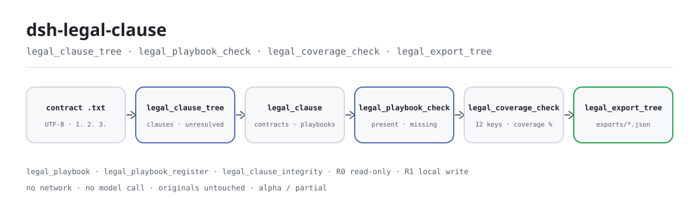
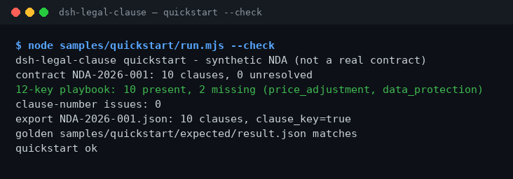

<div align="center">

<picture>
  <source media="(prefers-color-scheme: dark)" srcset="docs/assets/dsh-legal-clause-flow-dark.svg">
  
</picture>

# dsh-legal-clause

**Transforme um contrato em árvore de cláusulas, alinhe-o a um playbook de 12 chaves e veja na hora quais chaves faltam — tudo local.**

Um verificador estático de cláusulas para o DeepSeek Harness: divide as cláusulas pela numeração inicial, mapeia cada uma para uma das 12 chaves (risco / controle / comercial / execução) por palavras-chave do título e do corpo, e reporta lacunas e problemas de numeração. Sem rede, sem chamada a modelo e sem upload.

[Instalar](#instalação-em-três-passos) · [Configuração](#configuração) · [FAQ](#faq) · [简体中文](README.md) · [English](README.en.md) · [Español](README.es.md) · [Português](README.pt.md) · [हिन्दी](README.hi.md)

[](LICENSE)
[](#compatibilidade)
[](https://www.npmjs.com/package/dsh-legal-clause)
[](https://github.com/PerryLink/dsh-legal-clause/actions/workflows/ci.yml)
[](#compatibilidade)

[](https://github.com/PerryLink/dsh-legal-clause/stargazers)
[](https://www.npmjs.com/package/dsh-legal-clause)
[](https://dshfind.com/plugins/PerryLink/dsh-legal-clause?ref=badge)
[](https://dsh.market/)
[](https://gitee.com/perrylink/dsh-plugins)

```sh
dsh plugin --profile <profile> add dsh-legal-clause
```

</div>

<sub>Plugin da comunidade, sem afiliação com a DeepSeek. Repositório canônico: <https://github.com/PerryLink/dsh-legal-clause>; repositórios com o mesmo nome em outras contas não são afiliados. Apache-2.0; o Gitee é um espelho agregado.</sub>

> **Status: alpha / sintético público / parcial / não contabilizado / não GA.** Sem evidência de clientes, dados de clientes ou promessa de produção.

## O que é

O `dsh-legal-clause` transforma um texto plano de contrato em árvore de cláusulas usando a numeração inicial de cada cláusula e, em seguida, mapeia cada uma para uma das 12 cláusulas-chave — risco (confidencialidade, responsabilidade, indenização), controle (rescisão, cessão, lei aplicável, disputas), comercial (pagamento, reajuste de preço, propriedade intelectual) e execução (garantia, proteção de dados) — por palavras-chave do título e do corpo. Ele reporta quais chaves faltam e se a numeração tem duplicatas ou saltos. As sete ferramentas ficam no namespace `legal.`; não há rede, chamada a modelo nem upload, e o arquivo original nunca é modificado.

- **Adequado para**: contratos de 10–200 cláusulas em texto plano UTF-8, em chinês ou inglês; verificar primeiro a numeração (duplicatas/saltos) e depois quais das 12 cláusulas-chave faltam; exportar a árvore de cláusulas como JSON para uma etapa seguinte.
- **Não adequado para**: digitalizações, PDF ou arquivos Word originais (primeiro converta para texto plano); pareceres jurídicos cláusula a cláusula ou avaliações de risco; enviar um contrato de cliente para qualquer lugar (tudo roda na sua máquina).

## Instalação em três passos

1. **Instale** (escolha um canal):

   ```sh
   # canal npm (recomendado, versões publicadas)
   dsh plugin --profile <profile> add dsh-legal-clause
   # canal git (último main; lib/ não é versionado, rode antes pnpm install && pnpm build)
   dsh plugin --profile <profile> add github:PerryLink/dsh-legal-clause
   # canal tarball: pnpm pack neste repo e depois
   dsh plugin --profile <profile> add ./dsh-legal-clause-<version>.tgz
   ```

   O pacote npm inclui `lib/` já compilado; o canal git é um snapshot do código com `lib/` no gitignore: compile antes de instalar.

2. **Configuração mínima**: os padrões funcionam — `cordis.patch.yml` insere uma única linha (`id: dsh-legal-clause`) e não há chaves de configuração Schemastery; os únicos ajustes são variáveis de ambiente (ver Configuração).

   ```yaml
   - insert:
       - id: dsh-legal-clause
         name: 'dsh-legal-clause'
   ```

3. **Verifique se montou**:

   ```sh
   dsh --profile <profile> --dump-config | grep dsh-legal-clause
   pnpm build && node samples/quickstart/run.mjs --check
   ```

   O segundo comando recalcula a árvore de cláusulas, a cobertura do playbook e a integridade da numeração do NDA sintético de 10 cláusulas incluído, e compara o resultado com o arquivo de ouro `samples/quickstart/expected/result.json`; a última linha é `quickstart ok`.

**Desinstalar**: `dsh plugin --profile <profile> remove dsh-legal-clause` (ou apague a linha do patch do perfil).

<details>
<summary>Instalar pelo marketplace do DSH Desktop</summary>

Todos os plugins PerryLink podem ser explorados no marketplace embutido do DSH Desktop: **Marketplace → Sources → Add source → cole** `https://perrylink-dsh-catalog.perrylink.workers.dev/catalog-source.json` **→ selecione**. A instalação continua passando pela verificação de identidade npm do marketplace e pela sua confirmação.

</details>

## Capacidades principais

- **Árvore de cláusulas pela numeração** — `legal.clause_tree` divide por números arábicos no início da linha (`1.`, `1.2`, `1)`; é preciso um espaço após o número) e junta as linhas de continuação à cláusula anterior; texto sem numeração falha fechado com `E_CLAUSE_TREE_INVALID`. Retorna contagem de cláusulas, não resolvidas e cobertura, e grava o resultado na tabela `contracts` do domínio `legal_clause`.
- **Mapeamento de 12 chaves** — cada cláusula é pontuada por acertos de palavras-chave (o título pesa mais que o corpo) e mapeada para uma das 12 chaves; o que não casa é marcado explicitamente como `unresolved`, nunca escondido nem descartado.
- **Cobertura e lacunas** — `legal.playbook_check` informa present / missing e cobertura de uma árvore gravada; `legal.coverage_check` calcula o percentual de cobertura das 12 chaves direto no texto. Ambos só contam se a chave aparece; nenhum julga a qualidade da cláusula.
- **Integridade da numeração** — `legal.clause_integrity` reporta números duplicados, números de primeiro nível faltantes e numeração fora de ordem; quando o número de primeiro nível passa de 5000, retorna um único `E_CLAUSE_NUMBER_RANGE` em vez de expandir todas as lacunas.
- **Playbooks personalizados** — `legal.playbook_register` registra um conjunto de chaves versionado (chaves não vazias e únicas); `legal.playbook_check` o usa quando recebe `version`. O playbook embutido nunca é alterado.
- **Exportação restrita** — `legal.export_tree` grava uma árvore armazenada como JSON em `exports/<contract_id>.json` e retorna o caminho e o `sha256`; o nome do arquivo deve casar `[A-Za-z0-9._-]{1,120}` e não pode conter `/`, espaços ou caracteres chineses.
- **Somente local** — o código-fonte não tem chamadas HTTP / DNS / WebSocket; sem rede, sem chamada a modelo, sem upload e sem alterar os originais.

### Superfície de ferramentas

Os nomes das ferramentas são a API estável (mantidos em inglês para casar com a saída do runtime); as descrições estão localizadas.

| Ferramenta | Propósito | Risco |
|---|---|---|
| `legal.playbook` | Retorna o playbook embutido de 12 chaves (4 categorias) | R0 somente leitura |
| `legal.clause_tree` | Interpreta o texto pela numeração, mapeia as 12 chaves e grava a árvore | R1 escrita local (domínio de armazenamento) |
| `legal.playbook_register` | Registra um playbook personalizado versionado; nunca sobrescreve o embutido | R1 escrita local (domínio de armazenamento) |
| `legal.playbook_check` | Compara uma árvore gravada com o playbook embutido ou uma versão; informa present / missing / cobertura | R0 somente leitura |
| `legal.export_tree` | Exporta uma árvore gravada como arquivo JSON; retorna caminho e `sha256` | R1 escrita local |
| `legal.clause_integrity` | Verifica números duplicados, números de primeiro nível faltantes e desordem | R0 somente leitura |
| `legal.coverage_check` | Calcula a cobertura das 12 chaves direto no texto; não grava estado | R0 somente leitura |

### Entradas e saídas

**Entradas**:

- Contratos em texto plano UTF-8 com uma cláusula por linha, começando por um número arábico como `1.` ou `2.`; `1.2` e `1)` também são aceitos. O corpo pode ser colado no argumento da ferramenta ou lido de um arquivo.
- A amostra incluída `samples/quickstart/input/synthetic-nda-2026.txt` tem cerca de 3 KB e 10 cláusulas; mantenha um documento abaixo de 1 MB (mais texto significa varredura de palavras-chave mais lenta).
- Origens: exportação de um sistema de contratos, Word salvo como texto plano ou colagem manual. Os originais nunca são modificados; não há OCR nem parsing de PDF/Word.

**Saídas**:

- Valores de retorno: número de cláusulas, não resolvidas, cobertura, chaves faltantes, problemas de numeração e o caminho de exportação com `sha256`.
- O JSON da árvore de cláusulas: gravado em `$DSH_HOME/storages/dsh-legal-clause/exports/<contract_id>.json`; o arquivo original não muda.
- O domínio de armazenamento `legal_clause` da sessão: `contracts` guarda árvores e `playbooks` guarda playbooks personalizados.
- Arquivo de ouro: `samples/quickstart/expected/result.json` (gerado por uma execução real, não escrito à mão).

### Exemplos

Cole esta frase para o assistente (o prompt de demonstração do `package.json`, traduzido):

```text
Tenho um acordo de confidencialidade de 10 cláusulas. Divida em uma árvore de cláusulas e diga quais das 12 cláusulas-chave estão faltando.
```

Você também pode rodar (execução real; a captura é um render da saída deste comando):

```sh
pnpm build && node samples/quickstart/run.mjs --check
```



*O comando real `node samples/quickstart/run.mjs --check` no NDA sintético de 10 cláusulas incluído: 10 cláusulas, 0 não resolvidas, 10 das 12 chaves presentes (faltam `price_adjustment` e `data_protection`), 0 problemas de numeração e o arquivo de ouro confere. Procedência em [`screenshots.json`](screenshots.json); o arquivo de ouro é `samples/quickstart/expected/result.json`.*

Exemplo com fixture: entrada [`fixtures/public/mit/sample_nda.txt`](https://github.com/PerryLink/dsh-legal-clause/blob/main/fixtures/public/mit/sample_nda.txt) (amostra pública com licença MIT); comando `pnpm test`.

### Evidência de aceitação

`node scripts/acceptance.mjs` gera `ACCEPTANCE.csv`: as sete linhas SKU são `counted=false` e a linha da amostra incluída `PS1-QS01` é `counted=true`.

| req_id | Métrica | Limite | Real | pass | source | counted |
|---|---|---|---|---|---|---|
| SKU-10-A01 | Árvore de cláusulas (20 sintéticos) | 20/20 | 20 | true | public/synthetic | false |
| SKU-10-A02 | Mapeamento de cláusulas | 240 | 240 | true | public/synthetic | false |
| SKU-10-A03 | Não resolvidas | 0 | 0 | true | public/synthetic | false |
| SKU-10-A04 | Exportação JSON | 20 | 20 | true | public/synthetic | false |
| SKU-10-A05 | Playbook personalizado v2 | 1/1 | 1 | true | public/synthetic | false |
| SKU-10-A06 | Integridade da numeração | 2 | 2 | true | public/synthetic | false |
| SKU-10-A07 | Cobertura de cláusulas | 16.67 | 16.67 | true | public/synthetic | false |
| PS1-QS01 | Amostra quickstart confere com o ouro | 1/1 | 1 | true | synthetic/quickstart | true |

*0 contratos reais e 0 evidências de clientes; são linhas públicas/sintéticas e não estabelecem precisão com clientes nem disponibilidade GA. As linhas completas e os hashes de evidência estão em [`ACCEPTANCE.csv`](ACCEPTANCE.csv) e [`EVIDENCE.md`](EVIDENCE.md).*

## Configuração

Este plugin não tem chaves de configuração Schemastery: `cordis.patch.yml` insere uma única linha e os padrões funcionam. Os ajustes são variáveis de ambiente:

| Chave | Valor padrão | Significado |
|---|---|---|
| `DSH_CLAUSE_HOME` | `$DSH_HOME/storages/dsh-legal-clause` | Raiz de armazenamento: o diretório `exports/` fica aqui; sem `$DSH_HOME`, cai em `storages/dsh-legal-clause` sob o cwd do processo host |
| `DSH_HOME` | cwd do processo host | Usado apenas para derivar o `DSH_CLAUSE_HOME` padrão; ignorado quando `DSH_CLAUSE_HOME` é definido explicitamente |

<details>
<summary>Superfície de montagem completa, domínio de armazenamento e playbook embutido</summary>

`cordis.patch.yml` (completo):

```yaml
- insert:
    - id: dsh-legal-clause
      name: 'dsh-legal-clause'
```

- O plugin declara `inject = ['tools', 'storageDomain']`: os dois serviços precisam estar presentes ou o plugin não monta; sem `storageDomain` nunca há degradação silenciosa.
- As ferramentas se registram em `ctx.tools`; `legal.clause_tree` e `legal.playbook_register` gravam o domínio de armazenamento, `legal.export_tree` também grava `exports/`, e as outras quatro são somente leitura.
- O domínio de armazenamento `legal_clause` (versão 1) tem duas tabelas: `contracts` para árvores e `playbooks` para playbooks personalizados; o fechamento do domínio é registrado como efeito Cordis e é desfeito ao parar ou recarregar a quente.

Playbook embutido de 12 chaves:

| Chave | Categoria | Título da cláusula |
|---|---|---|
| `confidentiality` | risk | Confidentiality |
| `liability` | risk | Limitation of Liability |
| `indemnity` | risk | Indemnity |
| `termination` | control | Termination |
| `assignment` | control | Assignment |
| `governing_law` | control | Governing Law |
| `dispute` | control | Dispute Resolution |
| `payment` | commercial | Payment |
| `price_adjustment` | commercial | Price Adjustment |
| `ip` | commercial | Intellectual Property |
| `warranty` | performance | Warranty |
| `data_protection` | performance | Data Protection |

</details>

## FAQ

<details>
<summary>Não instala ou não monta. O que fazer?</summary>

Confira se `node --version` é ≥24.9 e <25 e se `dsh --version` está dentro de `>=0.2.1-rc.3 <0.4.0`, e rode `dsh plugin --profile <profile> add dsh-legal-clause`. O host precisa fornecer `tools` e `storageDomain` (dependência dura); sem eles o plugin não monta. A tabela completa de erros está em [`TROUBLESHOOTING.md`](TROUBLESHOOTING.md).

</details>

<details>
<summary>Processa PDF, arquivos Word originais ou digitalizações?</summary>

Não. Só aceita texto plano UTF-8: `.docx`/`.doc`, PDF, digitalizações e imagens não são interpretados. Salve primeiro como texto plano no Word/WPS (em digitalizações, faça OCR antes) e coloque cada cláusula na própria linha começando por `1.`; caso contrário, falha fechado com `E_CLAUSE_TREE_INVALID`.

</details>

<details>
<summary>Uma cláusula não foi reconhecida ou o resultado parece errado. Por quê?</summary>

Rode primeiro `node samples/quickstart/run.mjs --check`: se a amostra passa, a instalação está ok. Depois confira se cada cláusula está na própria linha e começa com um número arábico. O mapeamento é casamento estático de palavras-chave (o título pesa mais que o corpo), não compreensão semântica: palavras-chave em chinês e inglês funcionam, mas outra redação pode cair em `unresolved`. Use `legal.coverage_check` para ver quais chaves faltam e registre seu próprio conjunto com `legal.playbook_register`.

</details>

<details>
<summary>Ele altera meu arquivo de contrato? Onde os dados ficam?</summary>

Nunca altera os originais. As árvores são gravadas em `$DSH_HOME/storages/dsh-legal-clause` (ou `DSH_CLAUSE_HOME`): as tabelas `contracts`/`playbooks` do domínio `legal_clause` da sessão e, quando você exporta explicitamente, `exports/<contract_id>.json`. O código não tem chamadas de rede; nada é enviado e nenhum modelo é chamado. O repositório só tem fixtures públicos/sintéticos, sem dados de clientes.

</details>

<details>
<summary>Um playbook personalizado sobrescreve as 12 chaves embutidas?</summary>

Não. `legal.playbook_register` grava uma entrada versionada na tabela `playbooks` e o playbook embutido continua somente leitura; `legal.playbook_check` usa as 12 chaves embutidas sem `version` e a versão indicada com ela. Versão desconhecida gera `E_PLAYBOOK_NOT_FOUND`; chaves vazias ou duplicadas geram `E_PLAYBOOK_INVALID`.

</details>

## Limites de segurança

- **Escopo de leitura**: apenas o texto de contrato que você passa explicitamente; sem varredura de diretórios e sem ler outros arquivos do ambiente.
- **Escopo de escrita**: apenas `exports/` de `DSH_CLAUSE_HOME` e o domínio de armazenamento `legal_clause` da sessão; os originais nunca são modificados.
- **Sem rede**: não há chamadas HTTP / DNS / WebSocket no código; sem sistemas externos, sem upload e sem chamada a modelo.
- **Lista de permissão do caminho de exportação**: o nome do arquivo deve casar `[A-Za-z0-9._-]{1,120}` (`E_LEGAL_PATH_INVALID`), deve ficar dentro de `exports/` após a resolução e é reancorado no `realpath`, de modo que um symlink não possa redirecionar a escrita para fora do diretório (`E_LEGAL_PATH_NOT_ALLOWED`).
- **Falha fechada**: texto vazio `E_CLAUSE_EMPTY`, sem numeração `E_CLAUSE_TREE_INVALID`, árvore inexistente `E_CLAUSE_TREE_NOT_FOUND`, playbook ou versão inválidos `E_PLAYBOOK_INVALID` / `E_PLAYBOOK_NOT_FOUND` geram erro em vez de devolver um resultado vazio como se fosse sucesso.
- **Limite da varredura de numeração**: um número de primeiro nível acima de 5000 retorna um único `E_CLAUSE_NUMBER_RANGE` em vez de expandir todas as lacunas (proteção DoS).
- **Níveis de risco**: ferramentas que gravam são R1 (escrita local), as somente leitura são R0; ver Superfície de ferramentas.
- **Sem julgamento de conteúdo**: é uma checagem estática de numeração e palavras-chave, não um parecer jurídico, não uma avaliação de risco e não uma avaliação de equidade.

## Permissões e dados

```text
leitura: o contrato em texto plano UTF-8 que você indicar; sem varrer outros diretórios
escrita: $DSH_HOME/storages/dsh-legal-clause/exports/ e o domínio legal_clause; originais intactos
rede: não
sistemas externos: nenhum
```

- Roda localmente; sem rede, sem chamada a modelo, sem upload.
- Apenas fixtures públicos/sintéticos; sem dados de clientes nem evidência de clientes.
- Alpha / parcial; não contabilizado, sem promessa de GA ou de produção.

## Limitações conhecidas

- **Apenas validação pública/sintética.** Alpha / parcial / não contabilizado / não GA; 0 contratos reais e 0 evidências de clientes. Não estabelece precisão com clientes, taxa de reconhecimento de cláusulas nem disponibilidade GA.
- **Somente texto plano.** Nada de `.docx` / `.doc`, PDF, digitalizações ou imagens; converta antes para texto plano UTF-8 e faça OCR nas digitalizações.
- **Depende da numeração inicial.** Cada cláusula precisa estar na própria linha e começar por um número arábico (`1.`, `1.2`, `1)`); numeração por palavras e exportações que perderam os números falham com `E_CLAUSE_TREE_INVALID`.
- **As palavras-chave são estáticas.** Um acerto mapeia a cláusula — inclusive em chinês e inglês — sem compreensão semântica nem julgamento de qualidade; outra redação pode produzir `unresolved` ou uma chave adjacente, e a cobertura significa apenas «quantas das 12 chaves apareceram».
- **`text_hash` não é SHA-256.** O `text_hash` de uma cláusula são os primeiros 16 caracteres do base64 do corpo; serve só para distinguir cláusulas de forma aproximada e nunca como hash de conteúdo para evidência.
- **O `contract_id` exportado é restrito pelo nome de arquivo.** IDs com `/`, `..`, espaços ou caracteres chineses são rejeitados (`E_LEGAL_PATH_INVALID`); use um ID ASCII como `NDA-2026-001`.
- **A varredura de numeração é limitada.** Um número de primeiro nível acima de 5000 retorna um único erro de faixa e nenhum detalhe de lacunas.
- **Sem UI ou metade cliente.** Plugin puro de host, sem interface de navegador ou editor; todos os resultados saem pela saída das ferramentas e pelo JSON exportado.

## Compatibilidade

| Superfície | Estado |
|---|---|
| Harness | `dsh >=0.2.1-rc.3 <0.4.0` |
| Node | `>=24.9.0 <25` |
| Plataformas | Onde o DSH rodar; apenas arquivos locais |
| Dados | Sem rede, sem chamada a modelo, sem upload |

## Ecossistema e qualidade

- [Espelho agregado do Gitee](https://gitee.com/perrylink/dsh-plugins) (espelho agregado de plugins PerryLink; o GitHub é a fonte canônica)
- [Página no dshfind](https://dshfind.com/plugins/PerryLink/dsh-legal-clause) (instalações e ranking)
- [DSH Market](https://dsh.market/) (listado)
- **Canal da loja 1024**: rode `npm i -g dsh1024` e depois `dsh1024 plugin --profile <profile> add dsh-legal-clause` (conta para o ranking de instalações do [deepseek1024.com](https://deepseek1024.com))
- Documentação: [`TROUBLESHOOTING.md`](TROUBLESHOOTING.md) · [`PRIVACY.md`](PRIVACY.md) · [`SECURITY.md`](SECURITY.md) · [`ACCEPTANCE.csv`](ACCEPTANCE.csv) · [`EVIDENCE.md`](EVIDENCE.md) · [`FIXTURES.md`](FIXTURES.md)
- Índices da família: [índice de domínio](https://perrylink.github.io/dsh-plugins/) · [família de checkers](https://perrylink.github.io/zh/checkers/) · [família principal](https://github.com/PerryLink/dsh-kit)
- Pacotes irmãos: [dsh-legal-intake](https://github.com/PerryLink/dsh-legal-intake) · [dsh-docx-redline](https://github.com/PerryLink/dsh-docx-redline) · [dsh-contract-suite](https://github.com/PerryLink/dsh-contract-suite)

Checkers relacionados (cada um é um pacote separado, com seu próprio rule pack e versão; instale só os que precisar):

| Pacote | Por que é relevante |
|---|---|
| [`dsh-contract-stance`](https://github.com/PerryLink/dsh-contract-stance) | Registro de postura por cláusula para posições de negociação e níveis de risco. |
| [`dsh-lawcite-adapter`](https://github.com/PerryLink/dsh-lawcite-adapter) | Verificação de citações e de elementos de documentos jurídicos. |
| [`dsh-evidence-check`](https://github.com/PerryLink/dsh-evidence-check) | Completude da lista de evidências do mesmo assunto. |

## Desenvolvimento

```sh
pnpm install --frozen-lockfile
pnpm build && pnpm lint && pnpm typecheck && pnpm test
pnpm run gate:sku10
node scripts/acceptance.mjs
pnpm run pack:check
pnpm build && node samples/quickstart/run.mjs --check
```

`pnpm test` compila com `tsc` e depois roda `node --test test/*.test.mjs` (25 casos: parsing de cláusulas, integridade de numeração, cobertura, segurança de caminhos, versões de playbook, smoke do plugin, NDA pública, quickstart). `pnpm run gate:sku10` reexecuta o script de aceitação e verifica se toda linha do `ACCEPTANCE.csv` tem `pass=true`.

| Caminho | Conteúdo |
|---|---|
| `src/core/clause.ts` | Playbook de 12 chaves, códigos de erro, parsing de cláusulas e integridade de numeração |
| `src/core/safe-path.ts` | Lista de permissão do nome de exportação e reancoragem por realpath |
| `src/plugin/index.ts` | Entrada host: lê variáveis de ambiente, abre o domínio `legal_clause` e registra as sete ferramentas |
| `src/plugin/storage.ts` | Domínio de armazenamento `legal_clause` (tabelas `contracts` / `playbooks`) |
| `src/plugin/tools.ts` | Definições das sete ferramentas |
| `test/` | Casos `node --test` (25) |
| `fixtures/public/mit/` | Amostra pública de NDA com licença MIT (com LICENSE / SOURCE) |
| `samples/quickstart/` | NDA sintético, script de execução e arquivo de ouro |
| `scripts/` | lint, aceitação, gate, checagem de pack e gerador de imagens |
| `docs/assets/` | SVGs do hero e capturas reais |

O diagrama de cabeçalho é gerado por [`scripts/gen-readme-assets.py`](scripts/gen-readme-assets.py) (Python; produz `docs/assets/dsh-legal-clause-flow-{light,dark}.svg`) e pode ser reexecutado; `quickstart.png` é um render da saída capturada de `node samples/quickstart/run.mjs --check`.

Topics: `deepseek-harness`, `dsh`, `dsh-plugin`, `legal`, `clause`, `contract`, `perrylink`, `playbook`

## Família e agradecimentos

Este projeto é membro da família de plugins do DeepSeek Harness mantida pela [PerryLink](https://github.com/PerryLink) (todos Apache-2.0). Se este plugin ajudar você, **deixe uma estrela** — ela não desbloqueia nada, mas faz a próxima pessoa encontrá-lo mais facilmente.

- [@PerryLink](https://github.com/PerryLink) — criador e mantenedor: parsing da numeração de cláusulas, playbook de 12 chaves, checagens de cobertura e integridade de numeração, exportação JSON restrita e documentação em cinco idiomas.

<details>
<summary>Família de plugins de domínio DSH (15 pacotes + 2 suites)</summary>

| Package | npm |
|---|---|
| **[dsh-einvoice](https://github.com/PerryLink/dsh-einvoice)** | [npm](https://www.npmjs.com/package/dsh-einvoice) |
| **[dsh-docx-redline](https://github.com/PerryLink/dsh-docx-redline)** | [npm](https://www.npmjs.com/package/dsh-docx-redline) |
| **[dsh-policy-ledger](https://github.com/PerryLink/dsh-policy-ledger)** | [npm](https://www.npmjs.com/package/dsh-policy-ledger) |
| **[dsh-ghg](https://github.com/PerryLink/dsh-ghg)** | [npm](https://www.npmjs.com/package/dsh-ghg) |
| **[dsh-bankrec](https://github.com/PerryLink/dsh-bankrec)** | [npm](https://www.npmjs.com/package/dsh-bankrec) |
| **[dsh-ap-three-way](https://github.com/PerryLink/dsh-ap-three-way)** | [npm](https://www.npmjs.com/package/dsh-ap-three-way) |
| **[dsh-ifc-qto](https://github.com/PerryLink/dsh-ifc-qto)** | [npm](https://www.npmjs.com/package/dsh-ifc-qto) |
| **[dsh-qms-capa](https://github.com/PerryLink/dsh-qms-capa)** | [npm](https://www.npmjs.com/package/dsh-qms-capa) |
| **[dsh-legal-intake](https://github.com/PerryLink/dsh-legal-intake)** | [npm](https://www.npmjs.com/package/dsh-legal-intake) |
| **[dsh-legal-clause](https://github.com/PerryLink/dsh-legal-clause)** | [npm](https://www.npmjs.com/package/dsh-legal-clause) |
| **[dsh-freight-audit](https://github.com/PerryLink/dsh-freight-audit)** | [npm](https://www.npmjs.com/package/dsh-freight-audit) |
| **[dsh-hs-candidate](https://github.com/PerryLink/dsh-hs-candidate)** | [npm](https://www.npmjs.com/package/dsh-hs-candidate) |
| **[dsh-travel-recon](https://github.com/PerryLink/dsh-travel-recon)** | [npm](https://www.npmjs.com/package/dsh-travel-recon) |
| **[dsh-pim-lint](https://github.com/PerryLink/dsh-pim-lint)** | [npm](https://www.npmjs.com/package/dsh-pim-lint) |
| **[dsh-eval-pack](https://github.com/PerryLink/dsh-eval-pack)** | [npm](https://www.npmjs.com/package/dsh-eval-pack) |
| **[dsh-finops-suite](https://github.com/PerryLink/dsh-finops-suite)** | [npm](https://www.npmjs.com/package/dsh-finops-suite) |
| **[dsh-contract-suite](https://github.com/PerryLink/dsh-contract-suite)** | [npm](https://www.npmjs.com/package/dsh-contract-suite) |

</details>

<details>
<summary>Família principal — 87 specs de instalação atuais</summary>

| Package | npm |
|---|---|
| **[dsh-aqua-input-check](https://github.com/PerryLink/dsh-aqua-input-check)** | [npm](https://www.npmjs.com/package/dsh-aqua-input-check) |
| **[dsh-archive-check](https://github.com/PerryLink/dsh-archive-check)** | [npm](https://www.npmjs.com/package/dsh-archive-check) |
| **[dsh-bid-ca-precheck](https://github.com/PerryLink/dsh-bid-ca-precheck)** | [npm](https://www.npmjs.com/package/dsh-bid-ca-precheck) |
| **[dsh-bid-qual-check](https://github.com/PerryLink/dsh-bid-qual-check)** | [npm](https://www.npmjs.com/package/dsh-bid-qual-check) |
| **[dsh-contract-stance](https://github.com/PerryLink/dsh-contract-stance)** | [npm](https://www.npmjs.com/package/dsh-contract-stance) |
| **[dsh-customs-doc-check](https://github.com/PerryLink/dsh-customs-doc-check)** | [npm](https://www.npmjs.com/package/dsh-customs-doc-check) |
| **[dsh-demurrage-ledger](https://github.com/PerryLink/dsh-demurrage-ledger)** | [npm](https://www.npmjs.com/package/dsh-demurrage-ledger) |
| **[dsh-drill-script-check](https://github.com/PerryLink/dsh-drill-script-check)** | [npm](https://www.npmjs.com/package/dsh-drill-script-check) |
| **[dsh-eia-guide-check](https://github.com/PerryLink/dsh-eia-guide-check)** | [npm](https://www.npmjs.com/package/dsh-eia-guide-check) |
| **[dsh-emergency-plan](https://github.com/PerryLink/dsh-emergency-plan)** | [npm](https://www.npmjs.com/package/dsh-emergency-plan) |
| **[dsh-essay-rubric-check](https://github.com/PerryLink/dsh-essay-rubric-check)** | [npm](https://www.npmjs.com/package/dsh-essay-rubric-check) |
| **[dsh-evidence-check](https://github.com/PerryLink/dsh-evidence-check)** | [npm](https://www.npmjs.com/package/dsh-evidence-check) |
| **[dsh-export-ctl-check](https://github.com/PerryLink/dsh-export-ctl-check)** | [npm](https://www.npmjs.com/package/dsh-export-ctl-check) |
| **[dsh-fmea-table-check](https://github.com/PerryLink/dsh-fmea-table-check)** | [npm](https://www.npmjs.com/package/dsh-fmea-table-check) |
| **[dsh-forecast-penalty](https://github.com/PerryLink/dsh-forecast-penalty)** | [npm](https://www.npmjs.com/package/dsh-forecast-penalty) |
| **[dsh-gongwen-flow-check](https://github.com/PerryLink/dsh-gongwen-flow-check)** | [npm](https://www.npmjs.com/package/dsh-gongwen-flow-check) |
| **[dsh-gongwen-word-check](https://github.com/PerryLink/dsh-gongwen-word-check)** | [npm](https://www.npmjs.com/package/dsh-gongwen-word-check) |
| **[dsh-guard-plan-qc](https://github.com/PerryLink/dsh-guard-plan-qc)** | [npm](https://www.npmjs.com/package/dsh-guard-plan-qc) |
| **[dsh-hazchem-check](https://github.com/PerryLink/dsh-hazchem-check)** | [npm](https://www.npmjs.com/package/dsh-hazchem-check) |
| **[dsh-hazplan-check](https://github.com/PerryLink/dsh-hazplan-check)** | [npm](https://www.npmjs.com/package/dsh-hazplan-check) |
| **[dsh-hidden-risk-map](https://github.com/PerryLink/dsh-hidden-risk-map)** | [npm](https://www.npmjs.com/package/dsh-hidden-risk-map) |
| **[dsh-hs-classify](https://github.com/PerryLink/dsh-hs-classify)** | [npm](https://www.npmjs.com/package/dsh-hs-classify) |
| **[dsh-icd-rule-check](https://github.com/PerryLink/dsh-icd-rule-check)** | [npm](https://www.npmjs.com/package/dsh-icd-rule-check) |
| **[dsh-lawcite-adapter](https://github.com/PerryLink/dsh-lawcite-adapter)** | [npm](https://www.npmjs.com/package/dsh-lawcite-adapter) |
| **[dsh-lc-doc-check](https://github.com/PerryLink/dsh-lc-doc-check)** | [npm](https://www.npmjs.com/package/dsh-lc-doc-check) |
| **[dsh-learning-gap-check](https://github.com/PerryLink/dsh-learning-gap-check)** | [npm](https://www.npmjs.com/package/dsh-learning-gap-check) |
| **[dsh-medrec-qc](https://github.com/PerryLink/dsh-medrec-qc)** | [npm](https://www.npmjs.com/package/dsh-medrec-qc) |
| **[dsh-nsfc-form-check](https://github.com/PerryLink/dsh-nsfc-form-check)** | [npm](https://www.npmjs.com/package/dsh-nsfc-form-check) |
| **[dsh-nurse-record-check](https://github.com/PerryLink/dsh-nurse-record-check)** | [npm](https://www.npmjs.com/package/dsh-nurse-record-check) |
| **[dsh-origin-rvc-check](https://github.com/PerryLink/dsh-origin-rvc-check)** | [npm](https://www.npmjs.com/package/dsh-origin-rvc-check) |
| **[dsh-ota-review-check](https://github.com/PerryLink/dsh-ota-review-check)** | [npm](https://www.npmjs.com/package/dsh-ota-review-check) |
| **[dsh-paper-doc-adapter](https://github.com/PerryLink/dsh-paper-doc-adapter)** | [npm](https://www.npmjs.com/package/dsh-paper-doc-adapter) |
| **[dsh-permit-report-check](https://github.com/PerryLink/dsh-permit-report-check)** | [npm](https://www.npmjs.com/package/dsh-permit-report-check) |
| **[dsh-pipeline-check](https://github.com/PerryLink/dsh-pipeline-check)** | [npm](https://www.npmjs.com/package/dsh-pipeline-check) |
| **[dsh-pleading-draft](https://github.com/PerryLink/dsh-pleading-draft)** | [npm](https://www.npmjs.com/package/dsh-pleading-draft) |
| **[dsh-policy-brief-draft](https://github.com/PerryLink/dsh-policy-brief-draft)** | [npm](https://www.npmjs.com/package/dsh-policy-brief-draft) |
| **[dsh-power-loss-split](https://github.com/PerryLink/dsh-power-loss-split)** | [npm](https://www.npmjs.com/package/dsh-power-loss-split) |
| **[dsh-power-ticket-check](https://github.com/PerryLink/dsh-power-ticket-check)** | [npm](https://www.npmjs.com/package/dsh-power-ticket-check) |
| **[dsh-ppap-check](https://github.com/PerryLink/dsh-ppap-check)** | [npm](https://www.npmjs.com/package/dsh-ppap-check) |
| **[dsh-protest-deadline](https://github.com/PerryLink/dsh-protest-deadline)** | [npm](https://www.npmjs.com/package/dsh-protest-deadline) |
| **[dsh-railway-window](https://github.com/PerryLink/dsh-railway-window)** | [npm](https://www.npmjs.com/package/dsh-railway-window) |
| **[dsh-repair-order-qc](https://github.com/PerryLink/dsh-repair-order-qc)** | [npm](https://www.npmjs.com/package/dsh-repair-order-qc) |
| **[dsh-review-reply-check](https://github.com/PerryLink/dsh-review-reply-check)** | [npm](https://www.npmjs.com/package/dsh-review-reply-check) |
| **[dsh-rulefile-check](https://github.com/PerryLink/dsh-rulefile-check)** | [npm](https://www.npmjs.com/package/dsh-rulefile-check) |
| **[dsh-safety-brief-check](https://github.com/PerryLink/dsh-safety-brief-check)** | [npm](https://www.npmjs.com/package/dsh-safety-brief-check) |
| **[dsh-site-log-check](https://github.com/PerryLink/dsh-site-log-check)** | [npm](https://www.npmjs.com/package/dsh-site-log-check) |
| **[dsh-soe-decision-check](https://github.com/PerryLink/dsh-soe-decision-check)** | [npm](https://www.npmjs.com/package/dsh-soe-decision-check) |
| **[dsh-soilwater-check](https://github.com/PerryLink/dsh-soilwater-check)** | [npm](https://www.npmjs.com/package/dsh-soilwater-check) |
| **[dsh-sop-sync-check](https://github.com/PerryLink/dsh-sop-sync-check)** | [npm](https://www.npmjs.com/package/dsh-sop-sync-check) |
| **[dsh-spc-gbt-adapter](https://github.com/PerryLink/dsh-spc-gbt-adapter)** | [npm](https://www.npmjs.com/package/dsh-spc-gbt-adapter) |
| **[dsh-tender-extract](https://github.com/PerryLink/dsh-tender-extract)** | [npm](https://www.npmjs.com/package/dsh-tender-extract) |
| **[dsh-tender-matrix](https://github.com/PerryLink/dsh-tender-matrix)** | [npm](https://www.npmjs.com/package/dsh-tender-matrix) |
| **[dsh-warranty-calc](https://github.com/PerryLink/dsh-warranty-calc)** | [npm](https://www.npmjs.com/package/dsh-warranty-calc) |
| **[dsh-auto-review](https://github.com/PerryLink/dsh-auto-review)** | [npm](https://www.npmjs.com/package/dsh-auto-review) |
| **[dsh-autotier](https://github.com/PerryLink/dsh-autotier)** | [npm](https://www.npmjs.com/package/dsh-autotier) |
| **[dsh-budget](https://github.com/PerryLink/dsh-budget)** | [npm](https://www.npmjs.com/package/dsh-budget) |
| **[dsh-cert-mcp](https://github.com/PerryLink/dsh-cert-mcp)** | [npm](https://www.npmjs.com/package/dsh-cert-mcp) |
| **[dsh-checkpoint-rewind](https://github.com/PerryLink/dsh-checkpoint-rewind)** | [npm](https://www.npmjs.com/package/dsh-checkpoint-rewind) |
| **[dsh-claude-move](https://github.com/PerryLink/dsh-claude-move)** | [npm](https://www.npmjs.com/package/dsh-claude-move) |
| **[dsh-click](https://github.com/PerryLink/dsh-click)** | [npm](https://www.npmjs.com/package/dsh-click) |
| **[dsh-composer-history](https://github.com/PerryLink/dsh-composer-history)** | [npm](https://www.npmjs.com/package/dsh-composer-history) |
| **[dsh-data-quality](https://github.com/PerryLink/dsh-data-quality)** | [npm](https://www.npmjs.com/package/dsh-data-quality) |
| **[dsh-defend](https://github.com/PerryLink/dsh-defend)** | [npm](https://www.npmjs.com/package/dsh-defend) |
| **[dsh-doublecheck](https://github.com/PerryLink/dsh-doublecheck)** | [npm](https://www.npmjs.com/package/dsh-doublecheck) |
| **[dsh-draw](https://github.com/PerryLink/dsh-draw)** | [npm](https://www.npmjs.com/package/dsh-draw) |
| **[dsh-fast](https://github.com/PerryLink/dsh-fast)** | [npm](https://www.npmjs.com/package/dsh-fast) |
| **[dsh-fund-research](https://github.com/PerryLink/dsh-fund-research)** | [npm](https://www.npmjs.com/package/dsh-fund-research) |
| **[dsh-industry-research](https://github.com/PerryLink/dsh-industry-research)** | [npm](https://www.npmjs.com/package/dsh-industry-research) |
| **[dsh-laya](https://github.com/PerryLink/dsh-laya)** | [npm](https://www.npmjs.com/package/dsh-laya) |
| **[dsh-library](https://github.com/PerryLink/dsh-library)** | [npm](https://www.npmjs.com/package/dsh-library) |
| **[dsh-local-ai](https://github.com/PerryLink/dsh-local-ai)** | [npm](https://www.npmjs.com/package/dsh-local-ai) |
| **[dsh-lsp-actions](https://github.com/PerryLink/dsh-lsp-actions)** | [npm](https://www.npmjs.com/package/dsh-lsp-actions) |
| **[dsh-mask](https://github.com/PerryLink/dsh-mask)** | [npm](https://www.npmjs.com/package/dsh-mask) |
| **[dsh-mcp-panel](https://github.com/PerryLink/dsh-mcp-panel)** | [npm](https://www.npmjs.com/package/dsh-mcp-panel) |
| **[dsh-memento](https://github.com/PerryLink/dsh-memento)** | [npm](https://www.npmjs.com/package/dsh-memento) |
| **[dsh-observe](https://github.com/PerryLink/dsh-observe)** | [npm](https://www.npmjs.com/package/dsh-observe) |
| **[dsh-output-styles](https://github.com/PerryLink/dsh-output-styles)** | [npm](https://www.npmjs.com/package/dsh-output-styles) |
| **[dsh-permission-rules](https://github.com/PerryLink/dsh-permission-rules)** | [npm](https://www.npmjs.com/package/dsh-permission-rules) |
| **[dsh-plugin-guide](https://github.com/PerryLink/dsh-plugin-guide)** | [npm](https://www.npmjs.com/package/dsh-plugin-guide) |
| **[dsh-plugin-upgrade](https://github.com/PerryLink/dsh-plugin-upgrade)** | [npm](https://www.npmjs.com/package/dsh-plugin-upgrade) |
| **[dsh-reach](https://github.com/PerryLink/dsh-reach)** | [npm](https://www.npmjs.com/package/dsh-reach) |
| **[dsh-research-report](https://github.com/PerryLink/dsh-research-report)** | [npm](https://www.npmjs.com/package/dsh-research-report) |
| **[dsh-score](https://github.com/PerryLink/dsh-score)** | [npm](https://www.npmjs.com/package/dsh-score) |
| **[dsh-session-sync](https://github.com/PerryLink/dsh-session-sync)** | [npm](https://www.npmjs.com/package/dsh-session-sync) |
| **[dsh-talk](https://github.com/PerryLink/dsh-talk)** | [npm](https://www.npmjs.com/package/dsh-talk) |
| **[dsh-test-drive](https://github.com/PerryLink/dsh-test-drive)** | [npm](https://www.npmjs.com/package/dsh-test-drive) |
| **[dsh-translate](https://github.com/PerryLink/dsh-translate)** | [npm](https://www.npmjs.com/package/dsh-translate) |

</details>

## Licença

[LICENSE](LICENSE) (Apache License 2.0) © 2026 PerryLink; veja também `NOTICE` e `THIRD-PARTY-NOTICES`.

<p align="center"><sub>Apache-2.0 · plugin da comunidade, sem afiliação com a DeepSeek.</sub></p>
